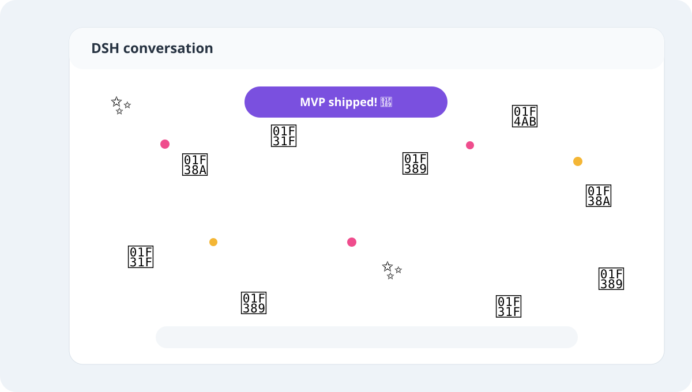
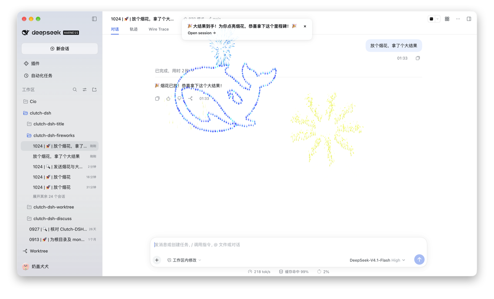
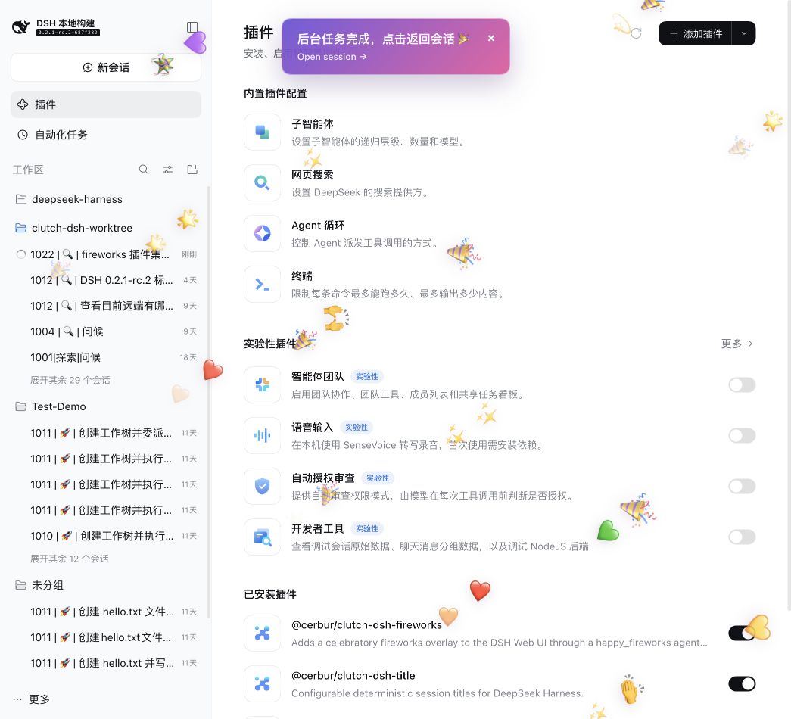
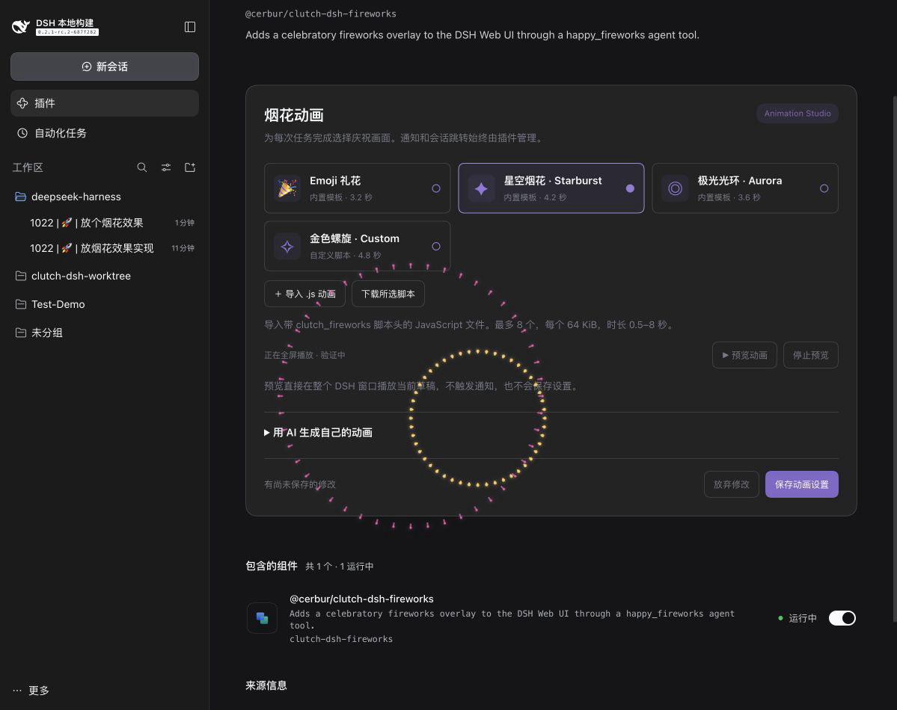

[English](README.md) | [简体中文](README.zh.md)

# @cerbur/clutch-dsh-fireworks

`@cerbur/clutch-dsh-fireworks` adds a short celebration overlay to the DSH Web UI. An agent can
call `happy_fireworks` after a meaningful milestone, optionally with a brief message, and the
DSH window shows a burst of emoji fireworks, even when the originating Session is in the background.
A clickable toast opens the Session that triggered the celebration.

The plugin is an additive DSH extension. It registers its own tool and Web UI overlay without
modifying DSH source code or adding custom events to conversation history.

## Installation

### Install from npm

With an installed DSH CLI:

```bash
dsh plugin --profile web add @cerbur/clutch-dsh-fireworks
dsh web
```

When using a DeepSeek Harness source checkout without a standalone `dsh` command, use the
equivalent `pnpm dsh` form.

### Install from a local checkout

Build the package and the DSH source checkout, then add the package by absolute path:

```bash
cd /absolute/path/to/clutch-dsh
pnpm install
pnpm --filter @cerbur/clutch-dsh-fireworks build

cd /absolute/path/to/deepseek-harness
pnpm install
pnpm run build
pnpm dsh plugin --profile web add /absolute/path/to/clutch-dsh/packages/clutch-dsh-fireworks
pnpm dsh web
```

The generated `lib/` directory is not committed, so use this built local checkout flow rather than
installing the package from a raw `github:` path. Re-run the absolute-path install command after
changing `package.json` or `cordis.patch.yml`.

## Features

| Feature                                    | Preview                                                                                                                                                   | What it does                                                                                                                                                                                                                                               |
| ------------------------------------------ | --------------------------------------------------------------------------------------------------------------------------------------------------------- | ---------------------------------------------------------------------------------------------------------------------------------------------------------------------------------------------------------------------------------------------------------- |
| **Automatic milestone celebrations**       |                                                     | The bundled guidance encourages an agent to call `happy_fireworks` after finishing a design or plan, completing and verifying a feature, resolving a complex bug, or passing full verification. Routine file reads and isolated checks are not milestones. |
| **Fireworks overlay**                      |                                                    | A successful call displays a short, click-through overlay across the DSH window, independently of the selected Session, and shows a clickable celebration toast.                                                                                           |
| **Jump to the source Session**             |  | Click the toast to open its originating Session through DSH navigation. Dismiss it without interrupting the animation. Captured from an installed plugin after a real background tool call.                                                                |
| **Animation templates and script imports** |               | Choose three built-in effects or import your own JavaScript animation. Preview, save, download scripts, and copy a complete AI generation prompt on the plugin details page.                                                                               |
| **Safe replay behavior**                   | —                                                                                                                                                         | Failed or cancelled calls stay quiet. Opening a Session, refreshing the page, or switching Sessions does not replay an old celebration.                                                                                                                    |

## Usage

### Celebrate a meaningful milestone

After installation, the agent sees guidance for the `happy_fireworks` tool. It may use the tool in
a concluding turn when work reaches a meaningful milestone, such as a finished design, verified
feature, resolved complex bug, or complete refactor verification.

The tool is not intended for routine intermediate actions, including reading a file, inspecting
Git status, or running one isolated check.

### Manual testing

You can explicitly ask an agent to test the overlay:

```text
After a meaningful milestone, call happy_fireworks with:
{"message":"The fireworks MVP is ready to test!"}
```

A successful call appears in the conversation and plays the overlay for a few seconds. The
optional message is trimmed and limited to a short toast. Programmatic tool-call dispatches are
supported as well as direct top-level tool results. You can switch to another Session or an app page
while the work runs: the global effect still plays. Click **Open session →** on the toast to return
to the originating Session, or use **×** to dismiss the toast.

### Choose, import, or generate animations

Open **Plugins → @cerbur/clutch-dsh-fireworks → 烟花动画**. Choose **Emoji**, **Starburst**,
or **Aurora**, preview it, then click **保存动画设置**. Changes take effect on the next celebration;
leaving without saving discards the draft. Existing animations keep their captured template.

**预览动画** sends the current draft through the same playback path as a tool launch, directly
over the current DSH page with a transparent background in light and dark themes. It creates no
toast or tool call and does not save the draft. Use **停止预览** to stop;
changing templates or leaving the page also cleans it up. Real task celebrations take priority.

Use **导入 .js 动画** to add a standalone script. A custom selection must finish its preview
without errors before saving is enabled. Download any selected script as a starting point, or
expand **用 AI 生成自己的动画**, copy the prompt, describe your effect, and import the generated
`.js` file. A ready-to-import example is [example-custom.js](assets/animations/example-custom.js).
The file format, drawing interface, and tips for smooth custom effects are documented in
[Animation scripts](docs/ANIMATIONS.md).

Selections and script source are stored through DSH Host settings, shared by connected pages,
and survive refresh/restart. A launch refreshes the saved choice before playback. After upgrading
an already-running local checkout, restart DSH so its Host loads the new Config schema.

## Requirements

| Component | Requirement                                                                                                                                                                                                                                                                                                               |
| --------- | ------------------------------------------------------------------------------------------------------------------------------------------------------------------------------------------------------------------------------------------------------------------------------------------------------------------------- |
| DSH       | A Web UI providing DSH Connection RPC, Host settings, plugin detail configuration slots, Session, Session Projection, Tools, UI Renderer, UI Slots, and UI Workspace navigation. Requires DSH 0.2.1-rc.1 or later with the native Gateway and Typert registry. The peer ranges in `package.json` are the source of truth. |
| Cordis    | Compatible Cordis `4.x`; development uses `4.0.5`.                                                                                                                                                                                                                                                                        |
| Browser   | DSH Web UI with the plugin's Web client bundle loaded; Workers and OffscreenCanvas for script effects (emoji fallback otherwise).                                                                                                                                                                                         |

## Behavior and limitations

- Built-ins include a 3.2-second emoji burst, 4.2-second starbursts and 3.6-second aurora rings.
  Custom effects last 0.5–8 seconds. The optional `message`
  is normalized to a maximum of 120 characters. Only the toast accepts clicks; particles remain
  click-through.
- Up to eight custom scripts are allowed, each at most 64 KiB. Scripts draw in an isolated Worker
  with Canvas 2D, time, seeded randomness and drawing helpers. Network, application DOM, Session
  navigation and toast controls are unavailable to scripts. The renderer owns cleanup and
  terminates stalled frames. Failed or unsupported live effects fall back to emoji; preview shows
  the error. Reduced-motion preferences keep a static midpoint frame visible for the configured
  duration while the full timeline is checked offscreen; a single frame does not validate an import.
- Animations use the window's actual CSS-pixel width and height. Large windows retain their aspect
  ratio; the renderer lowers DPR as needed to stay within its 8-million-pixel canvas budget.
- Only successful live fireworks results trigger playback. Errors, cancellations, historical
  Session loads, and page refreshes do not replay old celebrations.
- Switching Sessions or app pages does not clear the animation. The toast remains for up to
  8 seconds; closing it or successfully clicking through to its Session ends the toast early.
- Celebrations queue as whole events across Sessions. Each event starts its animation and toast
  together; the next event waits until both finish. An ended animation does not replace a
  remaining toast, and closing a toast does not cut off its animation. A fixed 12-second event
  deadline clears stalled rendering and advances without retry. Preview waits while a real
  event is active, including any remaining toast time.
- Duplicate Session/tool-call identities are ignored. The
  transient feed and playback queue are bounded to 128 entries each, and events expire after
  30 seconds. Expired or overflowed pending events are dropped. Brief disconnects can catch up
  within those limits.
- Each connected owner page consumes independently. The effect stays inside its DSH window;
  it does not create an operating-system desktop overlay. A successful tool result records the
  request, not confirmation that a browser displayed it.
- The plugin delivers `clutch_fireworks/launch` through the native Remote stream
  `clutch_fireworks/events`, multiplexed on DSH's authenticated `/api/remote.mux`
  WebSocket. DSH owns the connection, authentication, heartbeats and connection
  recovery. The plugin adds a logical subscription and reopens it after loss,
  without a separate SSE connection or polling. Short reconnects resume the
  retained cursor; fresh pages and restarted Hosts establish silent baselines.
  Host registration and Client mounts belong to the plugin lifecycle and are
  withdrawn on unload. The aggregate feed explicitly rejects non-owner peers.
  No DSH source or generated catalog edits are required. Rebuilt Host modules
  or changed package metadata can still require a DSH reload/restart.
- When the Host exposes DSH's `systemPrompt` service, the plugin adds milestone guidance.
  Without that optional service, the tool remains available without the guidance section.
- The package does not patch DSH source code or persist a copy of the conversation.

## Development

Build, type-check, and test the package from the workspace root:

```bash
pnpm --filter @cerbur/clutch-dsh-fireworks typecheck
pnpm --filter @cerbur/clutch-dsh-fireworks build
pnpm --filter @cerbur/clutch-dsh-fireworks test
```

Package release parameters and source-install constraints are documented in
[docs/RELEASING.md](docs/RELEASING.md).

## Uninstall

With the DSH CLI:

```bash
dsh plugin --profile web remove @cerbur/clutch-dsh-fireworks
```

From a DeepSeek Harness checkout, use `pnpm dsh plugin --profile web remove` with the same package
name.

## Friendly Links

- [LINUX DO](https://linux.do/) — A new ideal community.
