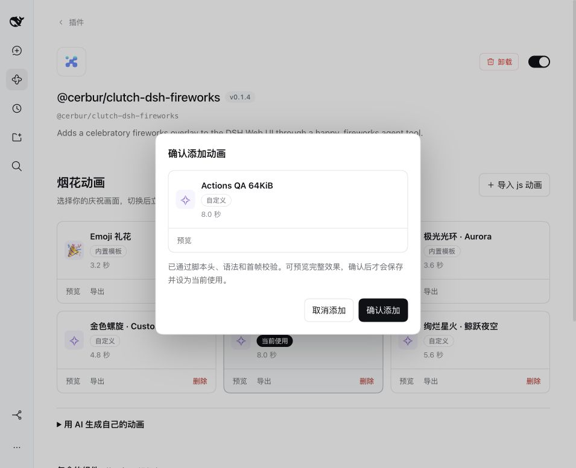

[English](README.md) | [简体中文](README.zh.md)

# @cerbur/clutch-dsh-fireworks

`@cerbur/clutch-dsh-fireworks` 为 DSH Web UI 增加短暂的庆祝覆盖层。Agent 在重要里程碑完成
后可以调用 `happy_fireworks`，也可以传入简短消息，让整个 DSH 窗口播放 emoji 礼花，即使来源
Session 正在后台运行。点击通知 toast 可以跳转到触发庆祝的 Session。

这是一个附加式 DSH 扩展。它只注册自己的工具和 Web UI overlay，不修改 DSH 源码，也不向
conversation history 添加自定义事件类型。

## 安装

### 从 npm 安装

在已安装 DSH CLI 的环境中：

```bash
dsh plugin --profile web add @cerbur/clutch-dsh-fireworks
dsh web
```

如果使用 DeepSeek Harness 源码 checkout 且没有独立的 `dsh` 命令，可使用等价的
`pnpm dsh` 形式。

### 从本地 checkout 安装

先构建 package 和 DSH 源码 checkout，再用绝对路径添加 package：

```bash
cd /absolute/path/to/clutch-dsh
pnpm install
pnpm --filter @cerbur/clutch-dsh-fireworks build

cd /absolute/path/to/deepseek-harness
pnpm install
pnpm run build
pnpm dsh plugin --profile web add /absolute/path/to/clutch-dsh/packages/clutch-dsh-fireworks
pnpm dsh web
```

生成的 `lib/` 目录不会提交，因此应使用这个已构建的本地 checkout 流程，而不要从原始
`github:` path 直接安装。修改 `package.json` 或 `cordis.patch.yml` 后，需要重新执行绝对
路径安装命令。

## 功能

| 功能                   | 预览                                                                                                                                      | 作用                                                                                                                                                                 |
| ---------------------- | ----------------------------------------------------------------------------------------------------------------------------------------- | -------------------------------------------------------------------------------------------------------------------------------------------------------------------- |
| **自动庆祝里程碑**     |                                                | bundled guidance 会引导 Agent 在完成设计或计划、完成并验证功能、解决复杂 Bug，或重构后通过全量验证时调用 `happy_fireworks`。读取文件和单次检查等日常动作不算里程碑。 |
| **Fireworks 覆盖层**   |                                              | 成功调用后，在整个 DSH 窗口显示短暂、可穿透点击的覆盖层，不依赖当前选中的 Session，并显示可点击的庆祝 toast。                                                        |
| **跳转到来源 Session** |           | 点击 toast，通过 DSH 导航打开来源 Session；关闭 toast 不会中断动画。截图来自已安装插件的真实后台工具调用。                                                           |
| **动画模板与脚本导入** |                     | 选择三种内置效果或导入 JavaScript 动画，切换立即生效；导入先校验并支持预览确认，每张卡片提供导出和删除二次确认。                                                     |
| **确认后导入**         |  | 选择文件后先校验，预览满意再确认保存并启用；取消不写入。                                                                                                             |
| **安全的回放行为**     | —                                                                                                                                         | 失败或取消的调用保持安静。打开 Session、刷新页面或切换 Session 都不会重新播放旧礼花。                                                                                |

## 使用

### 庆祝重要里程碑

安装后，Agent 会看到 `happy_fireworks` 工具的使用指引。当任务在收尾轮达到重要里程碑时，Agent
可以使用它，例如完成设计、验证功能、解决复杂 Bug，或完成重构后的全量验证。

这个工具不用于读取文件、检查 Git 状态或执行单次检查等日常中间步骤。

### 手动测试

可以明确要求 Agent 测试覆盖层：

```text
完成一个有意义的里程碑后，调用 happy_fireworks：
{"message":"礼花 MVP 已经可以测试了！"}
```

成功调用会出现在 conversation 中，并播放几秒覆盖层。可选消息会被 trim，并限制为适合 toast 的
短文本。程序化 tool-call dispatch 和直接顶层 tool result 都支持。任务运行时可以切换到其他
Session 或应用页面，全局效果仍会播放。点击 toast 上的 **Open session →** 返回来源 Session，
也可以点击 **×** 关闭通知。

### 选择、导入或生成动画

打开 **插件 → @cerbur/clutch-dsh-fireworks → 烟花动画**，选择 **Emoji 礼花**、**星空烟花**
或 **极光光环**，也可选择导入的动画，点击卡片后立即生效。选中卡片显示 **当前使用**，
不再需要单独保存；正在播放的动画继续使用开始时选定的模板。
卡片采用紧凑自适应布局，面板宽时每行展示更多，窄时自动减少。
名称、标签、时长纵向排列；长名称单行省略，悬停标题可查看全名。卡片与弹窗共用字体层级和
DSH 主题颜色，标签对齐 Agent 预设的描边与实心样式，适配浅色和深色模式。

每张卡片的 **预览** 会把该模板交给与工具调用相同的播放路径，直接叠加在当前 DSH 页面上，
在浅色和深色主题下均保持背景透明，不产生 toast、工具调用，也不改变当前使用的动画。
播放时预览按钮变为圆形进度/停止控件，点击即可停止；切换模板或离开页面也会清理预览。真实任务庆祝优先播放。

通过右上角 **导入 js 动画** 选择独立脚本，非法文件会弹窗提示；合法文件弹出确认窗口，
展示与卡片一致的图标、名称、标签和时长，支持全屏预览。只有点击 **确认添加** 才保存并
选中新动画；取消不修改配置或磁盘。每张卡片可 **导出** 脚本，自定义卡片点击 **删除** 后变红，
并在原操作栏左侧显示确认提示、右侧显示 **删除 / 取消**，卡片高度不变，取消占据原删除位置，
形成错位二次确认。第二次点击删除才实际移除。
删除当前模板后恢复为 Emoji，内置模板不提供删除。
也可以展开 **用 AI 生成自己的动画**，复制提示词并描述想要的效果，
再导入生成的 `.js` 文件。可直接导入的示例见 [example-custom.js](assets/animations/example-custom.js)，
文件格式、绘图接口与自定义动画的流畅度优化建议见 [动画脚本说明](docs/ANIMATIONS.md)。

保存的脚本位于 `$DSH_HOME/clutch-dsh-fireworks/animations/<sha256>.js`；Host 设置只保存
选择、相对 DSH Home 的路径（默认 Home 为 `~/.dsh`）及少量名称/时长元数据。确认添加与切换立即持久化，预览不写配置；
旧的全文配置在下次更新时迁移。备份设置时也应备份这个目录。删除模板在配置更新成功后清理文件，
仍被其他模板或 DSH profile 引用的文件会保留。文件丢失或损坏时保留卡片，标记 **本地文件损坏**，
只提供删除操作以清理配置项；若损坏项原本被选中，Host 会持久化切回 Emoji，同时保留损坏列表项。
设置页可见时每两秒及重新聚焦时刷新文件状态，已保存卡片在预览前重新检查，正式播放前也会刷新。
旧的路径配置在读取时补齐显示元数据。只读设置仅临时回退并提示无法持久化。
已保存的选择在已连接页面间共享，刷新、重启后保留，收到 launch 时会刷新后再播放。
升级正在运行的本地 checkout 后，需要重启 DSH，让 Host 加载新的接口。

## 要求

| 组件    | 要求                                                                                                                                                                                                                                                             |
| ------- | ---------------------------------------------------------------------------------------------------------------------------------------------------------------------------------------------------------------------------------------------------------------- |
| DSH     | 提供 DSH Connection RPC、Host 设置、插件详情配置 slot、Session、Session Projection、Tools、UI Renderer、UI Slots 和 UI Workspace 导航的 Web UI。要求 DSH 0.2.1-rc.1 或更高版本，并提供原生 Gateway 与 Typert registry；`package.json` 中的 peer 范围是唯一来源。 |
| Cordis  | 兼容的 Cordis `4.x`；开发使用 `4.0.5`。                                                                                                                                                                                                                          |
| Browser | 已加载该 plugin Web client bundle 的 DSH Web UI；脚本效果需要 Worker 和 OffscreenCanvas，否则回退到 emoji。                                                                                                                                                      |

## 行为与限制

- 内置效果包括 3.2 秒 emoji 礼花、4.2 秒星空烟花和 3.6 秒极光光环，自定义效果为 0.5–8 秒。可选的 `message` 会被规范化为
  最多 120 个字符。只有 toast 接收点击，粒子层保持点击穿透。
- 最多导入 8 个自定义脚本，每个不超过 64 KiB。脚本在隔离 Worker 中使用 Canvas 2D、时间轴、
  确定性随机数和绘图助手，不具备网络、应用 DOM、Session 导航和 toast 控制能力。渲染器统一
  清理资源并终止超时帧。正式播放失败或浏览器不支持时回退到 emoji，预览则显示错误；
  系统开启减少动态效果时，静态中点帧保留至配置的播放时长结束，同时在离屏画布验证完整时间轴；
  窗口尺寸或 DPR 改变时重绘中点帧。导入预检包含脚本头、语法、render 入口和有超时限制的首帧；
  可选预览检查完整时间轴。已知预览失败时禁止确认，直到重新预览成功。
- 动画使用窗口实际的 CSS 像素宽高。大窗口保持原有宽高比，渲染器按需降低 DPR，
  将画布限制在 800 万像素预算内。
- 只有实时成功的 fireworks 结果会触发播放。错误、取消、加载历史 Session 和刷新页面都不会
  重播旧庆祝。
- 切换 Session 或应用页面不会清除动画。toast 最多保留 8 秒，手动关闭或成功点击跳转到
  来源 Session 会提前结束 toast。
- 不同 Session 的庆祝以完整事件串行排队：同一事件的动画和 toast 一起启动，两者都结束后
  才播放下一事件。动画先结束不会替换仍在显示的 toast；关闭 toast 不会打断动画。
  每个事件从启动起有固定的 12 秒超时上限，超时清理并推进队列，不重试。
  真实事件仍占用时间片时（包括只剩 toast 时），预览不会插入。
- 重复的 Session/tool-call identity 会被忽略。临时事件源
  和播放队列各最多保留 128 项，事件在 30 秒后过期。过期或溢出的待播事件会被丢弃，
  短暂断线可以在这些限制内补收。
- 每个已连接的 owner 页面独立消费事件。效果仅显示在对应 DSH 窗口内，不创建操作系统桌面
  覆盖层。工具成功结果表示请求已记录，不表示浏览器确认完成了播放。
- 全局庆祝仅向 owner 页面开放，使用 DSH 已鉴权的连接。短暂断线可在上述限制内补收；
  刷新页面或 Host 重启不会重播旧庆祝。卸载插件会停止事件接收并移除其 UI。
  重新构建 Host 模块或修改包元数据后，仍可能需要重载或重启 DSH。
  传输与生命周期细节见[动画脚本文档](docs/ANIMATIONS.md#responsibilities-and-failure-handling)。
- 如果 Host 提供 DSH 的 `systemPrompt` service，插件会添加里程碑指引。没有该可选 service
  时，工具仍然可用，但不会添加这段指引。
- package 不 patch DSH 源码，也不持久化 conversation 副本。

## 开发

在 workspace 根目录构建、类型检查和测试：

```bash
pnpm --filter @cerbur/clutch-dsh-fireworks typecheck
pnpm --filter @cerbur/clutch-dsh-fireworks build
pnpm --filter @cerbur/clutch-dsh-fireworks test
```

package 发布参数和源码安装约束见 [docs/RELEASING.md](docs/RELEASING.md)。

## 卸载

使用 DSH CLI：

```bash
dsh plugin --profile web remove @cerbur/clutch-dsh-fireworks
```

如果使用 DeepSeek Harness checkout，可对同一个 package name 使用
`pnpm dsh plugin --profile web remove`。

## 友情链接

- [LINUX DO](https://linux.do/) — 新的理想型社区。
