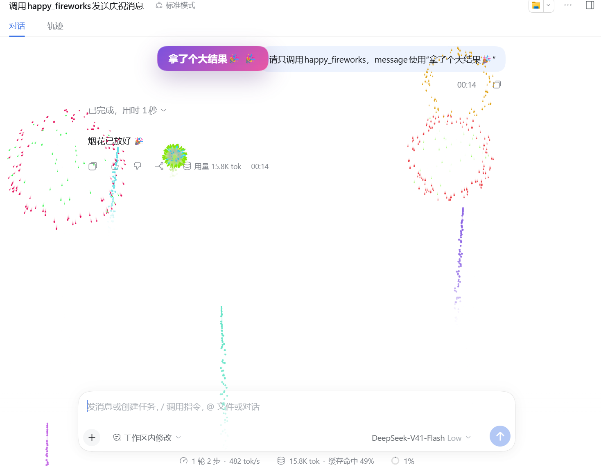

[English](README.md) | [简体中文](README.zh.md)

# @cerbur/clutch-dsh-fireworks

`@cerbur/clutch-dsh-fireworks` 为 DSH Web UI 增加短暂的庆祝覆盖层。Agent 在重要里程碑完成
后可以调用 `happy_fireworks`，也可以传入简短消息，让当前 conversation 播放 emoji 礼花。

这是一个附加式 DSH 扩展。它只注册自己的工具和 Web UI overlay，不修改 DSH 源码，也不改变
conversation history。

## 安装

### 从 npm 安装

在已安装 DSH CLI 的环境中：

```bash
dsh plugin --profile web add @cerbur/clutch-dsh-fireworks
dsh web
```

如果使用 DeepSeek Harness 源码 checkout 且没有独立的 `dsh` 命令，可使用等价的
`pnpm dsh` 形式。

### 从本地 checkout 安装

先构建 package 和 DSH 源码 checkout，再用绝对路径添加 package：

```bash
cd /absolute/path/to/clutch-dsh
pnpm install
pnpm --filter @cerbur/clutch-dsh-fireworks build

cd /absolute/path/to/deepseek-harness
pnpm install
pnpm run build
pnpm dsh plugin --profile web add /absolute/path/to/clutch-dsh/packages/clutch-dsh-fireworks
pnpm dsh web
```

生成的 `lib/` 目录不会提交，因此应使用这个已构建的本地 checkout 流程，而不要从原始
`github:` path 直接安装。修改 `package.json` 或 `cordis.patch.yml` 后，需要重新执行绝对
路径安装命令。

## 功能

| 功能                 | 预览                                                                                          | 作用                                                                                                                                                                 |
| -------------------- | --------------------------------------------------------------------------------------------- | -------------------------------------------------------------------------------------------------------------------------------------------------------------------- |
| **自动庆祝里程碑**   |    | bundled guidance 会引导 Agent 在完成设计或计划、完成并验证功能、解决复杂 Bug，或重构后通过全量验证时调用 `happy_fireworks`。读取文件和单次检查等日常动作不算里程碑。 |
| **Fireworks 覆盖层** |   | 成功调用后，在当前选中的 DSH conversation 上显示短暂、可穿透点击的覆盖层，并可显示可选的庆祝消息。                                                                   |
| **真实感庆祝烟花**   |  | 默认渲染器播放 canvas 烟花：火箭从底部升空，炸开成带重力、阻力和渐隐拖尾的发光弹型。传统 emoji 庆祝仍可在插件设置中选择。                                            |
| **安全的回放行为**   | —                                                                                             | 失败或取消的调用保持安静。打开 Session、刷新页面或切换 Session 都不会重新播放旧礼花。                                                                                |

## 使用

### 庆祝重要里程碑

安装后，Agent 会看到 `happy_fireworks` 工具的使用指引。当任务在收尾轮达到重要里程碑时，Agent
可以使用它，例如完成设计、验证功能、解决复杂 Bug，或完成重构后的全量验证。

这个工具不用于读取文件、检查 Git 状态或执行单次检查等日常中间步骤。

### 手动测试

可以明确要求 Agent 测试覆盖层：

```text
完成一个有意义的里程碑后，调用 happy_fireworks：
{"message":"礼花 MVP 已经可以测试了！"}
```

成功调用会出现在 conversation 中，并播放几秒覆盖层。可选消息会被 trim，并限制为适合横幅的
短文本。程序化 tool-call dispatch 和直接顶层 tool result 都支持。

### 配置庆祝效果

插件设置页提供三个选项：

| 设置项           | 默认值      | 作用                                                                                                                                       |
| ---------------- | ----------- | ------------------------------------------------------------------------------------------------------------------------------------------ |
| `mode`           | `realistic` | 庆祝渲染器。`realistic` 播放 canvas 烟花秀；`emoji` 保留传统 emoji 庆祝。                                                                   |
| `showDurationMs` | `3200`      | 一场烟花秀的发射窗口（毫秒，1500–15000）。窗口关闭后不再发射新火箭，整场秀在最后一发散尽后结束。仅对 realistic 模式生效。                   |
| `showRatePerSec` | `1.5`       | 发射窗口内的平均发射频率（发/秒，0.3–4）。每场秀的火箭数量在 `频率 × 窗口` 附近随机浮动，节奏更自然。仅对 realistic 模式生效。             |

请求减弱动态效果（reduced motion）的浏览器始终使用 emoji 庆祝。

## 要求

| 组件    | 要求                                                                                                                                                                    |
| ------- | ----------------------------------------------------------------------------------------------------------------------------------------------------------------------- |
| DSH     | 提供 DSH Session、Session Projection、Tools、UI Renderer、UI Session、UI Slots 和 Settings service 的 Web profile。peer 范围要求 `>=0.1.7-rc.1`；同一范围内的兼容稳定版也可使用。 |
| Cordis  | `@deepseek-ai/cordis` `4.0.4`，或 package peer range 允许的兼容 `4.x` 版本；DSH 0.2.x 使用更新的 `4.x`。                                                                          |
| Browser | 已加载该 plugin Web client bundle 的 DSH Web UI。                                                                                                                       |

## 行为与限制

- realistic 烟花秀按随机节奏在配置的发射窗口内升空，最后一发散尽后整场结束；emoji 庆祝时长
  固定为几秒。可选的 `message` 会被规范化为最多 120 个字符。
- 插件只响应成功的 fireworks 结果。错误和取消不会显示覆盖层；Session 打开时第一次观察到
  的历史 signal 会被刻意静默。
- 切换 Session 会清除当前覆盖层；只有新的 tool-call identity 才能再次播放。
- 如果 host 提供 DSH 的 `systemPrompt` service，插件会添加用于自主调用的里程碑指引。没有该
  可选 service 时，工具仍然可用，但不会添加这段指引。
- package 只贡献自己的 Cordis bundle 和 Web client metadata，不 patch DSH 源码，也不持久化
  conversation 副本。

## 开发

在 workspace 根目录构建、类型检查和测试：

```bash
pnpm --filter @cerbur/clutch-dsh-fireworks typecheck
pnpm --filter @cerbur/clutch-dsh-fireworks build
pnpm --filter @cerbur/clutch-dsh-fireworks test
```

package 发布参数和源码安装约束见 [docs/RELEASING.md](docs/RELEASING.md)。

## 卸载

使用 DSH CLI：

```bash
dsh plugin --profile web remove @cerbur/clutch-dsh-fireworks
```

如果使用 DeepSeek Harness checkout，可对同一个 package name 使用
`pnpm dsh plugin --profile web remove`。

## 友情链接

- [LINUX DO](https://linux.do/) — 新的理想型社区。
