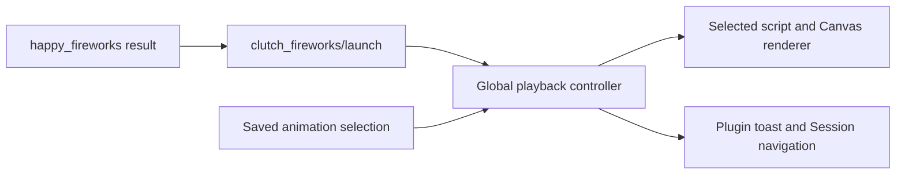

# Animation scripts / 动画脚本

An animation is a standalone UTF-8 `.js` file. Import it on the plugin details
page, let its full-window preview finish without errors, then save. The built-ins in
[`assets/animations`](../assets/animations/) use exactly the same interface.
Download a built-in or start with
[`example-custom.js`](../assets/animations/example-custom.js). The configuration
page contains a complete AI generation prompt with this contract.

动画是独立 UTF-8 `.js` 文件，在插件详情页导入，完整预览通过后保存。
所有内置效果与自定义效果使用同一个接口。设置页提供可复制的完整 AI 生成提示词。

Preview sends the draft to the same global renderer as a real launch, without a
separate preview canvas, toast, tool call or settings write. Stop it explicitly,
change templates, or leave the settings page to release its resources. A real
task celebration preempts a preview; stale preview callbacks cannot validate
another draft or cancel that task's effect.

Both requests use the same burst channel, rendering surface and lifecycle
callbacks. The iframe explicitly uses `color-scheme: normal`, matching its
srcDoc document. Otherwise Chromium can composite a transparent default-light
document as an opaque white viewport when DSH supplies a dark embedding scheme.
The effect keeps the underlying page visible in either theme.

预览直接通知全局渲染层全屏播放草稿，不使用预览框，也不触发通知或保存。
停止、切换模板或离开页面会清理预览；真实任务庆祝优先。
两种请求共用播放通道、渲染组件和生命周期回调。iframe 配色模式与内部文档保持一致，
避免深色主题下 Chromium 将透明内容合成为白色整窗背景。

## File format

The first line is a literal comment with JSON metadata. `version` is `1`,
`name` is a nonempty string of at most 60 characters, and `durationMs` is an
integer from 500 to 8000. Files are limited to 64 KiB; at most eight custom
templates can be saved. No module wrapper, imports, exports, React, or build
step is needed.

```js
// clutch_fireworks: {"version":1,"name":"Golden stars","durationMs":4000}
// eslint-disable-next-line @typescript-eslint/no-unused-vars -- Animation entry.
function render(frame, fx) {
  const alpha = Math.min(frame.progress * 5, (1 - frame.progress) * 4);
  for (let i = 0; i < 80; i++) {
    const angle = fx.random() * Math.PI * 2;
    const reach = Math.min(frame.width, frame.height) * 0.4 * fx.easeOut(frame.progress);
    fx.star(
      frame.width / 2 + Math.cos(angle) * reach,
      frame.height / 2 + Math.sin(angle) * reach,
      4 + fx.random() * 7,
      '#ffcf66',
      alpha,
      angle + frame.progress,
    );
  }
}
```

`render(frame, fx)` must be synchronous. The renderer calls it for each frame,
clears and resets drawing state, applies pixel scaling, follows resizing, and
owns the animation's duration and resource cleanup. Compute movement from
absolute `time` or `progress`, rather than counting frames. Each frame's random
sequence restarts from the same seed so initial positions remain stable.

## Drawing interface

Types are exported from `@cerbur/clutch-dsh-fireworks/animation` as
`AnimationFrame`, `AnimationHelpers`, and `AnimationRender`.

| Frame property           | Meaning                                                                                                                                    |
| ------------------------ | ------------------------------------------------------------------------------------------------------------------------------------------ |
| `ctx`                    | Standard `OffscreenCanvasRenderingContext2D`: paths, curves, gradients, text, shadows, compositing and other Canvas 2D drawing operations. |
| `width`, `height`        | Full DSH window drawing area in CSS pixels, shared by live playback and preview.                                                           |
| `dpr`                    | Applied pixel ratio, at most 2 and bounded by an 8-million-pixel canvas budget. Do not scale `ctx` again.                                  |
| `time`, `delta`          | Elapsed time and time since the previous frame, in milliseconds.                                                                           |
| `progress`, `durationMs` | Normalized time from 0 to 1, and the template's configured duration.                                                                       |
| `seed`                   | Deterministic integer seed for this celebration.                                                                                           |
| `message`                | Optional celebration text, or an empty string. No Session identity or DSH handles are exposed.                                             |

| Helper              | Arguments                                         |
| ------------------- | ------------------------------------------------- |
| `fx.random()`       | Seeded random number in `[0, 1)`.                 |
| `fx.clamp(value)`   | Clamp to `[0, 1]`.                                |
| `fx.easeOut(value)` | Cubic ease-out, input clamped to `[0, 1]`.        |
| `fx.circle(...)`    | `x, y, radius, color, alpha = 1, glow = 0`        |
| `fx.ring(...)`      | `x, y, radius, color, lineWidth = 2, alpha = 1`   |
| `fx.line(...)`      | `x1, y1, x2, y2, color, lineWidth = 2, alpha = 1` |
| `fx.star(...)`      | `x, y, radius, color, alpha = 1, rotation = 0`    |
| `fx.emoji(...)`     | `text, x, y, size = 32, alpha = 1, rotation = 0`  |

Colors are CSS colors; rotations are radians; sizes are CSS pixels. Helpers
restore their own Canvas state. Keep the background transparent, fade in and
out, and aim for fewer than about 1000 particles per frame. A reduced-motion
preference renders a static midpoint frame.

## Performance

The helpers reuse emoji and glowing-circle bitmaps within each playback. Emoji
use stable raster sizes while their position, size, rotation and opacity can
change each frame. Glowing circles reuse a sprite when radius, color and glow
stay the same; animate position and alpha instead of re-blurring each particle.
Large emoji above 128 CSS pixels draw directly to retain their resolution.
Direct `ctx` drawing remains available and does not use these caches.

The shared sprite cache holds at most 128 entries and two million pixels,
refreshes on DPR changes, and is released with the Worker. When full, helpers
draw directly so particles are retained. Built-ins keep their particle counts;
Starburst uses fixed-size glowing dots that fade instead of shrinking and
recomputing the blur every frame. Transparent helper calls skip painting with
normal `source-over` compositing.

Skip particles before their start and after their end. Consume their random
values before skipping so later particles retain stable positions. Compute
shared values such as burst radius and easing once outside the particle loop.
The suggested particle count is a starting point, not a frame-rate guarantee:
text rasterization, shadows, display size and DPR also affect drawing cost.

绘图助手会在单次播放内复用 emoji 与发光圆点的位图。emoji 仍可逐帧移动、缩放、旋转、
淡入淡出；发光圆点保持固定半径、颜色与 glow，通过位置和 alpha 表达运动，避免重复模糊。
超过 128 CSS 像素的大 emoji 直接绘制以保持分辨率。直接调用 `ctx` 不经过这些缓存。

共享缓存最多 128 项、总计 200 万像素，DPR 改变时刷新，随 Worker 释放；缓存满后回到
直接绘制，不丢弃粒子。内置效果保留原有粒子数量；星空烟花的发光圆点改为固定大小并淡出，
不再通过逐帧缩小圆点重复计算模糊。正常 `source-over` 混合下，完全透明的助手调用跳过绘制。

跳过尚未开始或已经结束的粒子前，先消费它的随机数，避免后续粒子位置跳动。将同组粒子共享
的半径、缓动等计算移到循环外。粒子数量建议不是帧率保证，文字栅格化、阴影、窗口尺寸与
DPR 都会影响开销。

## Responsibilities and failure handling



Scripts run in a dedicated Worker inside a `sandbox="allow-scripts"` iframe
with an opaque origin and a restrictive CSP. They cannot access the application
DOM, storage, network, DSH services, navigation, or toast controls. Do not use
`fetch`, `import`, `importScripts`, `require`, DOM APIs, timers, event listeners,
`postMessage`, or change global functions. Use only the frame, helpers, Canvas
and pure math. Custom scripts never execute in the Host or DSH main renderer.

Host delivery uses the native `clutch_fireworks/events` Remote stream on DSH's
shared authenticated `/api/remote.mux` WebSocket. The plugin registers its Host
service and explicit strict descriptor through public runtime APIs; the Client
mounts the same descriptor once per plugin fiber. No automatic `./typert` loader
registration, generated DSH catalog edits, separate SSE socket or plugin heartbeat
is involved. DSH handles connection authentication and recovery. On stream loss,
the controller reopens the logical subscription after one second with its epoch
and cursor; fresh pages and restarted Hosts establish silent baselines. Replay
stays bounded to 128 events/30 seconds and slow readers coalesce from that buffer.

Animation settings still use native unary settings RPC. The toast and animation
share one event slot and their 12-second deadline is independent of delivery.
Unmount cancels the logical stream, removes the UI and withdraws the Host/Client
descriptors; re-enable creates a new epoch. Updating loaded Host JavaScript or
package metadata may still need a DSH reload/restart. The supported SDK baseline
is DSH 0.2.1-rc.1. Development SDK and browser acceptance use 0.2.1-rc.2.
The global feed rejects non-owner callers even if their Remote
access policy otherwise permits the endpoint.

The renderer detects startup errors and frames taking over 750 ms, terminates
the Worker, and releases its Blob URL and iframe. A preview reports errors and
does not enable saving a failed custom selection. During a real celebration,
script errors or unavailable Worker/OffscreenCanvas support trigger the trusted
emoji fallback. The independent toast remains clickable and dismissible.

Animation and toast share one event time slot. Both start together, and the
controller advances the queue only after both finish. Closing or successfully
following a toast completes that branch; its automatic lifetime is eight
seconds. Each event has an absolute 12-second deadline from launch, independent
of renderer acknowledgements. The deadline clears both branches and consumes
the event without retry. Old callbacks cannot complete a newer event. Preview
cannot interrupt an active event's remaining toast.

动画与 toast 共用一个事件时间片，同时启动、全部完成后再出队。toast 在自动消失、
手动关闭或成功跳转后结束；每个事件从启动起最多等待 12 秒，超时清理并继续，
不重试。旧回调不能结束新事件，预览也不能插入真实事件剩余的 toast 时间。

Saved selections and sources belong to the Host settings namespace
`clutch-dsh-fireworks`, in its `animation` field. Writes use the revision the
page read; a concurrent edit is rejected instead of overwritten. Imported or
removed templates remain drafts until saved. Each queued launch captures the
currently saved template and duration when it begins. No script or preference
is written into Session history.

## Acceptance

Validated in installed DSH 0.2.1-rc.2 with `DSH_HOME=~/.dsh-test`, using Codex's
built-in browser: built-in preview, file import, custom preview and save,
refresh persistence, real background `happy_fireworks` playback of the imported
template, toast navigation to the source Session, and termination of a
deliberately looping preview while the settings page remains responsive.

Rendering regression gate: use a dark DSH theme, click preview, and verify the
settings text and sidebar remain visible behind the moving particles. Repeat
in a light theme and with a real background tool call; click its toast to
verify Session navigation. The iframe and srcDoc color schemes must match.
Node unit tests do not reproduce Chromium's iframe compositing behavior, so
this browser check is required when changing the rendering surface or theme
styles.
