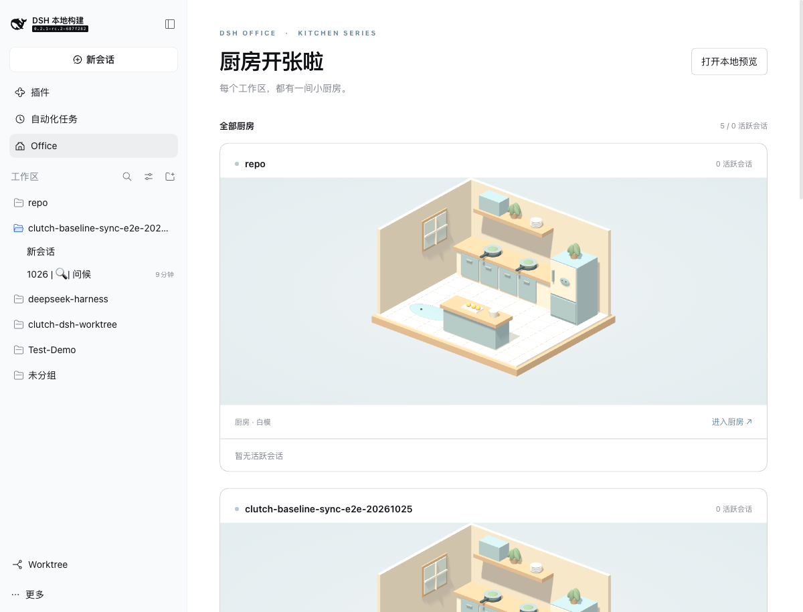

[English](README.md) | [简体中文](README.zh.md)

# @cerbur/clutch-dsh-office

Office 将所有 DSH 工作区变成一间间 3D 小厨房。每间最多两位鲸鱼娘代表
活跃 Session：工作时做饭，需要你回应时举起等待气泡。从侧栏打开 **Office**
查看总览，再进入单间厨房。

当前为程序化白模 MVP，并提供本地预览，用于体验后续活动。

## 安装

### 从 npm 安装

首次 npm 发布尚未完成。发布后可使用：

```bash
dsh plugin --profile web add @cerbur/clutch-dsh-office
dsh web
```

发布前请使用下面的本地 checkout 方式。安装后重启 DSH Web 服务或 DSH Desktop，
再刷新客户端。仅刷新页面不会激活新添加的 Host 插件。

### 从本地 checkout 安装

```bash
cd /absolute/path/to/clutch-dsh
pnpm install
pnpm --filter @cerbur/clutch-dsh-office build

cd /absolute/path/to/deepseek-harness
pnpm install
pnpm run build
pnpm dsh plugin --profile web add /absolute/path/to/clutch-dsh/packages/clutch-dsh-office
pnpm dsh web
```

包内 `lib/` 为生成目录。修改源码或 manifest 后重新构建，并再次执行绝对路径
add 命令。这些命令安装插件，不要求修改 DeepSeek Harness 源码。

## 功能

| 功能                  | 预览                                                                                                                    | 行为                                                                                                                     |
| --------------------- | ----------------------------------------------------------------------------------------------------------------------- | ------------------------------------------------------------------------------------------------------------------------ |
| 厨房列表              |                | 所有原生工作区按单列纵向排列；空闲厨房保留但没有角色，活跃时最多展示两位角色，其余显示数量。截图来自隔离的模拟 fixture。 |
| 真实 DSH profile 验收 |  | 在 `~/.dsh-test` 中展示全部工作区及空闲厨房；也已验证真实 agent 轮次和原生用户提问。                                     |
| Session 活动与气泡    | 同上方总览                                                                                                              | Session 运行时做饭；等待用户交互优先，并持续显示等待气泡。                                                               |
| 单间与预览            | 同上方总览                                                                                                              | 进入单间厨房，或打开明确标记的本地预览，体验做饭、等待、找食材、编辑和休息。                                             |

## 使用

1. 在 DSH 侧栏打开 **Office**。
2. 每个原生工作区都在纵向列表中拥有一间厨房。其账户内有未归档、非空白、
   非 subagent 的 Session 正在运行或等待用户处理时，角色会进入厨房。
3. 点击 **进入厨房** 查看更大的场景，通过 **返回全部厨房** 回到总览。
4. 点击 **打开本地预览**，无需运行真实 Session 即可体验活动。

角色活跃期间会保留原有位置。超出的活跃 Session 显示为计数，空出位置后
其他角色可进入。没有活跃 Session 时厨房仍保留，场景中没有角色，并显示
**暂无活跃会话**；加载与重连状态会明确显示。

首版真实映射只使用运行和等待交互状态。找食材和编辑属于预览活动及扩展入口，
尚未接入真实工具分类。气泡使用本地化活动标签，不展示 prompt 或工具输出。
角色列表也提供相同状态的可访问文本。
角色名称使用原生 Session 标题，并随改名更新。浏览器离线或 DSH 连接 generation
失效后，真实厨房和数量会撤下，直到连接及原生基线重新就绪。

## 要求

- DSH Web Client 运行时；初始接入以 `dsh-v0.2.1-rc.2` 为目标。
- `package.json` 声明的 DSH Workspace Controller、Session Controller/UI hooks、
  layout/sidebar/renderer 插槽和 locale 服务。
- WebGL 2，以及启用硬件加速的浏览器。
- 参考 DSH 版本要求 Node.js `^22.19.0 || >=24.0.0`。

`package.json` 是包版本和依赖范围的唯一来源。也已在 `~/.dsh-test` 中对参考
DSH 版本完成真实 profile 验收，测试范围见[验证记录](docs/MVP-VERIFICATION.md)。

## 限制

- MVP 每间厨房最多显示两位角色，使用简单程序化模型和预设移动，没有骨骼
  动画或碰撞系统。
- 成员关系遵循原生 Workspace 记录，不聚合仅存在于 Worktree 的虚拟成员关系，
  也不聚合 subagent、job 和 schedule 活动。
- 参考版本的原生 workspace 菜单和 Worktree 插件 workspace 菜单均未暴露
  追加插槽，请通过总览进入单间。
- 悬浮小窗、精细工具映射、项目规模装饰、自定义资产和持久化布局留待后续迭代。
- 插件只读原生客户端事实，不 retain Session、打开历史、发送模型请求或修改
  项目文件。预览状态仅存在于本地，可随时丢弃。
- 隐藏页面暂停动画，离屏厨房释放 GPU 资源；减少动态效果偏好会关闭连续动画。
  WebGL 或上下文故障会显示提示，并提供 **重新加载场景** 操作。

## 开发

```bash
pnpm --filter @cerbur/clutch-dsh-office typecheck
pnpm --filter @cerbur/clutch-dsh-office build
pnpm --filter @cerbur/clutch-dsh-office test
pnpm --filter @cerbur/clutch-dsh-office preview
```

隔离浏览器 fixture 在 `http://127.0.0.1:4188` 运行，使用模拟工作区。
`?lang=en` 切换英文，`?empty=1` 查看空状态。

参见 [AGENTS.md](AGENTS.md)、[MVP 计划](docs/plans/2026-10-26-office-mvp.md)、
[发布参数](docs/RELEASING.md)和[发布日志](RELEASE-LOG.md)。初始 MVP 直接在
release worktree 开发，后续功能使用 `wt-office-<version>/feat-<name>`，
并遵守公共发布门禁。

## 卸载

```bash
dsh plugin --profile web remove @cerbur/clutch-dsh-office
```

在 DSH 源码 checkout 中使用 `pnpm dsh plugin --profile web remove`，包名相同。
