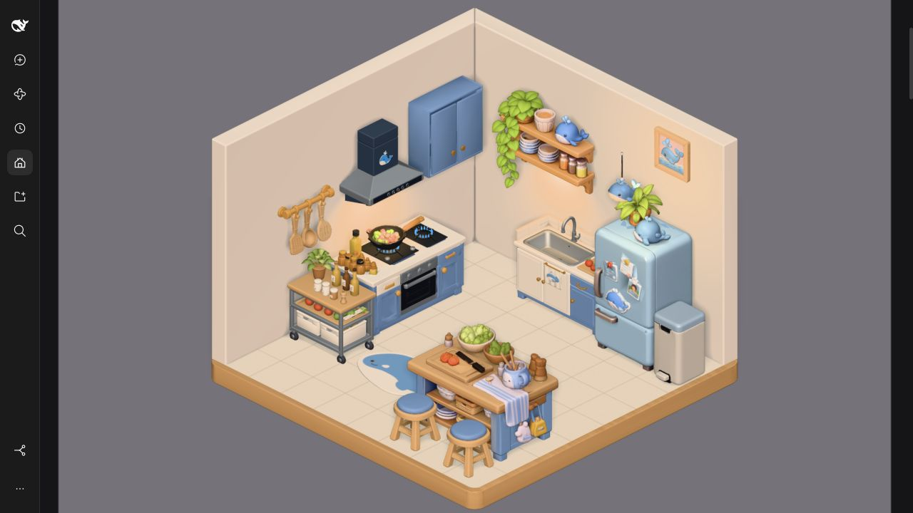
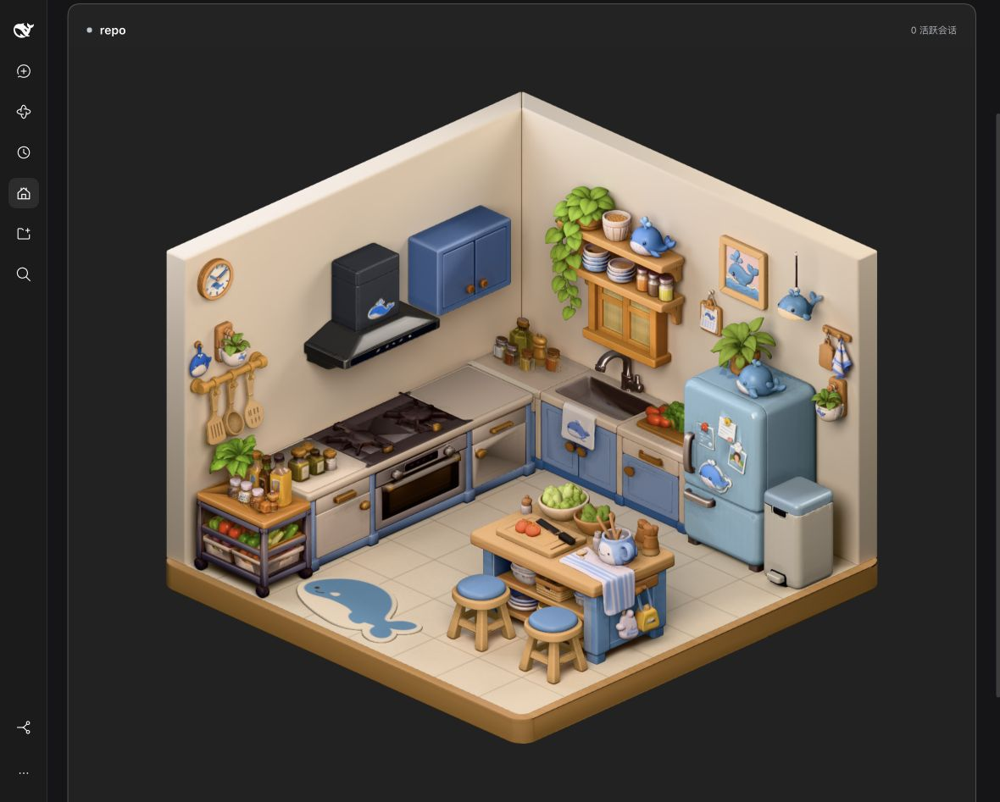
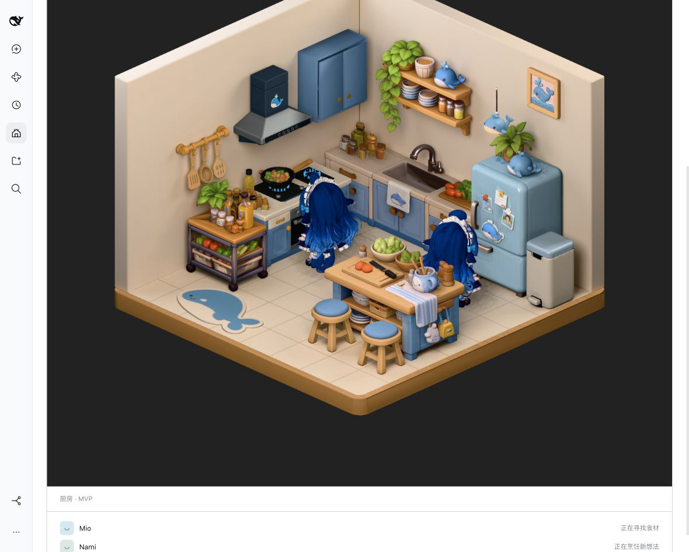
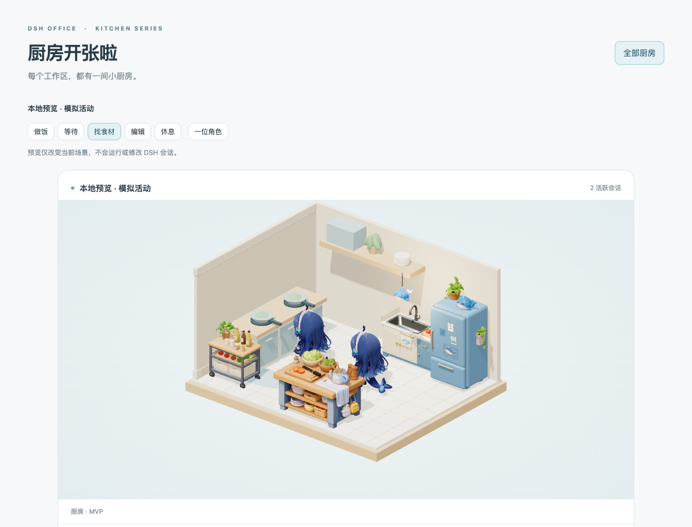

[English](README.md) | [简体中文](README.zh.md)

# @cerbur/clutch-dsh-office

Office 将所有 DSH 工作区变成一间间 3D 小厨房。每间最多两位鲸鱼娘代表
活跃 Session：工作时做饭，需要你回应时举起等待气泡。从侧栏打开 **Office**
查看总览，再进入单间厨房。

当前 MVP 内置 Blender 圆角木框瓷砖底板、左右两面墙、鲸鱼吊灯、水槽柜、冰箱、
料理桌、置物柜、墙面厨具挂杆、灶台、蓝色吊柜、油烟机、双层置物架、不透明装饰窗、鲸鱼挂画、两把圆凳、鲸鱼地毯、鲸鱼隔热垫、木质壁钟、砧板抹布挂件、壁挂绿植、鲸鱼挂历、独立脚踏垃圾桶和 DeepSeek 鲸鱼娘角色；配色和 PBR 表面统一为奶油色、柔和蓝色与蜂蜜木。
参考 Blender 审核图的三盏大面积柔光、深灰背景、柔和阴影、保色映射和环境反射共同塑造微缩场景。
本地预览可体验后续活动映射，不会运行 DSH Session。

## 安装

### 从 npm 安装

首次 npm 发布尚未完成。发布后可使用：

```bash
dsh plugin --profile web add @cerbur/clutch-dsh-office
dsh web
```

发布前请使用下面的本地 checkout 方式。安装后重启 DSH Web 服务或 DSH Desktop，
再刷新客户端。仅刷新页面不会激活新添加的 Host 插件。

### 从本地 checkout 安装

```bash
cd /absolute/path/to/clutch-dsh
pnpm install
pnpm --filter @cerbur/clutch-dsh-office build

cd /absolute/path/to/deepseek-harness
pnpm install
pnpm run build
pnpm dsh plugin --profile web add /absolute/path/to/clutch-dsh/packages/clutch-dsh-office
pnpm dsh web
```

包内 `lib/` 为生成目录。修改源码或 manifest 后重新构建，并再次执行绝对路径
add 命令。这些命令安装插件，不要求修改 DeepSeek Harness 源码。

## 功能

| 功能               | 预览                                                                                                                | 行为                                                                                                                                                                                                                                                                                                                                                                                                                      |
| ------------------ | ------------------------------------------------------------------------------------------------------------------- | ------------------------------------------------------------------------------------------------------------------------------------------------------------------------------------------------------------------------------------------------------------------------------------------------------------------------------------------------------------------------------------------------------------------------- |
| 厨房列表           |            | 所有原生工作区按单列纵向排列；空闲厨房保留但没有角色，活跃时最多展示两位角色，其余显示数量。截图来自隔离的模拟 fixture。                                                                                                                                                                                                                                                                                                  |
| Session 活动与气泡 | 同上方总览                                                                                                          | Session 运行时做饭；等待用户交互优先，并持续显示等待气泡。                                                                                                                                                                                                                                                                                                                                                                |
| 单间与预览         | 同上方总览                                                                                                          | 进入单间厨房，或打开明确标记的本地预览，体验做饭、等待、找食材、编辑和休息。                                                                                                                                                                                                                                                                                                                                              |
| Blender 厨房组件   |  | 以统一玩具色板和 PBR 表面，按参考图安排左侧灶台及烟机、相邻蓝色吊柜、后侧水槽、右侧冰箱、前方料理桌，餐具挂杆在左墙、窗户放左侧并抬高避开水龙头，带绿植的置物架放右侧并降低、料理桌保留此前靠右的位置，配有挂画、两把圆凳、鲸鱼地毯、冰箱旁垃圾桶和独立吊灯；水槽按宽3.08米、深0.80米填满后墙转角，烟机仅按火灶区宽度设置；其他素材保持交付尺寸；新版置物柜为带贴图的静态总成，前沿靠底板左前边缘；五类新挂件补在非热区墙面，两盆绿植共用同一素材并按墙面旋转；新烟机对齐1.374米宽的火灶区，不包含旁柜；新吊柜、水槽窗、挂画及吊灯按参考安排。加长灶台台面约3.247米、进深约1米，与水槽左柜形成等高L形，台面薄收口避让水槽把手。 |
| DeepSeek 鲸鱼娘    |  | 最多两位独立 DeepSeek 角色代表活跃 Session，各自显示状态气泡；静态单网格仅做整体移动和轻微待机起伏。                                                                                                                                                                                                                                                                                                                      |
| 减少动态与离屏     |            | 减少动态效果下 GLB 仍可显示；离屏厨房释放 GPU 资源，重新进入视口时重建。                                                                                                                                                                                                                                                                                                                                                  |

## 使用

1. 在 DSH 侧栏打开 **Office**。
2. 每个原生工作区都在纵向列表中拥有一间厨房。其账户内有未归档、非空白、
   非 subagent 的 Session 正在运行或等待用户处理时，角色会进入厨房。
3. 点击 **进入厨房** 查看更大的场景，通过 **返回全部厨房** 回到总览。
   厨房采用 左右 45° 对称、与 Blender 审核图相同俯角约 26.74° 的正交视角，场景区域更高，网页布局更宽。房间外壳宽、深约 5 米，高约 3.5 米，
   除水槽宽深按后墙转角设置、烟机宽度按火灶区设置外，家具和角色保持交付尺寸。
4. 点击 **打开本地预览**，无需运行真实 Session 即可体验活动。
   选择 **找食材**，角色会转身、绕桌走到冰箱前并面向冰箱；切换其他活动会返回。

角色活跃期间会保留原有位置。超出的活跃 Session 显示为计数，空出位置后
其他角色可进入。没有活跃 Session 时厨房仍保留，场景中没有角色，并显示
**暂无活跃会话**；加载与重连状态会明确显示。

首版真实映射只使用运行和等待交互状态。找食材和编辑属于预览活动及扩展入口，
尚未接入真实工具分类。气泡使用本地化活动标签，不展示 prompt 或工具输出。
角色列表也提供相同状态的可访问文本。
角色名称使用原生 Session 标题，并随改名更新。浏览器离线或 DSH 连接 generation
失效后，真实厨房和数量会撤下，直到连接及原生基线重新就绪。

## 要求

- DSH Web Client 运行时；初始接入以 `dsh-v0.2.1-rc.2` 为目标。
- `package.json` 声明的 DSH Workspace Controller、Session Controller/UI hooks、
  layout/sidebar/renderer 插槽和 locale 服务。
- WebGL 2，以及启用硬件加速的浏览器。
- 参考 DSH 版本要求 Node.js `^22.19.0 || >=24.0.0`。

`package.json` 是包版本和依赖范围的唯一来源。也已在 `~/.dsh-test` 中对参考
DSH 版本完成真实 profile 验收，测试范围见[本轮厨房素材验收](docs/STORAGE-SINK-VERIFICATION.md)。

## 限制

- 圆角木框底板使用烘焙木纹和瓷砖法线；砖缝凹凸只影响受光，没有几何/碰撞深度，
  瓷砖表面为真实圆角轮廓，共 52 个三角面。

- 左右墙为纯色奶油哑光圆角板，与底板同为名义 0.285 米厚；外沿与底板齐平，没有墙面纹理；水槽上方另有不透明装饰窗，没有墙洞、透光或开窗动画。

- 墙和地面保留 Blender Cycles 烘焙漫反射及间接光；家具和角色采用实时PBR、弱正面面光及低分辨率方向性室内环境反射，改善暗面颜色；环境是全局近似，不包含空间遮挡。家具避免碎片光照UV的黑缝。更换源素材、布局或烘焙灯光后需重烘。参见[光照设计](docs/LIGHTING-DESIGN.md)。

- MVP 每间厨房最多显示两位角色。厨房家具和装饰均为内置 GLB：底板、左右墙、鲸鱼吊灯、
  水槽柜、冰箱、料理桌、置物柜、厨具挂杆、灶台、吊柜、油烟机、置物架、挂画、圆凳、地毯、装饰窗和脚踏垃圾桶。DeepSeek 是静态单网格，只支持整体移动和
  轻微待机起伏，没有骨骼、独立手臂/尾巴、拿取动画或通用碰撞导航。
- 二十四件源GLB合计约49.19 MiB；生产二进制通过插件自有鉴权白名单接口按需加载，客户端脚本约2.01 MB。场景光照RGBA图集占16 MiB；运行时模型贴图最长边限制1024px，原始素材不缩小。更新素材后需构建并重启DSH Web服务。
- 水槽通过场景缩放设置宽深，龙头、毛巾和台面摆件会随总成一起缩放。
- 新置物柜为静态单网格，没有独立轮轴或可移动食材。
- 新水槽为静态总成，不包含旧门/抽屉的独立枢轴；新鲸鱼娘保留新原件外观与静态能力。
- 桌面器具和柜内物品是静态分组；桌面锚点不代表已有拿取或轮子动画；新灶台为静态总成，没有独立门轴、抽屉、炒锅或蓝火焰；吊柜门保持闭合、烟机为静态；两把圆凳共用同一模型，本轮没有坐姿动画。隔热垫、木钟、砧板抹布、壁挂盆和挂历为静态装饰，钟和挂历不跟随实时时间/日期；两面墙上的挂盆朝向不同，每房间只解析一次模型并共享资源。新挂件避开灶台及烟机区域。
- 成员关系遵循原生 Workspace 记录，不聚合仅存在于 Worktree 的虚拟成员关系，
  也不聚合 subagent、job 和 schedule 活动。
- 参考版本的原生 workspace 菜单和 Worktree 插件 workspace 菜单均未暴露
  追加插槽，请通过总览进入单间。
- 悬浮小窗、精细工具映射、项目规模装饰、自定义资产和持久化布局留待后续迭代。
- 插件只读原生客户端事实，不 retain Session、打开历史、发送模型请求或修改
  项目文件。预览状态仅存在于本地，可随时丢弃。
- 空厨房按需重绘，角色动画最高30FPS。静态阴影缓存，角色key-shadow更新到烘焙墙地面；目前省略角色对实时家具的阴影与自身阴影。
- 隐藏页面暂停动画，离屏厨房释放 GPU 资源；减少动态效果偏好会关闭连续动画。
  WebGL 或上下文故障会显示提示，并提供 **重新加载场景** 操作。

## 开发

玩具质感按[三阶段Spec](docs/specs/2026-10-28-kitchen-candy-look.md)和[执行计划](docs/plans/2026-10-28-kitchen-candy-look.md)推进；阶段1补光及阶段2全厨房表面优化已完成技术验证；木、布、叶片、皮肤和金属保留不同响应，哑光墙与地毯保持。倒角/几何修正留给下一阶段，最终视觉认可仍待用户。

```bash
pnpm --filter @cerbur/clutch-dsh-office typecheck
pnpm --filter @cerbur/clutch-dsh-office build
pnpm --filter @cerbur/clutch-dsh-office test
pnpm --filter @cerbur/clutch-dsh-office preview
pnpm --filter @cerbur/clutch-dsh-office lighting:geometry /tmp/office-bake/geometry.json
pnpm --filter @cerbur/clutch-dsh-office lighting:import /absolute/delivery/manifest.json
```

隔离浏览器 fixture 在 `http://127.0.0.1:4188` 运行，使用模拟工作区。
`?lang=en` 切换英文，`?empty=1` 查看空状态。

Blender 源素材在独立素材库中遵守 `office/<scene>/<component>`，跨场景角色放在
`office/character/<id>`。带版本号的导入与验收流程见[素材交接](docs/BLENDER-ASSETS.md)，
当前冰箱不含粉色侧挂盆或完整内胆。材质版本保留原有造型和贴图细节，
冰箱与顶部鲸鱼使用局部柔亮涂装，叶片/陶盆/金属保留差异；既有底色烘焙明暗与重建瑕疵仍在。烟机修正表面法线，减轻三角形明暗，保留原有造型与贴图；参见[统一美术语言](docs/ART-DIRECTION.md)。
本轮真实页面证据见[厨房素材验收](docs/STORAGE-SINK-VERIFICATION.md)。

参见 [AGENTS.md](AGENTS.md)、[MVP 计划](docs/plans/2026-10-26-office-mvp.md)、
[发布参数](docs/RELEASING.md)和[发布日志](RELEASE-LOG.md)。初始 MVP 直接在
release worktree 开发，后续功能使用 `wt-office-<version>/feat-<name>`，
并遵守公共发布门禁。

## 卸载

```bash
dsh plugin --profile web remove @cerbur/clutch-dsh-office
```

在 DSH 源码 checkout 中使用 `pnpm dsh plugin --profile web remove`，包名相同。
