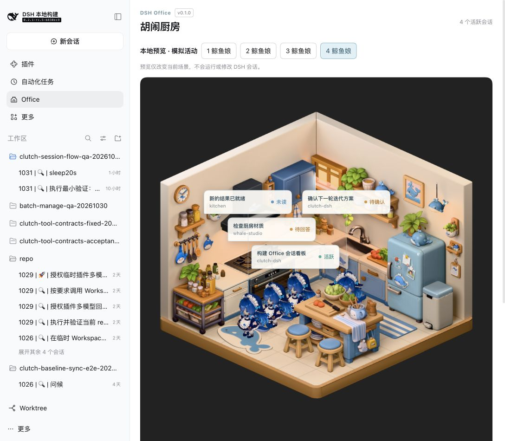
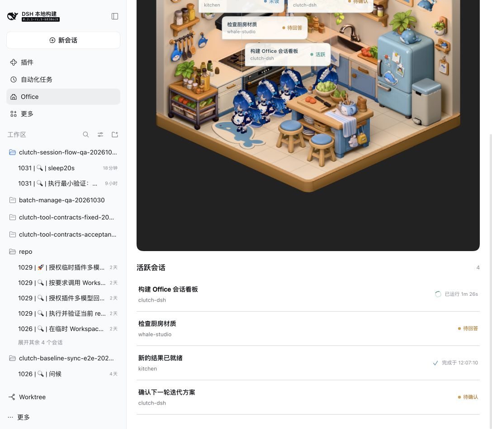
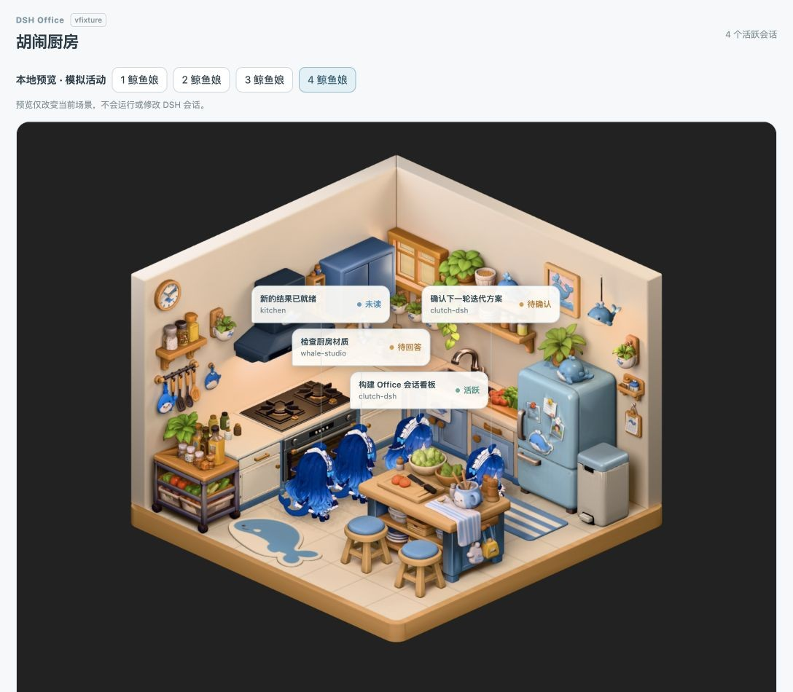
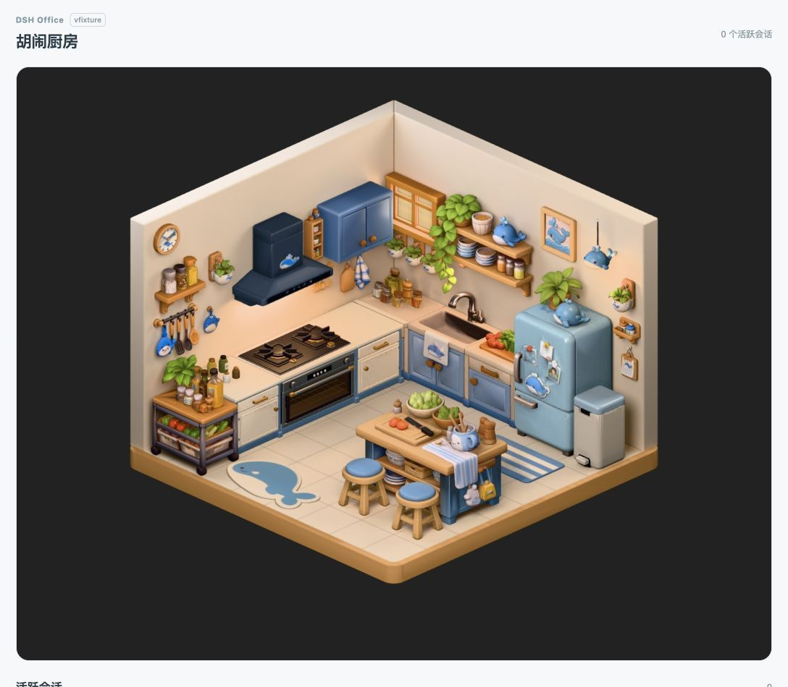

# clutch-dsh-office

[English](README.md) | 简体中文

胡闹厨房把 DeepSeek Harness 的活跃会话放进同一间 3D 厨房。最多四位鲸鱼娘在厨房中
游走，常驻气泡展示对应会话；下方列表让所有需要关注的会话都能随时打开。

## 安装

### 从 npm 安装

首个 npm 版本尚待发布，发布后使用：

```bash
dsh plugin --profile web add @cerbur/clutch-dsh-office
dsh web
```

### 从本地 checkout 安装

```bash
cd /absolute/path/to/clutch-dsh
pnpm install
pnpm --filter @cerbur/clutch-dsh-office build

cd /absolute/path/to/deepseek-harness
pnpm dsh plugin --profile web add /absolute/path/to/clutch-dsh/packages/clutch-dsh-office
pnpm dsh web
```

安装或更新素材后重启 DSH Web 或 Desktop，再刷新客户端。Windows checkout 请替换为
本机路径。拉取更新后先重新 build，再重启 DSH；仅刷新页面不会重新构建素材。
无需修改 Harness 源码。

## 功能

| 功能             | 预览                                                                                                                   | 行为                                                                                                         |
| ---------------- | ---------------------------------------------------------------------------------------------------------------------- | ------------------------------------------------------------------------------------------------------------ |
| 共享厨房         |        | 最多四位鲸鱼娘代表运行、待交互或未读完成会话。计数与列表包含超出部分，空闲会话不展示。                       |
| 可点击会话气泡   | 同上                                                                                                                   | 常驻气泡展示标题、工作区和状态，点击打开对应原生会话。长标题可通过提示与列表完整查看。                       |
| 活跃会话列表     |             | 按更新时间从新到旧展示标题与工作区。运行行显示执行时长，未读完成显示完成时间，待交互保留状态；列表不限四条。 |
| 鲸鱼娘与本地预览 |  | 独立行走、自动眨眼与柔和角色补光。本地预览可显示一至四位模拟角色，不改变真实会话。                           |
| 温馨厨房         |    | 丰富的厨房摆设，搭配柔和暖光与细腻表面。                                                                     |

会话与角色截图均来自明确标注的本地预览，四条会话均为模拟数据。

## 使用

1. 在侧栏打开 **Office**，查看 **DSH Office · 胡闹厨房**、一间厨房和活跃会话列表。
2. 运行、待交互、未读完成会话均有角色资格，优先级为待交互、运行、未读完成。
   运行中的子代理汇总到父会话。
3. 前四个符合条件的会话保留角色槽位，直到不再符合条件；后来的会话等待空位，
   仍可通过列表打开。
4. 点击气泡或列表行打开对应原生会话。仅打开 Office 不会确认未读，已读状态由 DSH 管理。
5. 双击版本标签切换至明确标记的一至四角色本地预览，再双击返回真实会话。
   模拟气泡和列表行不跳转。

## 要求与限制

- 需要 DSH Web Client，首版针对 `dsh-v0.2.1-rc.2` 验证，以及支持 WebGL 2 和 WebP
  图片的浏览器。渲染失败时提供重新加载操作。
- 只展示原生列表中活跃、非空白、未归档的父会话；工作区关系缺失时标为 **未分组**。
- Office 不发起模型请求、不读会话历史、不写会话日志。角色移动是装饰表现，
  不代表实际工具执行。
- 断连时清除过期角色与列表，重连后恢复。展示时间基于原生更新和观察到的状态变化估算，
  不作为执行日志；缺失时间明确显示。
- 减少动态效果时停止游走与眨眼；隐藏时暂停，离屏时释放渲染资源并在返回时重建。
  动画上限为 30 FPS，实际性能取决于设备，近距离放大可能看到纹理或阴影细节减少。

## 开发

在仓库根目录运行：

```bash
pnpm --filter @cerbur/clutch-dsh-office typecheck
pnpm --filter @cerbur/clutch-dsh-office build
pnpm --filter @cerbur/clutch-dsh-office test
```

## 友情链接

- [LINUX DO](https://linux.do/) — 新的理想型社区。
