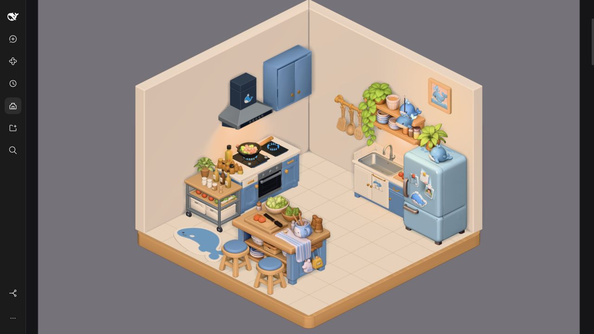
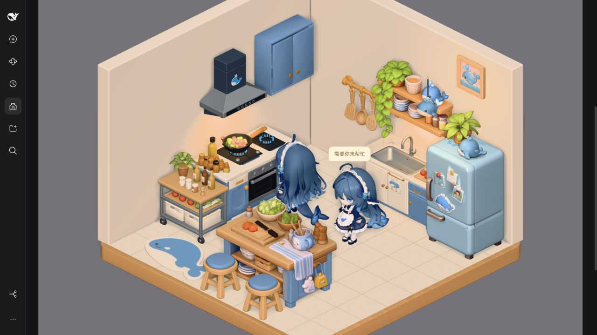

# Plain walls and kitchen decorations — 2026-10-27

The user requested floor-matched wall thickness and no wall surface textures,
then supplied four new component deliveries. This iteration adopts both plain
wall revisions plus shelf, artwork, two instances of the chair, and the rug.

| Asset              | Adopted revision | Triangles |     Bytes | SHA-256                                                            |
| ------------------ | ---------------- | --------: | --------: | ------------------------------------------------------------------ |
| kitchen/left-wall  | 2026-10-27-r3    |       428 |     9,104 | `29011850a3197a1598becf0f484a5b0aa9c7aec163bcfec084e79294dd21558f` |
| kitchen/right-wall | 2026-10-27-r2    |       428 |     9,104 | `a13b080cccf614e3c9bc488ab90097c9f1d9a418ed239bcd5ac016f074704730` |
| kitchen/wall-shelf | 2026-10-27-r3    |    52,540 | 5,560,276 | `e4b88d8392922a577ff9ec2832889faf54aa172f68232aa8f66afc90aa55ea86` |
| kitchen/wall-art   | 2026-10-27-r1    |    12,000 | 1,646,264 | `bdcf1d393ab7f7b9e4235556dccc6259368472946e60a8e73a3be5a1576ac03c` |
| kitchen/chair      | 2026-10-27-r1    |    18,994 |   915,124 | `83d888fd628ecd16cb6268bc2b33ce335002b59dfb1cd1bf5ad45e346ebfac46` |
| kitchen/rug        | 2026-10-27-r1    |     4,604 | 2,916,784 | `8fe26d0aa137f095a0f52a4d0388fedf9f2bb84a92d5456d6c294f9ca87dc235` |

The Blender library remains the source of truth; all native sources, review
renders and immutable delivery manifests are component-local. The plugin imports
only frozen GLB/manifest bytes using its explicit importer, with independent
origins, budgets, required nodes, measured bounds and anchors. Refrigerator's
30k/8MiB ceiling is unchanged. No engine material overrides or normalization.

Walls are uniform #F0E3D2, roughness.68, metallic0, no texture/normal/bump/noise.
Each is428triangles, one mesh/material/primitive and zero images. Nominal slab
thickness.285m matches floor. Actual bevel/miter envelope.285174m differs0.174mm;
rounded miter width5.16645m. Heights remain3.5m and interior planes stay localZ+.06.
Additional thickness grows outward; external edge extends75mm beyond the previous
5.2m platform footprint. Old furniture/interior5m shell remains fixed. No window.
Separate trim nodes were intentionally removed; new contract is root/wall_panel/front_anchor.
Previous projects and frozen revisions remain unchanged. Source projects:
`kitchen/<wall-id>/lookdev/2026-10-27-plain-wall/厨房<左/右>墙_纯色哑光.blend`.
Both final wall GLBs independently imported and rendered with official Blender
Cycles CPU; zero degenerate triangles/non-finite normals, zero external images.

Final placements, meters/Y-up, scale1 and Y rotation0 except left wall+pi/2:

| Instance    | Position               |
| ----------- | ---------------------- |
| left-wall   | `[-2.45, 0, 0.5]`      |
| right-wall  | `[0, 0, -1.95]`        |
| wall-shelf  | `[0.42, 0, -1.888]`    |
| wall-art    | `[1.55, 2.99, -1.888]` |
| chair-left  | `[0.05, 0.025, 2.73]`  |
| chair-right | `[1.08, 0.025, 2.73]`  |
| rug         | `[-1.2, 0.0255, 2.4]`  |

Shelf installation height is already in its mesh; rootY stays0. The artwork
has a wall-plane-center origin and receives its height only from layout.
New shelf removes the old procedural shelf, dishes and plant. Rug removes only
the three old whale-mat spheres; original floor GLB remains unchanged. Two chair
instances share one embedded asset, one parse and one owner for geometry/materials/
textures. Failed/late loading and reduced-motion redraw retain existing lifecycle.

Exact transformed triangle BVH checks found0 surface intersections between each
new instance and old furniture/new decor; this is surface testing, not containment
inference. Full actor activity-pair sampled routes/rotations/dwell AABBs include
both chairs and rug and pass. Rug is outside current actor swept bounds, because
the runtime uses fixed foot height. Chairs contactY=.025; rug bottomY=.0255,
topY=.0515. Chair seat extends8.4mm past tile front onto timber rim; feet remain
inside tile support and the full mesh stays inside the5.2m platform.

Only shelf-work-light moved to new lower-board underside: [shelf.x,1.80,shelf.z+.30]
toward[shelf.x,1.20,shelf.z+.07]. Global light colors/intensities, exposure, camera,
CSS, existing furniture placements, floor and other11GLBs/manifests stay unchanged.

Actual checks:

```text
/Applications/Blender.app/Contents/MacOS/Blender --background --factory-startup --python /tmp/build_plain_office_walls.py
/Applications/Blender.app/Contents/MacOS/Blender --background --factory-startup --python /tmp/verify_office_decor.py
node --input-type=module # sequential syncAsset(manifest, assets/models/kitchen) for the six adopted deliveries
pnpm --filter @cerbur/clutch-dsh-office test
pnpm --filter @cerbur/clutch-dsh-office typecheck
pnpm --filter @cerbur/clutch-dsh-office lint
pnpm run check:workspace
pnpm run check:patches
node --test packages/clutch-dsh-office/test/kitchen-assets.test.mjs
```

54tests pass. Updated actor-route test passes separately after adding chairs/rug.
Typecheck/lint/workspace/patches pass; patch check retains pre-existing!!js YAML warning.
Original unsaved interactive Blender scene preserved via separate background process.
The in-memory preload of four new assets matches their delivered geometry/PBR; their
original independent Blender validation lives in each immutable delivery.

Real test profile: `DSH_HOME=/Users/yuancheng/.dsh-test`, http://127.0.0.1:3088/.
The profile package symlink targets this release worktree; cold browser tab loads
the rebuilt bundle. Five native idle kitchens, focused room, local dual-actor
cooking/waiting/search and editing switch reviewed. New shelf/art/rug/both chairs
appear together without duplicate placeholders. Scroll to final room leaves1canvas/
0alerts; first-room return rebuilds every new asset. Cold console0warnings/0errors.
OS reduced-motion preference was not manually toggled; asynchronous redraw, late
dispose and fallback regressions passed. No native Session was run for preview.




Additional focused/search/list-end/rebuilt captures and model collision report are
mirrored to library `sync/evidence/2026-10-27-decor/`. Six revision/hash receipts in
`sync/receipts/` align with catalog/latestAccepted and each component HANDOFF.
17GLBs total34,660,596bytes (33.05MiB); uncompressed Client47,710,606bytes
(47.71MB). This transport size remains a known follow-up.

Original texture shading/geometry irregularities of supplied decor remain. Props
are static, stools do not implement sitting, rug normals are shading-only. No DSH
source or production profile changes, commit, push or publish. Current integration
is an uncommitted release working tree, not an existing HEAD commit.
