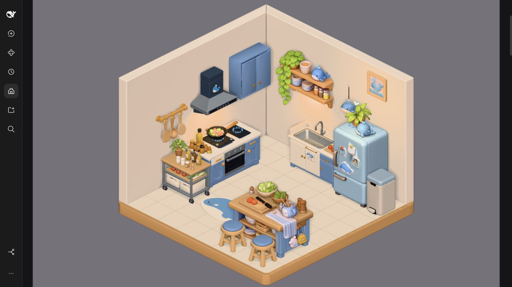
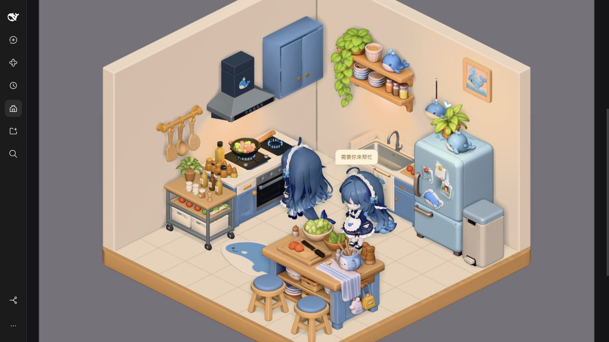

# Aligned shell and reference layout — 2026-10-27

User asked for inward walls flush with the platform, a rounded floor surface corner,
left-wall utensils, a higher shelf closer to the blue cabinet, a table toward the
right/middle, adjusted rug, and a new independent bin beside the refrigerator.
This request supersedes the previous stage's fixed furniture positions.

| Changed asset      | Revision      | Triangles |     Bytes | SHA-256                                                            |
| ------------------ | ------------- | --------: | --------: | ------------------------------------------------------------------ |
| kitchen/floor      | 2026-10-27-r2 |       880 | 3,687,020 | `4c4044eead24f761e41ea65c4112c49459b884737e6b367619931d9a87aac006` |
| kitchen/left-wall  | 2026-10-27-r4 |       428 |     9,104 | `a41c9d34da7460c1a4d4da7d7af4665c563bb7828c7aa0753930f8ee4263365b` |
| kitchen/right-wall | 2026-10-27-r3 |       428 |     9,104 | `7a4cd1f93ee2ddef33328f2805614d08166d28924807a4acf4459682ea28b1f5` |
| kitchen/trash-can  | 2026-10-27-r2 |    19,197 |   466,588 | `5e564460e4fab56449e2b2a1daf3c83872d9574baddae71393081d351150f83d` |

Floor native source: `office/kitchen/floor/lookdev/2026-10-27-rounded-floor/厨房底板_圆角表面.blend`.
The rounded surface uses an actual.12m-radius perimeter,52fan triangles,880total
triangles. All four corners match, including the visible front/right. Original
wood geometry,5.2m exterior,Y=.025 support and bottom=-.26 remain. Five original
embedded PBR image byte hashes match r1 exactly. Existing genuine Cycles normal
bakes are retained with affine planar UVs; no new baking claimed.64high tiles and
editable shader sources remain packed in the native project, zero missing files.

Walls keep pure matte cream and nominal.285m thickness. Their matching miter ends
shorten75mm and root placement shifts75mm inward. Outside straight planes now align
floorX=-2.6/rearZ=-2.1 within.3mm; actual rounded envelope width5.091445m. Interior
planes move toX=-2.315/Z=-1.815, so wall-mounted units shift to retain clearance.
Native projects are under each wall's `lookdev/2026-10-27-flush-wall/`.
Previous frozen deliveries/source projects remain intact.

Bin is new `kitchen/trash-can`,r2 only; r1 was withdrawn by its author.19,197faces,
3meshes/6primitives/3materials/0images, independent20k/2MiB ceiling. Blender5.2.3
official CPU import/Cycles renders of frozen GLB closed/open verify lid/pedal
local-X pivots and stationary body; runtime remains closed with original PBR.
Bin GLB is not reexported, merged into or substituted for refrigerator. Earlier
software-only validation is historical; this integration adds real Blender review.
Original geometry seam/irregularity remains; no native trash-can.blend authored.

Final world placements, meters,Y-up,scale1:

| Component       | Position                           | Y rotation |
| --------------- | ---------------------------------- | ---------- |
| floor           | `[0, 0, 0.5]`                      | 0.000000   |
| left-wall       | `[-2.375, 0, 0.5]`                 | 1.570796   |
| right-wall      | `[0, 0, -1.875]`                   | 0.000000   |
| stove           | `[-1.855, 0, 0.15]`                | 1.570796   |
| table           | `[1.45, 0, 1.72]`                  | 0.000000   |
| refrigerator    | `[1.4, 0, -1.355]`                 | 0.000000   |
| storage-cabinet | `[-1.715, 0, 1.55]`                | 0.000000   |
| sink-cabinet    | `[-0.05, 0, -1.463]`               | 0.000000   |
| pendant-light   | `[1.65, 0.6000000000000001, -0.7]` | 0.000000   |
| utensil-rail    | `[-2.313, 2.03, 1.52]`             | 1.570796   |
| wall-cabinet    | `[-2.113, 1.7, -1.05]`             | 1.570796   |
| range-hood      | `[-2.013, 0, 0.2865143656730652]`  | 1.570796   |
| wall-shelf      | `[-0.65, 0.25, -1.813]`            | 0.000000   |
| wall-art        | `[1.55, 2.99, -1.813]`             | 0.000000   |
| chair-left      | `[0.95, 0.025, 2.6]`               | 0.000000   |
| chair-right     | `[1.98, 0.025, 2.6]`               | 0.000000   |
| rug             | `[-0.35, 0.0255, 1.5]`             | 0.000000   |
| trash-can       | `[2.23, 0.025, -1.18]`             | 0.000000   |

Table moves right0.85m and rearward0.13m from prior placement; stools follow.
Shelf moves left1.07m/up.25m toward blue cabinet, installation height applied once.
Utensil rail rotates+pi/2 onto left wall above cart. Rug avoids cart/table and actor
routes. Fridge/sink shift left together so bin fits at actual right side,16.3mm
fridge gap and2.8mm inside tile edge. This is authorized whole-scene rearrangement,
overriding old component prompt's request to preserve fridge placement; fridge
GLB/door pivots/topper/plant remain unchanged. Fridge rear clears new wall~3mm.

Search targetZ=.115, turn gateZ>.08, main aisleZ0; cooking/rest stations unchanged.
The narrower room needs precise collision verification: broad AABB then actual
transformed vertex bounds and Triangle/Box SAT avoid invented empty hair/tail corners.
Two actors/all activity-pair walk/turn/dwell samples pass against every furniture
box, both chairs, rug and bin. Not a general navigation or dynamic collision engine.
Exact static Blender BVH shows no furniture surface intersections; only41shared
wall miter contacts remain, intentionally joined. No claim of zero total contacts.

Actual commands passed:

```text
/Applications/Blender.app/Contents/MacOS/Blender --background --factory-startup --python /tmp/round_office_floor.py
/Applications/Blender.app/Contents/MacOS/Blender --background --factory-startup --python /tmp/build_flush_office_walls.py
/Applications/Blender.app/Contents/MacOS/Blender --background --factory-startup --python /tmp/verify_aligned_office.py
node --input-type=module # sequential syncAsset for floor r2, left-wall r4, right-wall r3, trash-can r2
pnpm --filter @cerbur/clutch-dsh-office test
pnpm --filter @cerbur/clutch-dsh-office typecheck
pnpm --filter @cerbur/clutch-dsh-office lint
pnpm run check:workspace
pnpm run check:patches
```

60tests pass. New bin tests cover independent budgets, actual PBR/unit scale,
lid/pedal/body isolation, fallback/late resource disposal and reduced-motion redraw.
Floor tests check actual corner vertices and52triangle count; walls check exterior
alignment. All type/lint/workspace/patch checks pass, pre-existing!!js YAML warning.

Real `DSH_HOME=/Users/yuancheng/.dsh-test`, http://127.0.0.1:3088/; local profile
symlink targets this release package. Cold browser tab verifies5native idle rooms,
focused room, dual-actor cooking/waiting/search, last room and first-room rebuild.
1canvas/0alerts after scrolling; zero cold console warnings/errors. OS reduced-motion
not manually toggled; loading/redraw/disposal regressions cover that path.
No native Session started for preview. Server left running.




Evidence mirrored to library `sync/evidence/2026-10-27-aligned-layout/`, including
native round-corner close-up, bin open/closed renders, BVH report and test logs.
Four asset revision/hash receipts and full layout snapshot:
`sync/receipts/kitchen-layout-2026-10-27-aligned-v1.json`. Catalog/component handoffs point to current adopted versions.
All18asset revisions/hashes are recorded there; other14prior GLB/manifests unchanged.

18GLBs total35,130,104bytes (33.50MiB), uncompressed Client48,337,749bytes
(48.34MB). Camera/orthographic parameters, global light colors/intensity/
exposure and CSS unchanged. Local shelf light follows root height/placement.
Sources remain in library; no DSH source/production-profile edits, commit/push/publish.
Integration is an uncommitted release working tree, not an already committed HEAD.
