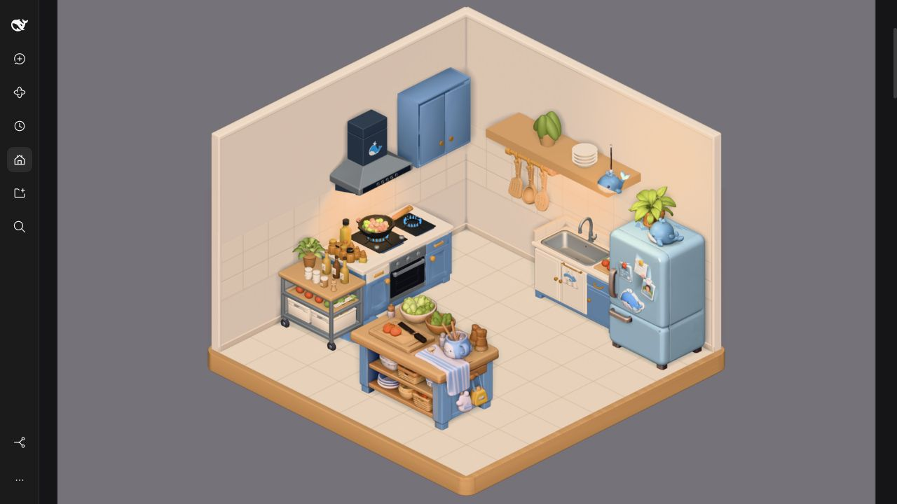
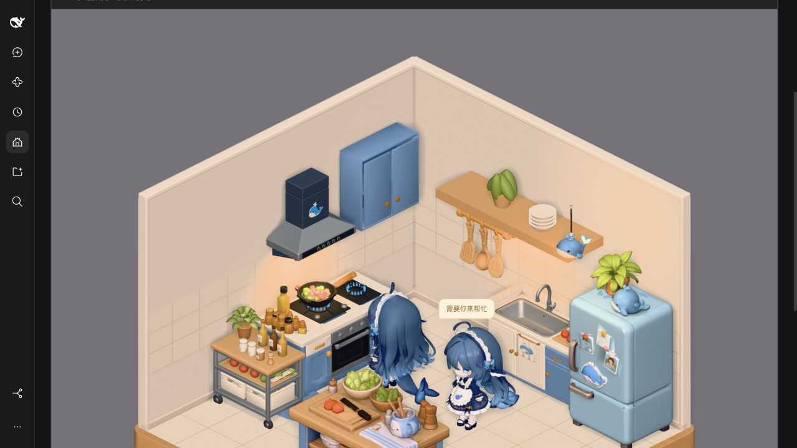

# Kitchen wall acceptance — 2026-10-27

Both walls now use independently authored Blender assets. Cream matte plaster,
slightly glazed backsplash tiles and rounded trim replace the flat wall surfaces.
User requested the geometry rebuild after the material-only freeze; the scope is
limited to these walls. Existing layout, furniture, camera, CSS and lighting remain.

| Asset              | Revision      | Triangles |  Bytes | SHA-256                                                            |
| ------------------ | ------------- | --------: | -----: | ------------------------------------------------------------------ |
| kitchen/left-wall  | 2026-10-27-r2 |      1500 | 384416 | `0de04443a1988bb296d37e32a405a4888122100eafe851966eb876c83e810a60` |
| kitchen/right-wall | 2026-10-27-r1 |      1500 | 384420 | `a0d624409cf2f56a6377418ec31db2c14de4b60141cccaaecfc38ed44f11bd01` |

Each asset has4 meshes/primitives,1 material and3 embedded images; budget10k/1MiB.
Authored envelope5×3.5×.16m, meters/Y-up/+Z-front/floor-center, scale1. The old
left-wall width/height compensation is removed. Only wall surfaces are exported;
right-side shelf/dishes/plant remain scene-owned and appear once.

Source library: `/Users/yuancheng/Documents/blender/office/kitchen/<id>/`.
Projects: `left-wall/厨房左墙_重制.blend` and `right-wall/厨房右墙.blend`.
Both have3 packed images and4 preserved editable source materials, no missing files.
Build scripts and independent import checks remain alongside those native projects.
Immutable manifests/previews/validation are in each `deliveries/<revision>/`.

Actual Cycles CPU NORMAL bake captures procedural beveled grout and plaster bump
into1024² tangent normals.512² albedo/roughness use emission-only baking; no studio
highlights or shadows are baked. This is shader bump-to-normal baking, not
high-to-low selected-to-active projection. Brick bandY=.82–1.72m, tiles.5×.3m.
Both final GLBs independently imported and rendered in a fresh Blender process;
zero degenerate triangles, non-finite normals or invalid UVs. Explicit tangents
and portable PBR textures are checked by the delivery contract test.

Commands actually passed:

```text
/Applications/Blender.app/Contents/MacOS/Blender --background --factory-startup --python /tmp/build_office_walls.py
/Applications/Blender.app/Contents/MacOS/Blender --background --factory-startup --python /tmp/verify_office_walls.py
/Applications/Blender.app/Contents/MacOS/Blender --background --factory-startup --python /tmp/audit_office_walls.py
pnpm --filter @cerbur/clutch-dsh-office assets:import /Users/yuancheng/Documents/blender/office/kitchen/left-wall/deliveries/2026-10-27-r2/manifest.json
pnpm --filter @cerbur/clutch-dsh-office assets:import /Users/yuancheng/Documents/blender/office/kitchen/right-wall/deliveries/2026-10-27-r1/manifest.json
pnpm --filter @cerbur/clutch-dsh-office test
pnpm --filter @cerbur/clutch-dsh-office typecheck
pnpm --filter @cerbur/clutch-dsh-office lint
pnpm run check:workspace
pnpm run check:patches
```

37tests pass, including wall envelope/tangent/material checks and independent
right-wall import while retaining the refrigerator budget. Patch validation has
the pre-existing`!!js` YAML warning.

Real acceptance: `DSH_HOME=/Users/yuancheng/.dsh-test`, http://127.0.0.1:3088/.
Profile's package symlink targets this release worktree; the rebuilt bundle is
loaded in a new browser tab. Existing test service remains running; no restart
needed this iteration. Five kitchens render with zero native active Sessions.
Focused room and two-actor local preview show the walls beside stove, sink,
fridge and table, with aligned corner/band/trim and no visible intersections.
Cooking/waiting and search preview verified without running native Sessions.
Scroll to final room:1 canvas/0 alerts; return to first room successfully rebuilds
both walls and floor. Fresh tab captured zero console warnings/errors.




Additional evidence: `office-walls-search.png`, `office-walls-list-end.png` and
`office-walls-rebuilt.png` in assets/screenshots. Mirrored to library
`sync/evidence/2026-10-27-walls/`, along with bake/import/native audits and logs.
Per-wall revision/hash receipts are in library `sync/receipts/` and catalog.

Baseline SHA audit: all11 other GLBs/manifests unchanged, including the floor.
runtime.ts(camera),lighting.ts,styles.ts,kitchen-layout.ts unchanged. Only left
asset replaced and new right added.13GLBs total24,372,776 bytes (23.24MiB);
uncompressed client33,989,929bytes (33.99MB).

Normals supply shading relief only, without collision/silhouette displacement.
No window or additional wall decorations supplied; unseen back reasonably
completed from the reference. Current unsaved interactive Blender scene preserved
by using separate official background processes. All changes remain uncommitted
working-tree changes; no DSH source/production-profile edits, push or publish.
