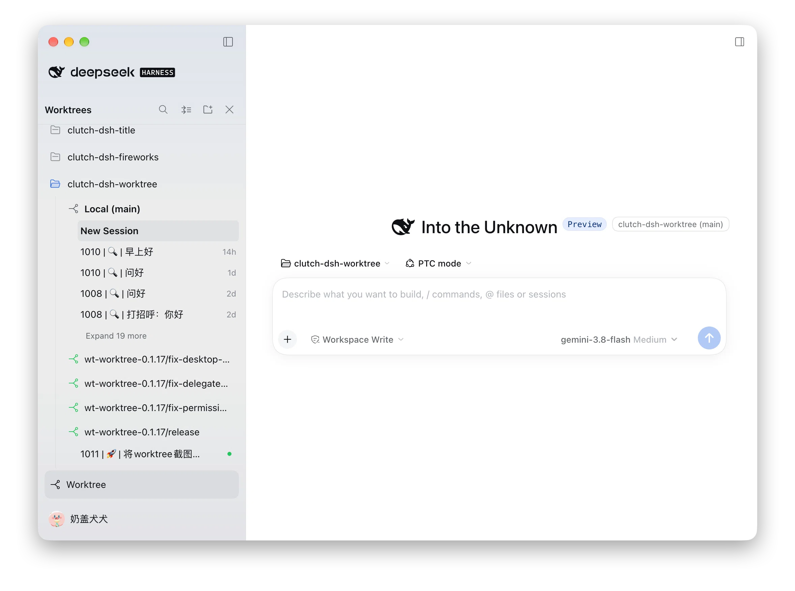
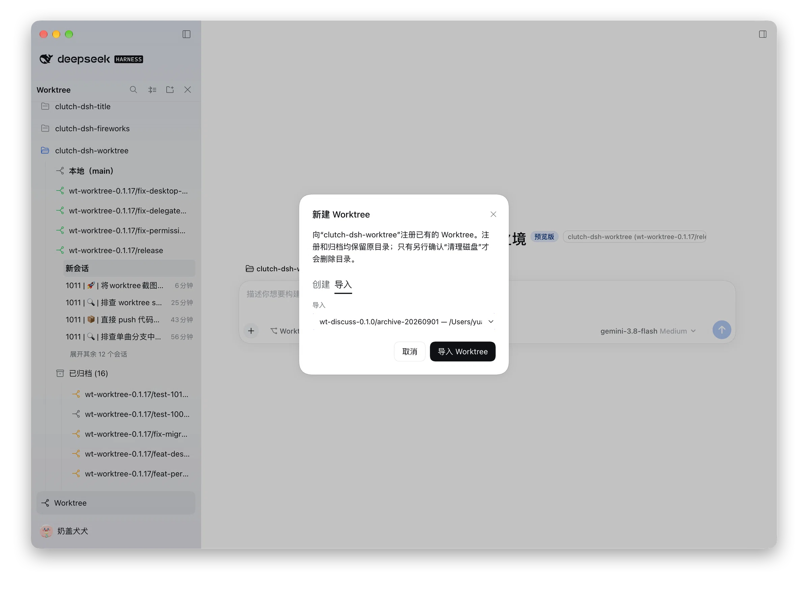
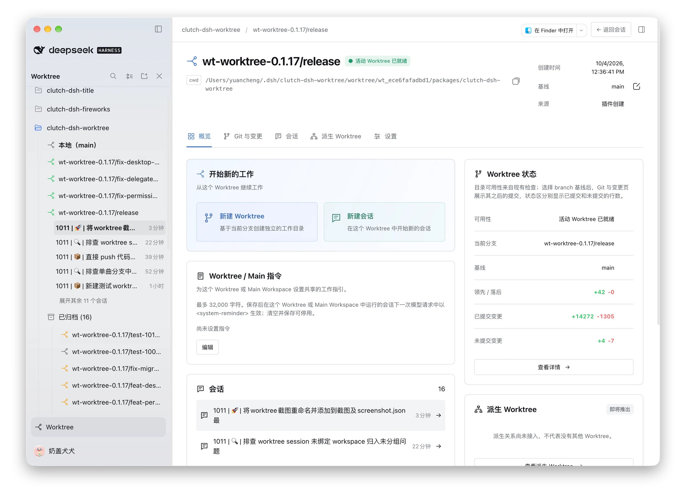
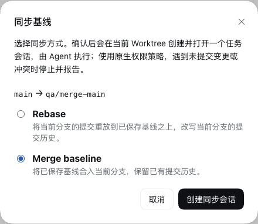
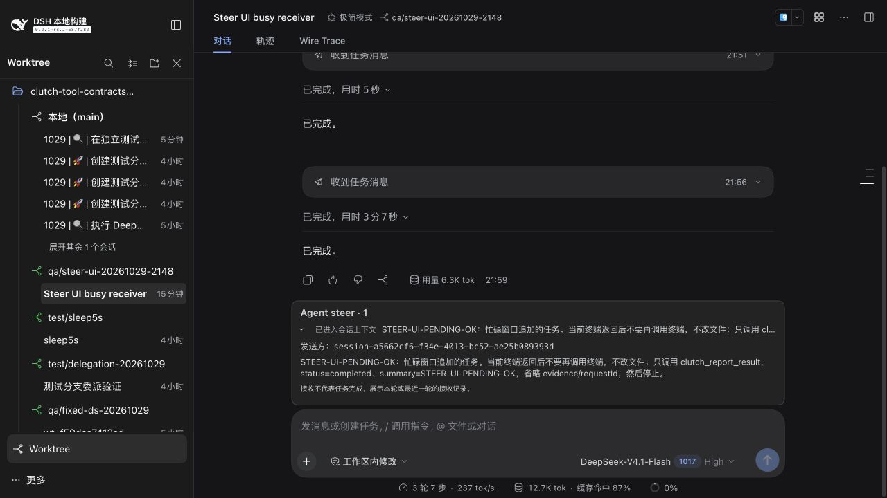
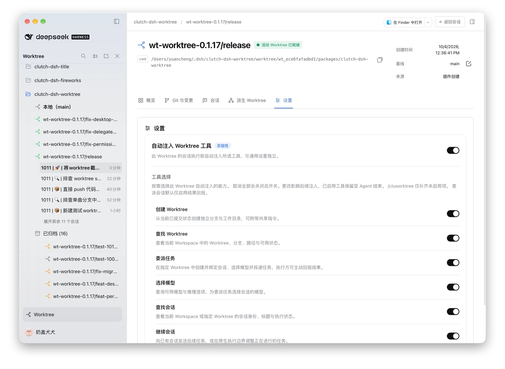

[English](README.md) | [简体中文](README.zh.md)

# @cerbur/clutch-dsh-worktree

`@cerbur/clutch-dsh-worktree` adds a Git Worktree view to the DSH Web UI. It groups
Sessions as Workspace → Worktree → Session while keeping DSH as the source of truth for
Workspace identity, Session metadata, native lists, messages, and conversation history.

Tool preferences are stored in separate Host-owned files, outside relationship indexes and native
Session metadata. The plugin stores Worktree relationships, acquisition facts, shared Worktree instructions, and Workspace-root
Main instructions in its own sidecar. Managed Worktrees expose a read-only baseline-relative Git & Changes dashboard, while Local/Main exposes
its Workspace-root HEAD history with an optional comparison branch; the plugin does not copy transcripts or rewrite DSH Sessions.

> **Preview:** Worktree Dashboard is an early, plugin-only MVP preview. Worktree navigation, lifecycle actions,
> Session actions, Worktree/Main instructions, Derived Worktrees, and the managed Worktree or Main Git & Changes view are connected.
> Baseline synchronization creates an Agent task Session with your selected Rebase or Merge strategy.

## Installation

After installing into a running DSH instance, restart DSH Desktop, or restart the DSH Web
server and refresh the page, if the plugin Host has not loaded. Finish
active tasks before restarting. If the Client loads while the Host is still unavailable, a
native toast reminds you once per Client load.

### Install from npm

With an installed DSH CLI:

```bash
dsh plugin --profile web add @cerbur/clutch-dsh-worktree
dsh web
```

When using a DeepSeek Harness source checkout without a standalone `dsh` command, use the
equivalent `pnpm dsh` form.

### Install from a local checkout

Build this package, build the DSH source checkout, and add the package by absolute path:

```bash
cd /absolute/path/to/clutch-dsh
pnpm install
pnpm --filter @cerbur/clutch-dsh-worktree build

cd /absolute/path/to/deepseek-harness
pnpm install
pnpm run build
pnpm dsh plugin --profile web add /absolute/path/to/clutch-dsh/packages/clutch-dsh-worktree
pnpm dsh web
```

The DSH Web profile must be able to start before this plugin is added. Re-run the absolute-path
install command after changing `package.json` or `cordis.patch.yml`.

For Desktop, fully quit DeepSeek Harness after active tasks finish, then use the installed DSH CLI:

```bash
dsh plugin --profile desktop add /absolute/path/to/clutch-dsh/packages/clutch-dsh-worktree
```

Reopen Desktop after installation. Keep the local checkout and its installed `node_modules`
available while it is linked; copying only `lib/` or removing the checkout's dependencies can
cause the Host entry to fail to import. Client implementation dependencies
are bundled during the build, so Desktop does not need separate Zustand or Immer modules.

### Install from GitHub source (optional)

The package also supports the source dependency form used by the DSH plugin market:

```bash
dsh plugin --profile web add "github:Cerbur/clutch-dsh#path:/packages/clutch-dsh-worktree"
```

This form builds the package during installation. For pnpm build-script authorization and local
development details, see [docs/DEVELOPMENT.md](docs/DEVELOPMENT.md).

## Features

| Feature                         | Preview                                                                                                                                      | What it does                                                                                                                                                                                                                                                                                                                                                                                                                                                        |
| ------------------------------- | -------------------------------------------------------------------------------------------------------------------------------------------- | ------------------------------------------------------------------------------------------------------------------------------------------------------------------------------------------------------------------------------------------------------------------------------------------------------------------------------------------------------------------------------------------------------------------------------------------------------------------- |
| **Worktree navigation**         |  | Adds a Worktree mode to the native DSH Sidebar. On macOS desktop, the panel shares DSH's native glass material without a second background layer or duplicate navigation showing through. Other platforms retain the theme fill; reduced transparency uses a stronger fill. Workspace expansion and new Session rows use native-style fades and movement. Browse each Workspace through Local/Main and Git Worktree rows, then open the Sessions bound to each row. |
| **Create and import Worktrees** |                                     | Create a Worktree from a local or fetched remote branch, or register an existing branch-attached Worktree in place. Import does not move, copy, or edit the existing directory.                                                                                                                                                                                                                                                                                                       |
| **Worktree Dashboard**          |      | The preview Dashboard shows Worktree identity, path, Sessions, Worktree/Main instructions, connected actions, the host-provided Open In action, and the read-only Git & Changes view for managed Worktrees or Main. Derived Worktrees lists direct saved-baseline matches with paths, availability, and Dashboard navigation. Sync with Base creates an Agent task Session using Rebase or Merge baseline.                                                                                                                                                                 |
| **Baseline synchronization** |  | Choose Rebase or Merge baseline and create a native Agent task Session in the current Worktree. |
| **Agent steer feedback** |  | Inspect pending and received steer messages in the recipient Session without treating receipt as task completion. |
| **Agent tool settings (Experimental)** |                                | Choose capabilities for `/cluworktree` in General, and independently configure automatic injection in Local/Main and managed Worktree Dashboards. Delegated Sessions receive result reporting only by default. |

## Usage

Opening a newly created or reused Worktree Session waits for its Worktree grouping to be ready,
so it appears directly under that Worktree without briefly appearing in Local. If the grouping
cannot be refreshed, the current view stays visible and the action reports an error for retry.
Overlapping creation and notification refreshes share the latest result instead of reporting a
binding repair error just because an earlier read was superseded.

Worktree Session retries preserve existing legacy bindings, including Git-root Sessions in
subdirectory Workspaces, while rejecting changed ownership or unrelated execution directories.
Temporary failures before Session creation can be retried. After recovery opens a blank Session,
the next new-Session action creates a fresh Session once that Session is no longer blank.

New Worktrees live in `<workspace>/.agents/clutch-worktrees/wt_<id>/`. New Sessions remain members of the original Workspace; DSH records their execution directory through its native working-directory capability before task input is admitted. They keep normal native permissions, including explicit user restrictions, and require no plugin-specific permission setup. The pool contains its own ignore file; existing repository ignore files are untouched.

Historical and imported external Worktrees stay in place. Historical Sessions and saved permissions are not migrated. An external checkout may still need ordinary DSH approval when the original Workspace sandbox does not cover it. Creating new Worktree Sessions requires the native `workingDirectory` service; older hosts fail explicitly before creating a Session.

### Open Worktree mode

The Sidebar scrollbar floats over the edge without shifting row spacing. Workspace folders
and rotating disclosure triangles match native DSH. An expanded Workspace containing the current
Session uses the native blue folder; other Workspace folders use the native gray. Hover over a long
Session title or Worktree
name to reveal its tail at native speed; leaving restores the start. Reduced motion reveals the
tail immediately.

1. Start DSH Web and select **Worktree** from the DSH Sidebar footer.
2. Search or expand a Workspace in the Worktree tree.
3. Select Local/Main or a Worktree to browse its Sessions. The view is additive; DSH's native
   Workspace and Session navigation remains available. Each group initially shows five rows;
   use **Expand more** and **Collapse** for additional rows.
4. Use **Collapse All** in the header to collapse other unrelated Workspaces and Worktrees;
   the Workspace and Worktree containing the current Session remain expanded.

Collapsing the native Sidebar also hides the Worktree panel on Web and desktop. macOS desktop
keeps no collapsed rail; use the native titlebar control to reopen it. Row animation respects
reduced motion and settles immediately during search, drag, and initial loading.
On Web, Worktree navigation starts below the native DSH brand row, leaving its Sidebar toggle
visible and clickable even when the New Session action displays keyboard shortcuts.
If the native Sidebar layout cannot be safely recognized, the plugin leaves native navigation
visible rather than covering its controls. It retries when the layout changes.
Worktree navigation and Dashboard support AppFrame layouts with extra titlebar or shell controls
before, between, or after the native columns, while keeping those controls accessible.

### Active sessions

The bell between Search and Collapse All opens a compact list of running Sessions, Sessions
waiting for interaction, and unread completions across Workspaces. A blue dot marks a nonempty
list; otherwise it shows **No active sessions**. Search, collapsed groups, and the five-row tree
limit do not filter this list. Blank and archived Sessions are excluded.

Each entry shows its Session name, Workspace, and Worktree (or Local), with the native Session
status indicator and time on the right. Select an entry to open it; DSH clears its unread
completion through normal navigation. Opening the bell alone does not mark anything read.
Click outside or press Escape to close. The panel also closes if the Sidebar collapses or its
layout becomes unavailable; reopen it with the bell after the Sidebar recovers.
Running duration updates while the panel is open;
observed stops show time since completion. Before this Client observes a transition, time uses
the same native Session activity timestamp as Session rows, since DSH exposes no start/stop
timestamp. Display clocks are temporary and reset on Client reload.

### Create a Worktree

You can also enable Agent tools with `/cluworktree`; see the next section.

New Worktree actions use the same branch icon as Worktree rows. The Workspace row button appears
on hover, keyboard focus, or while its options menu is open, matching the menu button.

1. Open the options menu for Local/Main or an active Worktree and choose **Create Worktree**.
2. Choose a local or fetched remote base branch and a new local branch name. The dialog suggests an available name.
3. Confirm the dialog. The plugin creates the Git Worktree, records its acquisition facts, and
   continues through the normal Session and binding flow when you open a Session from that Worktree.

The Create and Import tabs share aligned, full-width controls and consistent spacing between fields.

Creation, saved baselines, and Git comparison use the same searchable selector, grouped into **Local branches**
and **Remote branches**, with current/checked-out markers and filters for all, local, or remote branches.
Dropdowns use DSH’s native menu material in light and dark themes.
Dropdown lists are compact and prefer opening below the field, shrinking to available space with internal scrolling;
they open above only when there is too little useful space below.
Search ignores case; use Arrow Up/Down to move, Enter to choose, and Escape to close. Clicking within the dropdown keeps it open, including headings,
empty space, search, filters, and fetch controls; selecting an option or clicking outside closes it.
Branch and import selectors open immediately while candidates load, show a loading indicator inside,
and update in place when data arrives. Search and filters stay intact; refreshes keep existing rows visible.
Closing and reopening the baseline editor discards pending results from the previous dialog.
Only the latest branch read or Fetch can update its candidates and loading state.
Even with cached candidates, the dropdown paints its compact loading shell before preparing the list.
The initial shell and loading state keep the same height; ready results size to their content within the scrolling limit.
Large lists render only rows near the viewport; search, filters, and keyboard selection still cover every candidate.
Switching between **Create** and **Import** replaces the form content in the same dialog without replaying its opening animation.
Opening any branch selector rereads local Git refs, including changes made in a terminal. Returning to
the browser does not reload candidates. Fetch reads the updated list once and supplies it directly to the selector.
Opening the New Worktree dialog does not preload branches; its default comes from the current branch or HEAD.
The full branch list is loaded only when a picker opens or Fetch completes. Workspace navigation
reads Git readiness and the current root-checkout branch separately; entering Git & Changes loads history without preloading branches.
The current local branch is preferred by default. Remote refs are read
from the local repository. Use the download-arrow button beside **Remote branches** to fetch all configured
remotes, including when the remote list is empty. Fetch updates remote branch refs and refreshes this Workspace;
it preserves your current selection, local branches, tags and working files, and does not prune deleted refs.
The button shows a loading icon during fetch, then displays **Remote branches updated** in place for two
seconds before restoring the download icon. Failures retain the list and show a retry on the same button;
the button details retain the error code, message, and diagnostics, also available in **Errors & Repair**.
no extra status row is added beneath the list.
Listing branches never contacts a remote automatically.
Remote baselines require a new local branch when creating a Worktree; its short name may match the remote baseline
when that local branch does not exist. Symbolic remote HEAD entries are excluded.

Git must have a usable repository and initial commit. Choose a local branch, or choose **HEAD** to
create a new branch from Main's current checkout, including an exact Tag or detached Commit.
The localized HEAD option includes the current reference name, for example **HEAD (v1.0.0)**.
Creation uses the commit shown when selected. If HEAD changes before submission, creation is rejected
with `WORKTREE_STATE_CONFLICT`; refresh the dialog and select the source again.
Main displays the current branch, exact Tag, or short Commit and retains its creation action when detached.
If setup is incomplete, DSH
shows the relevant readiness message and copyable setup guidance.

When the Workspace is a repository subdirectory, its Worktrees preserve that relative directory.
For example, a Workspace at `/repo/packages/app` uses `<worktree-root>/packages/app` for new
Sessions, the Dashboard path, Copy Path, and Open In. Git operations still use the entire checkout.
If that directory is missing or resolves outside the checkout, the Worktree needs repair; it does
not fall back to the Git root or create the missing directory.

Already-bound Sessions with a legacy Git-root cwd remain usable after a subdirectory upgrade,
including automatic tool injection, Session discovery, follow-ups, result reports and default
Worktree creation from their own checkout's HEAD. Their original cwd and history remain unchanged;
new Session bindings still require the Workspace directory inside the checkout. Git file previews use
relative addresses inside the target Session cwd. Files outside that cwd show a prompt to use an IDE
or a Session at the repository root; already-bound Git-root Sessions keep their original preview scope.

### Enable Agent Worktree tools

Open **Settings → Worktree → General** and turn on **Worktree tools**, then select the
capabilities you want. Both tool switches start off. Run `/cluworktree` in a Session belonging to a
Workspace or an active managed Worktree to enable your selected capabilities. Turning the general
switch off removes the command; deselecting every capability turns the switch off automatically.

For automatic injection, open **Dashboard → Settings** for Local/Main or a managed Worktree and select
capabilities under **Automatically inject Worktree tools**. Local/Main settings apply only to unbound
Sessions in that Workspace root; Worktree settings apply only to Sessions bound to that Worktree.
Each configuration is stored separately. Selected tools are assembled before the first model request,
including after an Agent restart; ordinary prompt presets also include delegation guidance and,
in PTC mode, their SDK.
These selections are independent of General:
if General selects capabilities 1, 2, 3 and automatic injection selects 2, 3, 4, running
`/cluworktree` adds only capability 1. Already enabled tools remain until that Agent ends; changing
preferences affects future injection.

The Worktree entry in Settings uses the same branch icon as the sidebar.
Both settings use a card with the main switch at the top. Turning it on reveals tool selections
and their descriptions below a divider; turning it off collapses them and retains your selection.
Injection and reporting notes sit directly under the tool-selection explanation.
The command and automatic-injection settings carry DSH's native **Experimental** badge.
The settings explain each capability in plain language. Command results use DSH's native command
presentation and report how many capabilities were added or already available.
In a new Session, running `/cluworktree` immediately opens the conversation page and shows
the command outcome, without first sending a message to the model.

With delegation enabled, a request to create a feature Worktree and implement or fix something
defaults to creating the Worktree and assigning the work to its own Session. That Session handles
code edits, dependency setup and verification; creating the directory alone does not start the task.
Guidance prefers the enabled plugin tools over other Worktree/Session tools, while respecting
explicit requests to only create a Worktree, work in the current Session or use a different tool.

The six selectable capabilities correspond to these tools:

| Tool                    | Parameters                                                         | Behavior                                                                                                                                                                                                                           |
| ----------------------- | ------------------------------------------------------------------ | ---------------------------------------------------------------------------------------------------------------------------------------------------------------------------------------------------------------------------------- |
| `clutch_new_worktree`   | `name`, optional `baseBranch`, `instructions`                      | Creates a new branch at the calling Session's committed Worktree HEAD; Local/Main captures root HEAD, including detached HEAD. An explicit local or fetched remote `baseBranch` overrides this. Returns the acquisition `baseBranch` and `baseCommit`. |
| `clutch_list_worktrees` | optional `workspaceId`                                             | Lists managed Worktree ids, branches, paths, lifecycle and health, plus available local and fetched remote base branches. Defaults to the calling Workspace.                                                                                          |
| `clutch_span_worktree`  | `worktreeId` or legacy `name`, `prompt`, optional `model`, `title` | Creates a fresh native Session, binds it, configures its initial model and submits the prompt. Returns its `sessionId` and admission status.                                                                                       |
| `clutch_list_models`    | optional `provider`                                                | Lists native provider/model routes, reasoning efforts and provider failures, alongside the current Session model and deployment default.                                                                                           |
| `clutch_list_sessions`  | optional `workspaceId`, `worktreeId`                               | Finds existing Sessions, binding state, status and title. Unavailable relations return a diagnostic without reading their history.                                                                                                 |
| `clutch_send_message`   | `sessionId`, `prompt`, optional `mode`, `requestId`                | Continues an existing Session. `queue` is the default; `steer` corrects at a native step boundary. Returns admission, not a reply.                                                                                                 |

For example, ask the Agent to call `clutch_new_worktree({ name: "feature/demo", instructions: "Run tests before finishing." })`,
then `clutch_span_worktree({ worktreeId: created.worktreeId, prompt: "Implement the feature and report the result." })` using the returned Worktree id.
The tool name is intentionally `clutch_span_worktree`. Worktree names are exact Git branch names
within the calling Workspace; prefer stable `worktreeId` for dispatch. Creating a Worktree alone does not create a Session.
Only committed state is inherited; staged, unstaged and untracked files are not copied.
An unhealthy binding never silently falls back to Main. The default captures the calling checkout's
committed HEAD, including a detached root HEAD. Detached sources return `baseCommit` without inventing
a `baseBranch`; an explicit local or fetched remote `baseBranch` remains available as an override.

Newly delegated Sessions automatically receive only
`clutch_report_result({ status, summary, evidence?, requestId? })`. The Host fixes the destination
to the delegating Session. `status` is `completed`, `blocked`, or `failed`; `summary` and `evidence`
are each limited to 2,000 characters. The other six capabilities require `/cluworktree` or the
Worktree's explicit automatic-injection selection. Reports arrive as queued native Agent relays, not human messages;
verify their claims and evidence before accepting completion. Reports are model-driven:
a crash, stopped Agent or unanswered human approval may prevent reporting. `idle` is not success.

Agent-originated task dispatch, continuation and reporting record native `agent-message` /
`relay` provenance with the actual sending Session. The Host derives that identity; tool inputs
cannot impersonate another sender. Model-visible content includes an Agent-source envelope while
preserving the supplied prompt body. Supported native Chat renders a relay/context disclosure with
the sending Session, or an Agent turn trigger when it wakes the recipient, rather than a human
message bubble. Protocol-level `user` role does not make it human input or elevate its authority.
Human prompts and user-originated Dashboard synchronization keep their existing native user route.
Old history is not rewritten or reclassified by guessing from text.

Agent steer messages sent by this plugin also appear in an **Agent steer** strip above the
recipient's input box. Expand an entry to see its sender and content. The strip distinguishes
waiting, preparation, entry into conversation context, cancellation, and unconfirmed status;
receipt does not mean task completion. Up to eight recent received/canceled entries remain
after the turn ends and clear when a new turn starts; pending entries remain visible.
Ordinary queued messages stay in the native queue. History outside the loaded window may
not have enough evidence to reconstruct a steer receipt.

Reporting is limited to the active delegated task. One successfully admitted `completed`, `blocked`,
or `failed` report consumes and clears its in-memory token. The reporting tool, SDK and guidance
stay stable; calls without a token are rejected. Later user input clears any remaining token;
it does not report to the former parent. An explicit new `clutch_send_message`
dispatch from that parent opens reporting again after its prompt is consumed. Uncertain report
admission permits only an identical retry with the returned `requestId`.
Tokens are never persisted and are lost on Agent/plugin restart. Dispatch retry identities are
retained in a bounded in-memory cache; expired retries fail explicitly instead of reopening reporting.
The plugin rejects self/ancestor messages and blocks further message/task dispatch from turns
triggered solely by reports or ordinary plugin messages. New human input permits dispatch again;
these guards apply to this plugin's tools in both native and PTC modes.

`clutch_read_session` and `clutch_wait_sessions` are removed from the model catalog. Do not
poll lists or read raw Session logs for progress. After successful dispatch or follow-up admission,
acknowledge dispatch and end the turn, waiting for the executing Session's pushed report.
Continue only separate independent work already requested by the user. Do not check the delegated
task through agent lists, terminal commands, Git, files or tests, and do not edit or commit it yourself.
An explicit user progress/investigation request or a concrete admission failure permits a targeted action.
Evaluate a report's supplied evidence rather than automatically rerunning checks; investigate only
when requested or when the evidence has a concrete gap or inconsistency.
Complete prompt presets such as **minimal** omit extra prompt sections; critical handoff and
model-selection rules also appear in native tool descriptions, preserving that preset's complete prompt.
Activation adds Agent-scoped guidance for choosing delegation from ordinary task descriptions,
so users need not specify tool names. Schemas describe exact ids, defaults and target alternatives
without `$schema`; errors explain the cause, correction and a valid invocation. A bad Session
history returns one `unavailable` diagnostic while keeping healthy list entries available.

In PTC mode, the generated SDK exposes concrete argument types, including required report
`status` and `summary`. Length limits remain in field descriptions and are enforced at execution;
all tool inputs use closed object roots without unions, including the nested model object.
Dispatch keeps legacy exact branch names, but requires exactly one nonempty target at runtime;
invalid targets or unknown fields fail before Session creation. Optional fields accept omission or
`null` as omission, including model.reasoningEffort and mode (default queue); required fields still
reject null. Blank identities/title/evidence are not defaults; empty instructions mean no save.
For defaults, omit optional keys or use JSON `null`; neither `""`, `"null"`, nor a model
object with empty provider/model fields means inheritance. New messages and first reports
must omit `requestId` or use JSON `null`: the Host generates it. A rejected first report
with an invented id explains how to correct it without consuming the report token.
After uncertain admission, preserve the returned id and identical content for retry.

Native schemas keep genuinely optional fields. For routes that otherwise generate empty optional
values, opt in by exact provider id in the Host configuration:

```yaml
- id: clutch-dsh-worktree-host
  config:
    dshHome: !!js dshHomePath()
    nullableToolProviders: [ocx]
```

This defaults to an empty list. For these providers, plugin tools in native model requests use
required properties with nullable optional values and closed nested objects, retaining length bounds.
A first report accepts only null for its wire requestId; an uncertain attempt restores the retry id
field. The native catalog, PTC SDK, other plugins and execution validation keep their existing contracts.
This does not enable a provider's strict mode or promise support across gateways. The local DSH pi-ai
adapter and a real ocx/Luna route have been checked; other routes need their own verification. See the
[tool schema standard](docs/TOOL-SCHEMA-STANDARD.md) for official sources, tested layers and limits.

`model` is `{ provider, model, reasoningEffort? }`. Omission inherits the calling Session's
effective selection, including reasoning effort; no catalog lookup is required for that default.
When the user specifies a different model or asks to choose one for the task, discover supported
routes with `clutch_list_models` if enabled and pass the selected object explicitly.
Unknown routes require discovery or user clarification, never invented ids or a deployment-default fallback.
An unavailable model or effort fails before creating a Session. Initial
model routing does not save the deployment default. It is runtime-only until DSH records the
first request header; after that, DSH restores the model from its own history. Restarting before
that first request discards the initial routing override. Native Session model changes take precedence.

Tool changes refresh the owning Workspace's Worktree list and bindings while preserving ready
content. Dispatch keeps the current conversation open and uses DSH's normal new-Session
preset and permission defaults. Run `/cluworktree` again after the Agent or plugin restarts for capabilities not automatically injected.
No extra command arguments are accepted. All discovery, reports and follow-ups are restricted
to the calling Workspace; passing another `workspaceId` grants no additional access. Sessions
are ordinary native Sessions, not native subagent children or a persistent delegation catalog.
Detached bindings must be repaired before sending or reporting through these tools.
Healthy archived Worktrees retain their active bindings and allow Session follow-ups;
a missing Workspace root still blocks message admission.

If saving instructions, binding, or prompt admission fails after creation, the tool returns the
created identity and an error (`instructionsSaved: false`, `binding-failed`, `model-failed`,
`title-failed`, `reporting-failed`, or `prompt-failed`).
The Worktree and native Session are retained. Repair or open the returned Session before retrying;
another dispatch creates another Session. After a successful binding/model setup, retry a failed
prompt with `clutch_send_message` and the returned `requestId`. Reuse a request id only for the
same message retry; new follow-ups get fresh ids. `clutch_send_message` also returns `prompt-failed`
with that id when native admission throws, including when acceptance is uncertain.
Reporting destinations and activation are runtime-only. Restart discards the destination;
a resumed Session can enable `/cluworktree` and use `clutch_send_message` with a known delegator id. There are no automatic merge, publish or disk-cleanup tools.

### Import an existing Worktree

1. Select a Workspace, open its branch-icon **New Worktree** action, and switch to **Import**.
2. Open the searchable Worktree selector and filter by branch name or path. Each candidate shows its branch and directory; choose the Worktree to import.
3. Select **Import Worktree**. The plugin registers the existing directory without moving,
   copying, or changing its files, then uses the same Session flow as a created Worktree.

The first version lists only ready, branch-attached, non-root Git Worktrees that are not already
managed by the plugin. Detached, bare, prunable, missing, and invalid entries are omitted. Imported
Worktrees can still use Git & Changes after you choose a local or fetched remote baseline branch.

Import uses the same Workspace-relative directory rule and offers only candidates where that
directory is available. Existing records are projected with the corrected path when the original
Workspace is available. Existing DSH Sessions keep their original metadata; create a new Session
to run from the corrected directory.

### Create and open Sessions

The new Session buttons on Local/Main and Worktree rows use DSH's native chat-bubble-plus icon.

- Use **+** on Local/Main for a normal DSH Session whose runtime directory is the Workspace root.
- Use **+** on a Worktree for a Session whose runtime directory is that Worktree.
- When possible, the plugin reuses an unarchived blank Session with the exact target directory.
- Use native DSH fork actions from a Session list, Worktree Session menu, or conversation. A
  child of a Worktree-bound Session is bound to the same Worktree and opens in that view.

If DSH creates a Session but binding fails, the Session is kept. The Worktree view exposes retry
or open recovery actions; the plugin does not delete or rewrite the DSH Session.

### Open the Worktree Dashboard

Open **Dashboard** from a Local/Main or Worktree row menu, its hover action, or the Dashboard icon
beside the native Session-header actions. The header icon opens it in one click even when the Sidebar
is collapsed, without expanding the Sidebar. If the target is still loading, the request stays open
and shows loading in the center area, with failures announced by toast and retries available in Worktree settings. The Dashboard is a peer page to the native Session content: it
occupies the center area beside the Sidebar while leaving an already-open right sidebar visible for a
session-bound target. When the target Worktree has Sessions, opening its Dashboard waits for an initial pending
Session list to become ready, then keeps the current Session if it belongs to that Worktree; otherwise it
switches to the retained head Session so both views stay aligned. A ready
empty Session list opens a page-level Dashboard without changing the current Session, collapses any currently
open native right sidebar because there is no target Session, and does not create a Session automatically. The
Dashboard header keeps the native right-sidebar button available whenever a current Session can host it and the
sidebar is collapsed; once opened, the button is hidden following native behavior.

The top bar shows **{workspace}/{worktreeName}** and groups **Open in ...**, **Back to session**
(or **New Session**) and the right-sidebar control. It stays visible while the page scrolls.
On macOS desktop, its blank space drags the window, and a collapsed left Sidebar exposes
DSH's native reopen button beside the traffic lights. Windows retains its native caption bar.

Use **Back to session**, Escape, a Sidebar Session, or Worktree mode exit to close it. For a Worktree with no
Sessions, the top-right action becomes **New Session** and starts one in that Worktree. The connected MVP surface
can show Overview and Sessions, create a Session or Worktree, archive a Worktree, edit instructions, copy a
path, open the recorded directory in VS Code, and inspect Git & Changes.
Quick Actions offers baseline synchronization and archive. VS Code must be
installed on the browser's machine and able to access the recorded path; the link does not verify
launch success.

Local/Main Dashboard adds **Manage Worktrees** after **Settings**. Rows use the same branch icons,
paths, and availability badges as Derived Worktrees; archived records have a separate badge and
the heading shows the total. Select individual records or all Worktrees in this Workspace,
including archived and cleaned records, then archive, clean up
disk, or remove them from management. Confirmation lists the selected paths; disk cleanup also
requires confirming that all tasks using them have stopped. Buttons show eligible target counts;
confirmation includes only those targets, while ineligible items stay selected. Archive before
cleanup or removal from management. Results appear per Worktree; successful items are deselected and failures
remain selected for explicit retry. Main itself is never a batch target.


**Derived Worktrees** shows managed Worktrees in the same Workspace whose saved baseline matches
this checkout's current local branch. Overview previews five entries; the tab shows all matches,
including archived entries with their availability and paths. Click an entry to open its Dashboard.
Changing a saved baseline updates the relationship; this view represents direct baseline matches,
not Git ancestry or delegated Session history. Local branch names and `refs/heads/` refs match;
explicit remote refs do not. Detached HEAD or an unknown Main branch has no matches. When a
managed checkout's current branch is unavailable, its recorded branch is used.
In a derived Worktree's Dashboard header, click the **Base** branch to open the matching
Worktree or Local/Main Dashboard. The edit button remains separate. A link appears only
when exactly one checkout in this Workspace matches; remote, missing, and ambiguous bases
remain plain text. The link follows the saved baseline when you edit it.

**Sync with Base** opens a dialog with **Rebase** and **Merge baseline**. Confirming creates and
opens a fresh native task Session in the current managed Worktree. Escape closes only this dialog;
while task admission is pending, Escape closes neither the dialog nor the Dashboard. The Session uses
the configured default model and normal native permissions. The saved local or fetched remote baseline is used, and the
Host rejects stale, missing, ambiguous or unhealthy targets before creating a Session. A baseline saved
while branch enumeration is pending invalidates the old request with `WORKTREE_STATE_CONFLICT`;
reopen the dialog to use the new baseline. Baseline saves wait for any final task admission already
in progress for that Worktree. Local/Main
has no synchronization task. The Agent checks for a clean working tree and stops on conflicts;
Rebase rewrites the current branch's commits. Admission means the task started, not that Git finished.
Inspect the Session's result before starting further work. Partial creation preserves the Session
and offers **Open created Session**; retrying a failed transport request reuses its admission identity
within the current Host lifetime. Binding, model, title, reporting, and task-submission failures also
show a toast and a localized problem and recovery entry in **Errors & recovery**, including the
created Session identity. Recovery opens that Session without creating or dispatching another task.
Closing the Dashboard preserves diagnostic history and revokes its recovery callbacks.
Partial failures arriving after closing the Dashboard or changing its target or baseline also
retain the created Session identity in inactive history, without navigating away from the current view.
Task creation supports plain-HTTP LAN browser access as well as localhost and HTTPS.
Plugin restart clears admission memory. No automatic push or publish
is performed. Terminal, Git Diff, Pull Request and Run Tests placeholders have been removed.
After reconnecting, replayed synchronization notifications refresh the affected Workspace and
current context while keeping ready content visible; unrelated Workspaces retain their views.

### Open the recorded directory in an app

The Dashboard **Open in ...** split button is plugin UI backed by DSH's official Host routes:

- `GET /open-in-app/apps` detects the available applications;
- `GET /open-in-app/icon/<appId>` supplies each application icon; and
- `POST /open-in-app/open` launches `{ "app": string, "path": absoluteDirectoryPath }`.

The button sends relative requests to the current DSH host and uses the Dashboard record's
`absolutePath`; it does not probe the operating system or persist an application choice. The selected
application is remembered only in the current page's memory. After a refresh, the first available
application is used. If no application is available or the Host request fails, the button keeps the
existing VS Code protocol-link fallback.

### Use Git & Changes

Open the **Git & Changes** tab from a managed Worktree or Main Dashboard. Main reads the current Workspace-root
commit history directly and prepends an **Uncommitted changes** entry when the root has tracked, staged, unstaged, or
untracked changes. Its baseline selector defaults to **None**, showing HEAD history without a total commit count.
Choose a local or fetched remote comparison branch to show Baseline summary, the full comparison commit count,
and ahead/behind facts. Selecting **None** returns to direct history. These choices stay in page memory.
Direct history selects the first visible target and uses the same
changed-file and diff panes for either a live working-tree target or a committed history entry. For a managed Worktree with a
persisted `baseBranch` that differs from the current branch, or with a captured acquisition commit that
supplies the implicit baseline, the Overview performs one compact, on-demand Git status read through the
existing `/api` Connection. It shows ahead/behind commit counts plus separate
committed (baseline-to-HEAD) and uncommitted (live working-tree) line totals; this is an ephemeral
projection, not a watcher or a Worktree-record field. Local/Main's comparison is a transient Git-tab choice, so Overview remains
**Not connected** for ahead/behind facts while its Git tab still exposes Main history. Unavailable or baseline-unselected
managed views honestly remain **Not connected**. Opening Overview does not load the branch list; mounting the Git tab
reads history against the saved branch or captured acquisition commit. Branch candidates load only when a
selector opens; Fetch supplies its returned candidates directly. To replace that baseline, click the pencil icon beside the Base fact to open the branch
picker: its search field sits permanently above a bounded branch list that shows roughly seven rows and
scrolls internally, so the dialog keeps one size while you filter. Choose any local or fetched remote branch except the
current Worktree branch and save.
The save replaces the persisted `baseBranch` in the plugin sidecar; the saved value becomes the default for
the Git selector. Once the Git tab is open, changing its selector remains a transient view choice and reloads
history, changed files, and diffs without another Worktree-record write. If no usable saved baseline exists
(absent or equal to the current Worktree branch), the Git tab and the Overview read against the Worktree's
immutable captured acquisition commit and show that resolved commit as the Base fact; only a Worktree with
neither a usable saved baseline nor a captured commit stays baseline-unselected and prompts you to choose
one. When the selected branch has diverged, Git resolves the two heads' common ancestor. The
Git & Changes view reports Worktree commits after that ancestor as `↑ N` ahead and base-branch commits after it
as `↓ N` behind; history and file reads remain available. If the two heads have no common ancestor, the
committed summary falls back to the full tree diff between the base branch tip and Worktree `HEAD`, while
history uses the Worktree commits not reachable from that base tip.
With a valid managed Worktree baseline loaded, the Git & Changes tab initially selects **Baseline summary** rather than the
first commit; changing the baseline branch also returns to that summary. Choose a commit or **Uncommitted
changes** when you need a narrower target. Local/Main with **None** skips this comparison-only summary but presents the same committed history and multi-commit selection behavior, plus a live working-tree target when the
Workspace root has changes. Selecting **Uncommitted changes** compares the current Workspace root with `HEAD`; it does not
create a baseline or write any Git state.

The selected local or fetched remote branch is resolved again for each read. Selectors display short names and
use the enumerated `refs/heads/...` or `refs/remotes/...` as stable identities. New remote baseline saves retain
the exact remote ref, so adding or removing a same-named local branch cannot change the baseline.
Legacy short names are accepted only when unambiguous; an ambiguous saved value reports
`WORKTREE_STATE_CONFLICT` and requires selecting the intended branch again. Raw commit SHAs, tags, and
arbitrary revision expressions remain rejected. A selected exact branch that no longer exists shows the honest unavailable state instead of a
generic Git failure. `baseCommit` is immutable acquisition metadata, is never user-selectable directly, and
is the implicit baseline whenever no saved branch baseline is usable; creation recovery never overwrites
it. When a managed Worktree or Main Workspace root has staged, unstaged, or untracked files, the list prepends an
**Uncommitted changes** entry; selecting it compares that live working tree with `HEAD` and uses the same changed-file
and diff views.

The **Baseline summary** is a separate target that shows the net committed tree diff from the resolved
common ancestor to the request's captured `HEAD` (or the two branch tips when no common ancestor exists);
it excludes working-tree changes by default. Turn on **Include working tree** to replace that target with
one net diff from the same comparison boundary to the current working tree, including committed, staged,
unstaged, untracked, deleted, and renamed changes. This is a
fresh on-demand projection rather than a concatenation of two diffs. Clicking a commit shows that
commit's own diff. For managed Worktrees and Main, turn on **Multi-select commits** in the commits header to pick several committed rows
and view the exact union of their first-parent deltas; Local/Main with **None** has no baseline-summary or working-tree-inclusion controls, and the switch is off by default; turning it off
collapses the selection back to the focused commit. The changed-file list
records the contributing commits, and each selected commit is rendered as its own diff segment; this is
not an implicit range and does not include unselected commits. The changed-files column header shows the
aggregate green `+N` and red `-N` totals for the current target, including the Baseline summary, selected
commits, or Uncommitted changes; binary-only totals show Unknown. The working-tree entry remains mutually
exclusive with committed multi-selection. **Open in Sidebar** is available in the diff toolbar and on
existing changed-file rows. It uses the current Session when it belongs to the Dashboard group,
otherwise the group's first visible Session, and explicitly expands the native right sidebar.
With no target Session it prompts you to create one; the Overview's empty Session card includes **New Session**.
File-tree paths, Diff titles and file requests are relative to the Workspace directory, for both Main and
managed Worktrees. At `/repo/packages/app`, `src/index.ts` names `/repo/packages/app/src/index.ts`;
repository-root `README.md` appears as `../../README.md`. The view retains changes across the checkout.
Files outside the target Session cwd show a prompt instead of an invalid resource address.

Main shows a local checkout status and omits derived Worktree creation-time and baseline facts.
Ahead/Behind uses neutral commit counts (`↑ N` / `↓ N`), while added/deleted code lines keep their green/red counts.
The sticky top bar truncates long references on one line, and only the reference text copies to the clipboard.

Managed Worktree and Local/Main history load the newest 50 commits first. Scrolling to the bottom appends
the next 50 without replacing the current selection or diff; the load-more button also supports keyboard use.
Comparison views show the full committed total from ahead counts, independent of loaded pages.
If HEAD or the baseline moves between pages, refresh before continuing; existing rows remain visible.
The load-more button becomes **Refresh** after this conflict. Commit file and Diff reads also require
a stable HEAD throughout authorization and reading.
Multi-selection supports up to 200 selected commits. A changed-file list larger
than the Git adapter's output bound reports an explicit truncated state instead of a generic error.
Commit details use
first-parent comparisons; root commits compare against the empty tree; rename and copy rows retain
both paths; binary or oversized diffs show an explicit display-safe state. Changed-file rows show text
line counts as green `+N` additions and red `-N` deletions; binary files omit those counts. File names use
green for additions, red for deletions, and blue for other changes, and each row's title and accessible
label spells the status out. Folder icons indicate whether each folder is
expanded or collapsed. The **Uncommitted changes** entry is an on-demand snapshot, is not persisted, and is not a
Git watcher; refresh it to see later edits.

Git & Changes uses a viewport-bounded, fixed-size surface. Wide layouts show two columns: commits and
changed files stack in the narrower left column around a draggable divider, while the diff keeps the full
height on the right. Narrow layouts keep two rows: commits and changed files side by side on the first row,
with the summary diff underneath. Both dividers stay draggable in either layout — the vertical one trades
width between the columns, or between commits and changed files inside the first row, and the horizontal one
trades height between the commits and changed-file panes, or between the first row and the diff. Drag a
divider, or focus it and press the arrow keys, to move it, and double-click it to restore the default split.
Long commit and changed-file lists scroll inside their panes instead of expanding the Dashboard. The
changed-file pane also scrolls horizontally when paths are wider than the pane, keeping file and folder
names untruncated. Changed files are grouped by folders; folders start expanded and can be opened or
collapsed independently. Diff content also scrolls inside its bounded pane, while the read-only selection
and refresh behavior remains unchanged.

The view is read-only and does not provide commit or staging controls. For managed Worktrees, the plugin validates committed
entries against the selected branch-to-`HEAD` projection and re-reads working-tree paths against a fresh status projection;
Local/Main validates committed entries against HEAD reachability, excluding baseline ancestors when comparing. These endpoints are not generic Git object or file readers. Refresh keeps ready
content visible while replacement data loads, and late responses for an older commit or file selection
are ignored.

### Add Worktree or Main instructions

In the Dashboard, use **Edit** on the instructions card to save or clear shared guidance for the selected Worktree or
Main Workspace, up to 32,000 UTF-16 code units. The next model request receives the text as a separate
`<system-reminder>` context entry through DSH's pre-step hook, including unbound Sessions running at Main.

Instructions stay in the plugin's own data. They are not written to the project directory or an
`AGENTS.md` file. Clearing, detaching, cleaning, or forgetting a Worktree stops future injection; archiving
keeps an active binding and therefore keeps its Worktree instruction effective. Unchanged instruction text is not repeatedly added while its message remains visible.

### Resolve errors

Failures in the Worktree list, dialogs, and Dashboard appear as native toasts in the current DSH
language (English or Chinese). Each message explains the problem and how to recover. The list
keeps its existing content and has no error banner or diagnostics drawer at the top.

Use **Errors & recovery** in the toast, or open **Settings → Worktree → Errors & recovery**,
to read each failure and expand its original
diagnostics (including Git stderr). Retry reads, recover interrupted Worktree operations, retry
Session bindings, or open retained Sessions from the same tab. Records remain after the toast
fades; the list and Git panels have no inline error or retry controls. Closed operation views
disable their recovery actions; reopen the corresponding view to load its current state.
Records stay in page memory and clear on reload. **Clear history** keeps active recoveries.
Dialogs keep input; failed instruction and baseline saves retain drafts. Git setup guidance
stays in the creation dialog. Matching Git failures share one toast while keeping separate records.

The Worktree settings section uses DSH's native tabs, status tags and compact controls. Its
text, actions and diagnostic details follow the font size selected in **Settings → General**.

### Archive or remove a Worktree

- **Archive Worktree** is non-destructive. It keeps the directory, bindings, instructions, and
  runtime Worktree context. An archived Worktree can be unarchived while its Git registration is
  intact.
- **Clean Up Disk** is a separate action. It requires a second confirmation and runs the normal
  non-forced `git worktree remove`. The plugin does not check whether Sessions or subagents are
  still using the directory; stop those tasks before confirming. Successful cleanup detaches the
  bindings while keeping the recorded history until it is forgotten.
- **Remove from Management** deletes only the plugin's Worktree and binding records. It preserves
  the disk files and native DSH Sessions, and does not require a Session activity check.

## Requirements

| Component       | Requirement                                                                                                                                                                         |
| --------------- | ----------------------------------------------------------------------------------------------------------------------------------------------------------------------------------- |
| DSH Client      | `>=0.2.0-rc.1`, including the Session and Workspace Controllers and Client Store                                                                                                    |
| DSH Host        | `>=0.2.0-rc.1`, including the Typert Gateway `/api` connection and subprocess capability                                                                                            |
| Git             | `>=2.20.0`, installed and available on `PATH`                                                                                                                                       |
| Node.js         | `>=20.0.0` for the plugin; DSH `dsh-v0.2.0-rc.1` requires `^22.19.0                                                                                                                 |     | >=24.0.0` |
| Host filesystem | Normal Windows and macOS local paths are supported for sidecar and Git Worktree data; network, special, or alias-heavy filesystems may not support durable sync or identity checks. |

## Behavior and limitations

- DSH owns Workspace identity and root paths, Session identity and metadata, native lists,
  messages, prompts, transcripts, and history. The plugin never copies or rewrites those values.
- The plugin's external index stores Worktree paths, branches, sources, lifecycle state, bindings,
  ordering, instructions, acquisition facts, and related metadata. For managed Worktrees, the
  Dashboard Base fact is the persisted `baseBranch`; users can replace it with a local or fetched remote branch other
  than the current Worktree branch, and the saved value becomes the Git-tab selector default. The
  immutable acquisition `baseCommit` remains separate and is not rewritten by that edit. The index is
  kept in the DSH host plugin data directory, not in a project directory or DSH's raw data store. It
  does not store Session content or a copy of the Workspace root.
- New Sessions retain the original Workspace and immutable header directory. DSH owns the effective
  working-directory projection and its change events; the plugin never rewrites Session metadata.
  An active binding must match the effective directory. Leaving, detaching or cleaning a Worktree
  never redirects a running Session to Main; DSH may recover a missing directory on the next native operation.
  Old injected adapters without native directory facts retain their derived cwd compatibility behavior.
- One Session can have at most one active Worktree binding, while a Worktree can have many Sessions.
  Removing or cleaning a Worktree never deletes a DSH Session. A broken active binding reports a
  repair state instead of silently falling back to another Worktree.
- Git is read on relevant refreshes, when relevant menus open, and on Git Dashboard activation;
  the plugin does not watch Git continuously. An external branch change is shown as branch drift
  and requires explicit **Adopt current branch** before disk cleanup. Detached HEAD and
  recovery-needed states remain visible and retryable.
- Worktree health is shown by tinting the branch icon: ready uses the success (green) color, branch drift uses the warning color, and repair/recovery-needed uses the error color. The localized health label remains available to assistive technology even when hover replaces the icon with the disclosure control.
- Newly created or imported Worktrees are inserted at the head of their Workspace's Worktree list; existing Worktree order is preserved and Main remains fixed first.
- Persist Workspace, Main, and Worktree expansion choices in browser-local storage; the five-row Session overflow state remains transient and resets after refresh or parent collapse. **Collapse All** collapses unrelated nodes while keeping the current Session's Workspace and Worktree expanded.
- When the current Session is outside the visible tree, the matching row is highlighted and temporarily revealed; positioning keeps the navigation scroll unchanged when the row is already visible and moves only enough to expose it otherwise. This does not change persisted expansion choices.
- Git Dashboard reads run on the Host through the existing DSH `/api` transport. The browser does
  not execute Git, read sidecar files or `.git`, or expose working-tree mutation controls. File
  diffs disable external diff and text conversion and are bounded for safe display.
- The Dashboard Open In action uses only the official relative DSH Host open-in-app routes for application discovery, icons, and launching. It keeps the application choice in current-page memory; refreshes use the first available application, and an empty or failed Host response falls back to the encoded VS Code protocol link.
- The Git Dashboard is intentionally limited to committed history, a read-only **Baseline summary**
  (optionally including one fresh baseline-to-working-tree projection), one **Uncommitted changes**
  snapshot, changed files, and one unified diff at a time. These projections combine staged, unstaged,
  and untracked files when requested but are never written back to Git. The Dashboard does not provide
  commit, staging, reset, revert, cherry-pick, push, pull, pull requests, graph lanes,
  or syntax highlighting.
- Session rows and Dashboard cards use DSH's native status and relative-time presentation. The green
  completion dot is DSH's unread reminder for a Session that stops outside the current main view;
  opening that Session or running it again clears the reminder. A cold-start idle Session does not
  count as completed. The reminder remains DSH-owned and is not persisted by this plugin.
  Collapsed Workspace, Main,
  and Worktree groups derive one aggregate `StateDot` from their complete eligible membership (after native blank/archive filtering): waiting
  approval (and other pending-interaction warnings) takes priority over running, and running
  takes priority over completed. Idle Sessions do not contribute a group dot; Worktree health
  remains a separate leading indicator. Visual Session ordering initially follows the newest `updatedAt` values and
  remains browser-local; Main remains fixed first, Worktree drag updates only this local order projection,
  and Main drag updates native Workspace order only after DSH accepts it.
- Session creation, reuse, archive, cleanup and removal preserve native DSH permissions. The plugin provides no dedicated access preset, confirmation or permission recovery. Historical Session permissions remain unchanged; use DSH native controls when ordinary approval is needed.
- Session-to-Worktree bindings compare physical filesystem identity on the Host (`stat`/`realpath`) rather than relying on lexical path equality. This ensures robust compatibility across Windows and macOS path variations (including drive-letter casing, forward/backward slashes, UNC paths, and extended-length prefixes like `\\?\\`). On Windows, sidecar atomic persistence uses file-handle synchronization with best-effort directory sync, and Git CLI integration cleanly handles `NUL` null-device paths and CRLF line endings.
- Git must be installed and available on `PATH`. A missing Git executable shows install guidance
  and no command block; the plugin does not run setup or installation commands.
- If a Workspace root directory is missing, the Worktree view still renders the indexed Worktrees,
  Session bindings, and recorded instructions, and reports a localized missing-directory state
  instead of failing the whole view. Git-backed reads, Worktree creation and import, and cleanup
  actions remain rejected for that Workspace until its directory returns.
- If the plugin's external index is unavailable or corrupt, native DSH Workspace and Session views
  remain readable and the plugin enters a degraded read-only state. It never replaces native data
  with an empty index.

## Language behavior

Worktree mode follows DSH's current interface language. The entry point, tree, menus, dialogs,
statuses, Dashboard labels, and retry messages are localized in English and Chinese. Workspace
names, Session titles, branch names, and paths keep their original values. Errors use localized
problem and recovery guidance; unknown errors include a support code. Original diagnostics are available in Worktree settings. The plugin
does not write them to DSH logs.

## Development

For architecture, local DSH integration, testing, and contribution details, see:

- [docs/ARCHITECTURE.md](docs/ARCHITECTURE.md)
- [docs/DEVELOPMENT.md](docs/DEVELOPMENT.md)
- [docs/RELEASING.md](docs/RELEASING.md)
- [AGENTS.md](AGENTS.md)
- [src/client/README.md](src/client/README.md)

The focused package commands are:

```bash
pnpm --filter @cerbur/clutch-dsh-worktree lint
pnpm --filter @cerbur/clutch-dsh-worktree typecheck
pnpm --filter @cerbur/clutch-dsh-worktree build
pnpm --filter @cerbur/clutch-dsh-worktree test
```

Lint checks both source and test files. Resolve ESLint errors before committing.

The bilingual README structure is checked with:

```bash
node --test test/readme-parity.test.mjs
```

## Uninstall

With the DSH CLI:

```bash
dsh plugin --profile web remove @cerbur/clutch-dsh-worktree
```

From a DeepSeek Harness checkout, use `pnpm dsh plugin --profile web remove` with the same package
name.

## Friendly Links

- [LINUX DO](https://linux.do/) — A new ideal community.
