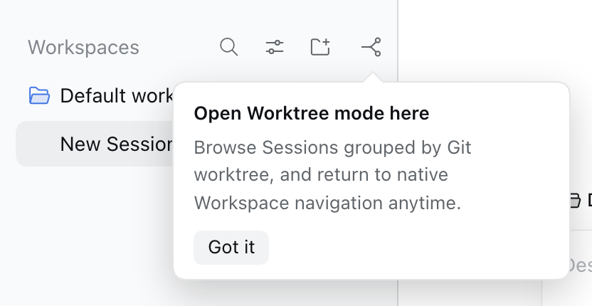
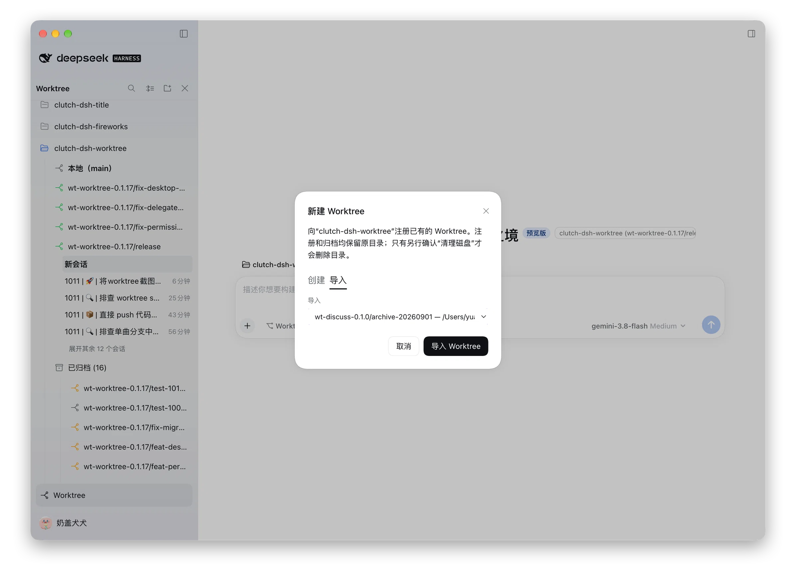
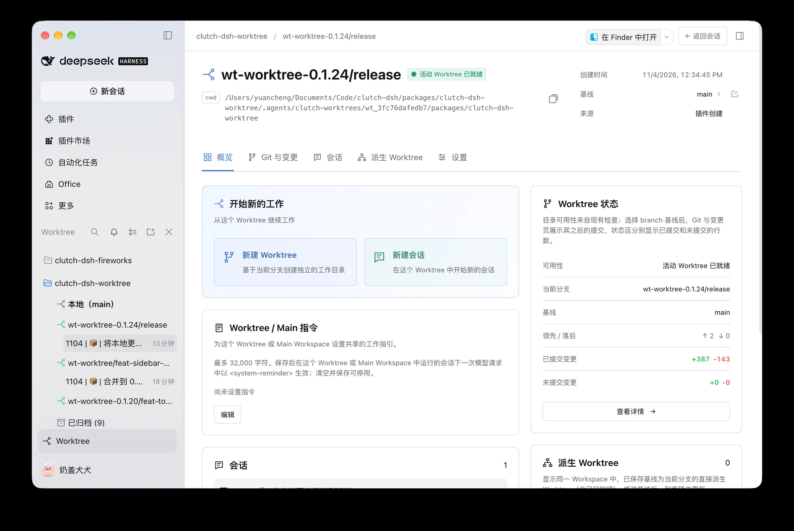
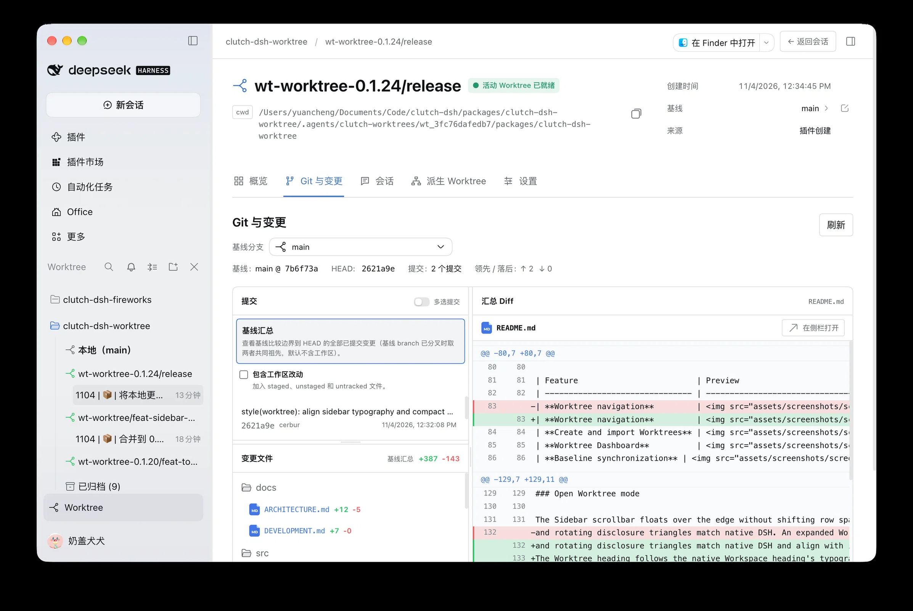
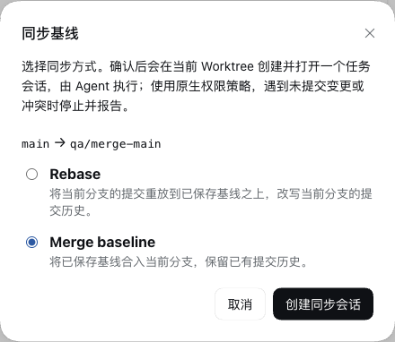
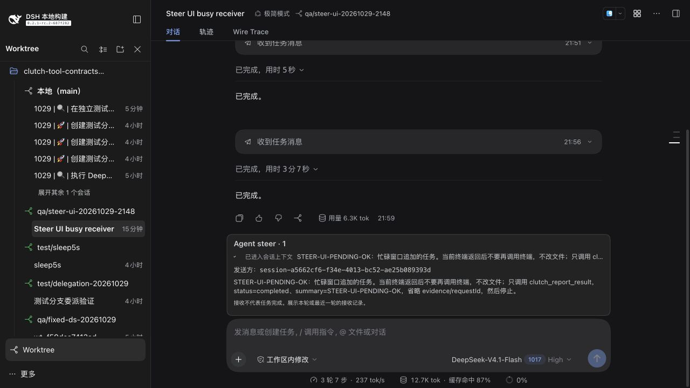
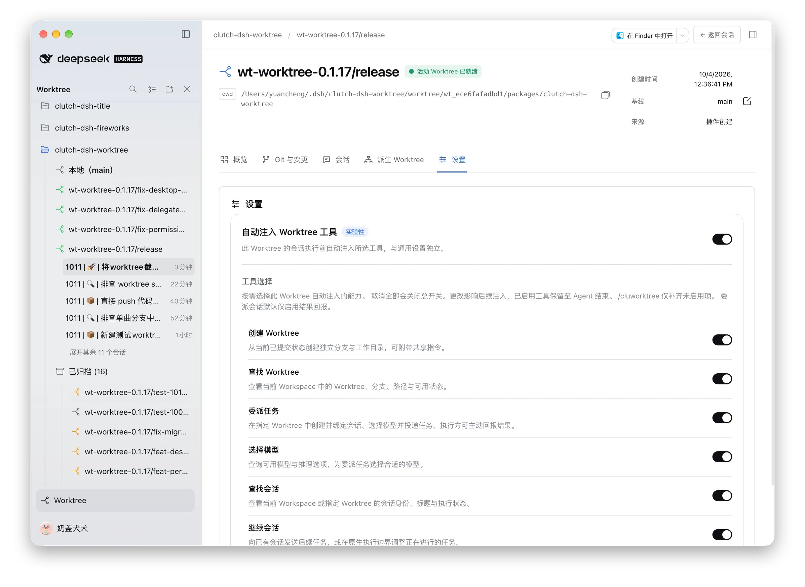

[English](https://github.com/Cerbur/clutch-dsh/blob/main/packages/clutch-dsh-worktree/README.md) | [简体中文](https://github.com/Cerbur/clutch-dsh/blob/main/packages/clutch-dsh-worktree/README.zh.md)

# @cerbur/clutch-dsh-worktree

Manage parallel coding tasks in DeepSeek Harness with a dedicated Git Worktree view.
Browse **Workspace → Worktree → Session**, give each task its own checkout, and review
changes without leaving DSH. Your existing Sessions and conversation history stay in DSH.

- Create or import Worktrees and open Sessions in the right directory.
- Find running tasks, pending approvals, and unread completions across Workspaces.
- Review commits and diffs, share task instructions, and ask an Agent to sync a branch with its baseline.
- Optionally enable Agent tools to delegate work and receive results in the original Session.

## Installation

### Install from npm

With an installed DSH CLI:

```bash
dsh plugin --profile web add @cerbur/clutch-dsh-worktree
dsh web
```

For Desktop, use `--profile desktop` instead of `--profile web`. Finish active tasks,
then restart Desktop, or restart the Web server and refresh the page, to load the plugin.
With a DSH source checkout, use `pnpm dsh` in place of `dsh`.

### Install from a local checkout

From the clutch-dsh repository, build and install by absolute path:

```bash
pnpm install
pnpm --filter @cerbur/clutch-dsh-worktree build
dsh plugin --profile web add /absolute/path/to/clutch-dsh/packages/clutch-dsh-worktree
```

Keep the checkout and its dependencies available while linked. See the
[development guide](https://github.com/Cerbur/clutch-dsh/blob/main/packages/clutch-dsh-worktree/docs/DEVELOPMENT.md) for DSH source setup, local iteration, and optional GitHub source installation.

## Features

| Feature | Preview | What it does |
| --- | --- | --- |
| **Worktree navigation** |  | Organize Sessions by checkout, filter by activity, and jump to tasks that need attention. |
| **Create and import** |  | Start from a local or fetched remote branch, or bring an existing Worktree into the view without moving its files. |
| **Dashboard** |  | See Sessions, shared instructions, baseline relationships, and lifecycle actions in one place. |
| **Git & Changes** |  | Review baseline comparisons, individual or multiple commits, and uncommitted changes. |
| **Baseline synchronization** |  | Choose Rebase or Merge baseline and launch an Agent task in the Worktree. |
| **Agent steer feedback** |  | See incoming Agent steer messages and their delivery state. |
| **Agent tools (Experimental)** |  | Enable delegation tools on demand or automatically for selected Worktrees. |

## Usage

### Browse your tasks

Select the branch control in the Workspace header, or its control in the collapsed rail, then
open a Workspace and its Local/Main or Worktree group. Select a Session to continue the
conversation. Use the Worktree panel header's exit control, or the rail exit while collapsed, to
return to native Workspace navigation.

A one-time hint appears when the entry is available. Hover over or focus `from @cerbur/clutch-dsh-worktree`
beside **Got it** to see the plugin description and GitHub link. If the sidebar is hidden or still loading,
the hint waits until you can use the button. Dismissing
the hint or opening the mode retires it for that browser, so users who were already inside
Worktree mode see it once after their first exit.

Filter Sessions by **Today**, **24 hours**, **7 days**, or **All**. Running and waiting Sessions,
and the Session you are viewing, remain visible. The range menu lets you hide inactive groups
and choose which range tabs to show. Filtering does not archive or remove anything.
When inactive groups are hidden, a Worktree created or imported within the selected range stays visible
alongside its Workspace, even before its first Session.

The bell opens **Active sessions** across Workspaces: running tasks, pending interactions,
and unread completions. Select an entry to open it. Use **Expand more** in a group to see
more than five Sessions, or **Collapse All** to focus on the current Session's group.

### Create or import a Worktree

1. Open the Local/Main or Worktree menu and choose **Create Worktree**.
2. Choose a local or fetched remote base branch and a new branch name.
3. Confirm to create the Worktree and open its first Session. If Forge is unavailable, the new Worktree appears in the sidebar with the Session error. Once Forge is ready, click **+** on that row to open a Session.

Use **Fetch** beside remote branches when you need updated remote refs; listing branches
does not contact remotes automatically. New Worktrees inherit committed files only.
They are created in `<repository-root>/.agents/worktrees/clutch/wt_<id>/`.

To bring in an existing checkout, switch the creation dialog to **Import**, choose a Worktree,
and select **Import Worktree**. Import keeps the directory and its files in place. Only available,
branch-attached, non-root Worktrees that are not already managed appear in the picker.

Use **+** on Local/Main for a Session in the original Workspace. A matching blank Session may
be reused. Forking a Worktree Session keeps the new Session in the same Worktree.

In Worktree mode, Sessions listed under **Local** show a branch icon when DSH still identifies them as Worktree Sessions, including after removal from management. The current blank Session shows the icon before its first message. Its tooltip names the branch. The icon follows the native record and disappears when the Session leaves that checkout; historical Sessions without official records are not relabeled.

After removal from management, the blank Session page and the conversation header both show the branch checked out in the Session’s working directory. Choosing **Continue in the project** switches the label to the project checkout’s branch.

### Review changes and manage a Worktree

Open **Dashboard** from a row menu or the Session header. Browse Sessions, edit shared
instructions, open the directory in an available app, or follow **Derived Worktrees** to
checkouts that use this branch as their saved baseline.

In **Git & Changes**, choose a baseline, commit, or **Uncommitted changes** to inspect files
and diffs. **Baseline summary** shows the net committed changes; enable **Include working-tree
changes** to include current edits. Enable **Multi-select commits** to review several commits
together. Main can show its history without a comparison branch by selecting **None**.
Refresh to see later edits; the Dashboard is read-only.

The Session header's **Worktree panel** keeps a compact change summary beside the conversation.
Use its refresh button or open the full Dashboard for more detail.

**Open native local changes** checks for a Session in the target directory first. If only another
Session matches, the Dashboard switches to it; click again once it loads. If none matches,
the Forge setting is left alone. If the current Session matches and Forge is off, DSH asks
before enabling it for the current profile. This also enables Forge's native Worktree
and GitHub integration; the setting remains enabled after this plugin is removed. You can turn
it off in **Plugins → Experimental plugins → Change requests & worktrees**.

### Sync with a baseline

In a managed Worktree Dashboard, choose **Sync with Base**, then **Rebase** or **Merge baseline**.
Confirmation creates an Agent task Session. Rebase rewrites the current branch's commits;
the Agent checks for a clean working tree and stops on conflicts. Review the Session's result
before continuing: task creation does not mean synchronization has finished. No automatic push
or publish is performed.

### Share instructions and delegate tasks

Edit the Dashboard's instructions card to give future model requests shared guidance for that
Worktree or Local/Main. Clearing the card removes the guidance from future requests. Instructions
are stored by the plugin and do not create or edit an `AGENTS.md` in your project.

Agent tools are experimental and off by default. Enable **Settings → Worktree → General →
Worktree tools**, choose capabilities, then run `/cluworktree` in a Session. To enable them
automatically, configure **Automatically inject Worktree tools** in that Local/Main or
Worktree's **Dashboard → Settings**. These selections are independent.

Available capabilities create and list Worktrees, start task Sessions, discover models,
find Sessions, and send follow-up messages. For example:

> Create a Worktree for the login fix, delegate the implementation and tests to its own Session,
> and report the result here.

Delegated Sessions receive result reporting by default; other tools need explicit activation.
Reports return to the delegating Session. A stopped or interrupted Agent may not report, and
an idle Session does not mean success. The **Agent steer** strip above the recipient's input
shows delivery status, not task completion. Preferences affect future activation; tools already
enabled remain available until that Agent ends.

### Archive, clean up, or stop managing

| Action | Result |
| --- | --- |
| **Archive Worktree** | Keeps files, Sessions, bindings, and instructions. You can unarchive while the Git registration remains intact. |
| **Clean Up Disk** | Removes the checkout after a separate confirmation. Stop all tasks using it first; the plugin does not check whether they are running. Sessions are kept. |
| **Remove from Management** | Stops tracking the Worktree while keeping its files and native DSH Sessions. Sessions already owned by a native Workspace stay in that Workspace immediately; no page refresh is needed. |

Local/Main Dashboard's **Manage Worktrees** supports batch actions. Archive before cleanup or
removal from management. Results are shown per Worktree so failed items can be retried.

Imported DSH-owned Worktrees still follow DSH's native archive-retention and cleanup settings.
Importing them does not prevent DSH from reclaiming their directories.

### Recover from errors

Open **Settings → Worktree → Errors & Repair**, or follow the link in an error toast, for
diagnostics and available recovery actions. Failed forms retain your input. If a Session was
created before a later step failed, open or repair that Session before creating another.

For unresolved disk cleanup, try recovery first. When offered, **Keep files and cancel pending
cleanup** cancels that cleanup request after backing up the plugin index; it keeps files and
Sessions and does not claim cleanup succeeded. Error history clears on page refresh.

## Requirements

| Component | Requirement |
| --- | --- |
| DSH Host, Client, and workspace path utility | `>=0.2.2-rc.2` |
| Git | `>=2.20.0`, available on `PATH`; creation needs a repository with an initial commit |
| Node.js | `>=24.9.0` |
| Filesystem | Local Windows or macOS paths; network or special filesystems may not be supported |

## Behavior and limitations

DSH may return a Session to the project before Forge offers recovery. You can continue the conversation there.

When Worktree first loads in a profile, it makes one attempt to enable the installed, compatible official Forge bundle. If you later turn Forge off, restarting DSH, browsing lists, and opening an existing Session leave it off. Creating a new Worktree Session from the sidebar, Dashboard, or an Agent tool turns Forge back on for that profile without asking. Opening **Diff** still asks before enabling Forge.

Session creation waits for the Forge panel and Worktree service to be running. If you disabled either component individually, re-enable it in **Plugins**. Worktree does not download Forge. If activation fails or requires a restart, no Session is created. Resolve the issue or restart DSH, then retry. If setup stops before the new Session enters the checkout, the Session stays in the original Workspace. After resolving the reported issue, click **+** on the Worktree again.

With official Forge enabled, new Sessions keep native Worktree records after removal from management or uninstall. Forge can restore missing checkouts inside its configured pool or let you **Continue in Project**. Restoration cannot recover uncommitted files.

- DSH remains the source of truth for Workspaces, Sessions, and conversation history. Removing
  a Worktree does not delete its native Sessions.
- Each Session can belong to one active Worktree; each Worktree can have multiple Sessions.
  External checkouts may need normal DSH access approval.
- Git & Changes does not commit, stage, reset, push, or pull. Native Diff actions follow DSH's permissions.
- If a managed checkout switches branches externally, review its branch-drift warning and use
  **Adopt current branch** before disk cleanup.
- A missing Workspace directory leaves recorded Worktrees and Sessions visible, but Git reads,
  creation, import, and cleanup remain unavailable until the directory is restored.
- If the plugin index is unavailable, native DSH navigation remains readable and plugin management
  becomes read-only.
- Git must be installed and available on `PATH`. A missing Git executable shows install guidance
  and no command block; the plugin does not run setup or installation commands.

## Language behavior

The interface follows DSH's English or Simplified Chinese setting. Workspace names, Session
titles, branches, and paths keep their original values.

## Development

Source setup, code architecture, tool contracts, and contributor checks live in the
[development guide](https://github.com/Cerbur/clutch-dsh/blob/main/packages/clutch-dsh-worktree/docs/DEVELOPMENT.md). Coding agents should start with [AGENTS.md](https://github.com/Cerbur/clutch-dsh/blob/main/packages/clutch-dsh-worktree/AGENTS.md).

## Uninstall

```bash
dsh plugin --profile web remove @cerbur/clutch-dsh-worktree
```

Use `--profile desktop` for Desktop or `pnpm dsh` from a DSH source checkout.

## Friendly Links

- [LINUX DO](https://linux.do/) — A community for sharing and discussion.
