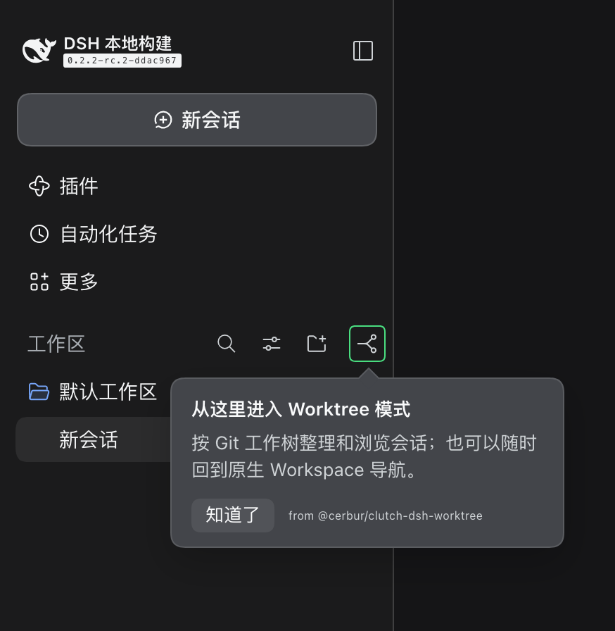
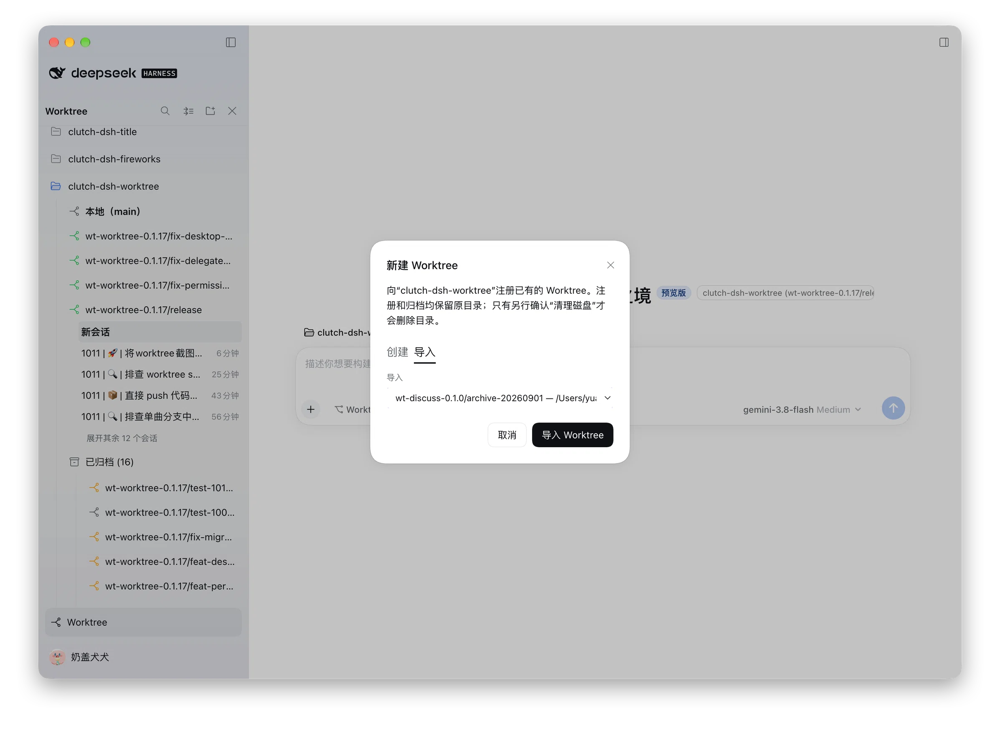
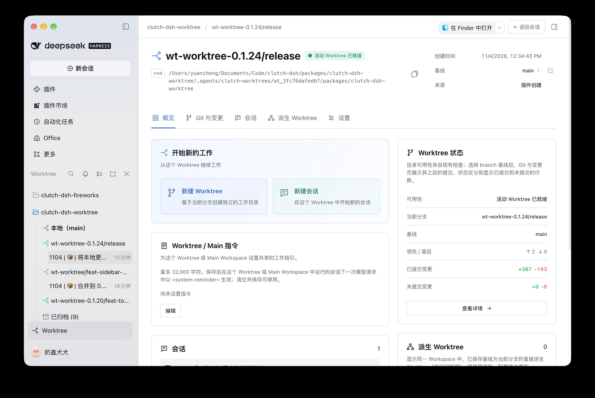
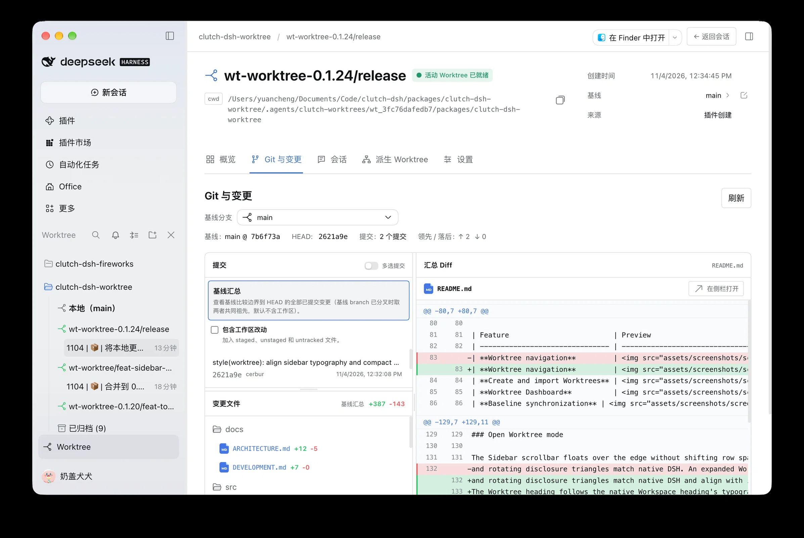
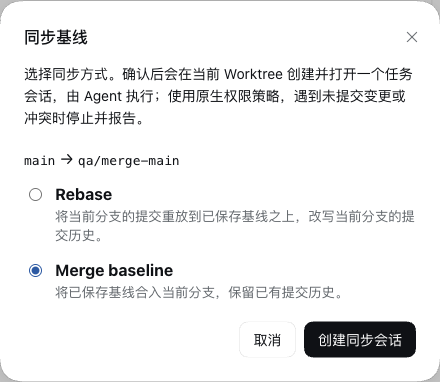
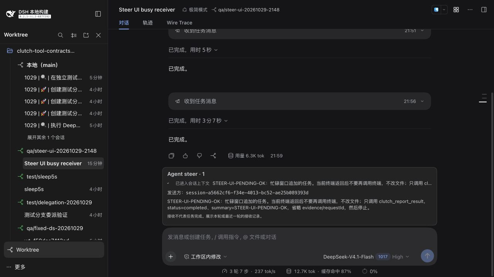
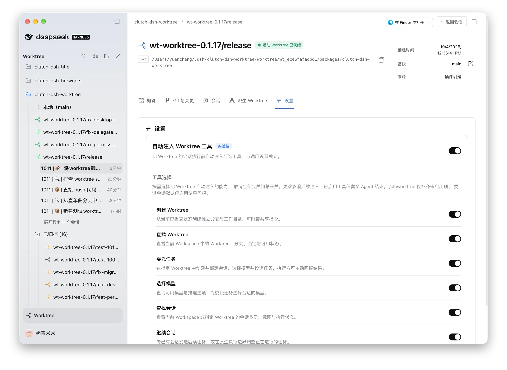

[English](https://github.com/Cerbur/clutch-dsh/blob/main/packages/clutch-dsh-worktree/README.md) | [简体中文](https://github.com/Cerbur/clutch-dsh/blob/main/packages/clutch-dsh-worktree/README.zh.md)

# @cerbur/clutch-dsh-worktree

在 DeepSeek Harness 中，用独立的 Git Worktree 管理并行开发任务。
按 **Workspace → Worktree → Session** 浏览，为每项任务准备独立目录，直接在 DSH 中检查改动。
已有会话和对话历史继续由 DSH 管理。

- 创建或导入 Worktree，在对应目录中打开会话。
- 集中查找运行中、等待审批和完成后未读的任务。
- 查看提交与差异、共享任务指引，让 Agent 将分支同步到基线。
- 按需启用 Agent 工具，委派任务并在原会话中接收结果。

## 安装

### 从 npm 安装

使用已安装的 DSH CLI：

```bash
dsh plugin --profile web add @cerbur/clutch-dsh-worktree
dsh web
```

Desktop 用户将 `--profile web` 换为 `--profile desktop`。结束运行中的任务后，
重启 Desktop，或重启 Web 服务并刷新页面，以加载插件。
使用 DSH 源码 checkout 时，将 `dsh` 换为 `pnpm dsh`。

### 从本地 checkout 安装

在 clutch-dsh 仓库中构建，再通过绝对路径安装：

```bash
pnpm install
pnpm --filter @cerbur/clutch-dsh-worktree build
dsh plugin --profile web add /absolute/path/to/clutch-dsh/packages/clutch-dsh-worktree
```

链接期间请保留 checkout 及其依赖。DSH 源码准备、本地迭代和可选的 GitHub 源码安装方式
见[开发指南](https://github.com/Cerbur/clutch-dsh/blob/main/packages/clutch-dsh-worktree/docs/DEVELOPMENT.md)。

## 功能

| 功能 | 预览 | 说明 |
| --- | --- | --- |
| **Worktree 导航** |  | 按目录组织会话，按活跃时间筛选，快速定位需要关注的任务。 |
| **创建与导入** |  | 从本地或已获取的远端分支开始，或接入已有 Worktree，无需移动文件。 |
| **Dashboard** |  | 集中查看会话、共享指引、基线关系和生命周期操作。 |
| **Git 与变更** |  | 查看基线对比、单个或多个提交，以及未提交的改动。 |
| **同步基线** |  | 选择 Rebase 或 Merge baseline，在 Worktree 中启动 Agent 任务。 |
| **Agent steer 提示** |  | 查看传入的 Agent steer 消息及其投递状态。 |
| **Agent 工具（实验性）** |  | 按需启用委派工具，或为选定 Worktree 配置自动启用。 |

## 使用

### 浏览任务

点击侧栏底部的 **Worktree**，打开 Workspace 下的 Local/Main 或 Worktree 分组，
选择会话继续对话。再次点击底部入口，可返回原生 Workspace 导航。

使用**今天**、**24 小时**、**7 天**或**全部**筛选会话。运行中、等待交互和当前查看的会话
始终可见。范围菜单支持隐藏不活跃分组、选择显示哪些时间范围。筛选不会归档或删除内容。
即使隐藏了不活跃分组，在所选时间范围内创建或导入的 Worktree 和所属 Workspace 仍然可见，即使其中还没有会话。

铃铛打开跨 Workspace 的**活跃会话**列表，包括运行中的任务、等待交互和完成后未读的会话，
点击即可跳转。分组超过五个会话时使用**展开更多**；**全部折叠**会保留当前会话所在分组展开。

### 创建或导入 Worktree

1. 打开 Local/Main 或 Worktree 菜单，选择**创建 Worktree**。
2. 选择本地或已获取的远端基线分支，并填写新分支名称。
3. 确认后，点击 Worktree 上的 **+**，在该目录中打开会话。

需要更新远端引用时，使用远端分支旁的 **Fetch**；列出分支不会自动访问远端。
新 Worktree 仅继承已提交的文件，目录位于 `<repository-root>/.agents/worktrees/clutch/wt_<id>/`。

接入已有目录时，切换到创建弹窗中的**导入**，选择 Worktree 后点击**导入 Worktree**。
导入保留原目录及文件。列表仅显示尚未受管理、目录可用、绑定分支且不是仓库根的 Worktree。

Local/Main 上的 **+** 在原 Workspace 中打开会话；存在匹配的空白会话时可能直接复用。
Fork 一个 Worktree 会话时，新会话仍属于同一 Worktree。

在 Worktree 模式下，列于**本地**的会话如果仍被 DSH 识别为 Worktree Session，会在右侧显示分支图标，包括移出管理后的会话。悬停图标可查看分支名。图标跟随原生记录，会话离开该 checkout 后消失；没有官方记录的历史会话不会补标。

移出管理后，会话标题栏仍显示其工作目录实际检出的分支。在 Forge 中选择**回到项目继续**后，标题栏会切换为项目目录的分支。

### 检查改动与管理 Worktree

从行菜单或会话标题栏打开 **Dashboard**。你可以浏览会话、编辑共享指引、用可用应用打开目录，
也可以通过**派生 Worktree**查看以当前分支为已保存基线的目录。

在 **Git 与变更**中选择基线、提交或**未提交的改动**，查看文件与差异。
**基线汇总**显示已提交的净改动，开启**包含工作区改动**可纳入当前编辑。
开启**多选提交**可以一起检查多个提交。Main 选择**无**可直接浏览历史，不与其他分支比较。
后续编辑需要刷新查看；Dashboard 为只读视图。

会话标题栏的 **Worktree 面板**在对话旁显示简洁的改动摘要。
可以直接刷新，也可以打开完整 Dashboard 查看详情。

**打开原生本地改动**先检查是否有会话正在使用目标目录。如果只有其他会话匹配，Dashboard 会先切换过去；
等会话加载后，再点一次打开 Diff 侧栏。没有匹配会话时不会更改 Forge 设置。当前会话匹配但 Forge 未启用时，
DSH 会询问是否为当前 profile 启用；这也会启用 Forge 的原生 Worktree 和 GitHub 集成，且卸载本插件后仍然有效。
可在**插件 → 实验性插件 → Change requests & worktrees**中关闭。

### 同步基线

在受管理 Worktree 的 Dashboard 中选择**同步基线**，再选择 **Rebase** 或 **Merge baseline**。
确认后会创建 Agent 任务会话。Rebase 会改写当前分支的提交；Agent 会检查工作区是否干净，
遇到冲突时停止。继续工作前请检查会话结果：创建任务不代表同步已完成。不会自动 push 或 publish。

### 共享指引与委派任务

编辑 Dashboard 的指令卡片，为该 Worktree 或 Local/Main 后续的模型请求提供共享指引。
清空后，后续请求不再附加这些指引。指令由插件保存，不会在项目中创建或修改 `AGENTS.md`。

Agent 工具为实验性功能，默认关闭。在**设置 → Worktree → 通用 → Worktree 工具**中启用并
选择能力，然后在会话中运行 `/cluworktree`。如需自动启用，在 Local/Main 或对应 Worktree 的
**Dashboard → 设置**中配置**自动注入 Worktree 工具**。两处选择相互独立。

可选能力包括创建与列出 Worktree、启动任务会话、发现模型、查找会话和发送后续消息。例如：

> 为登录问题创建一个 Worktree，把实现和测试委派给它自己的会话，完成后在这里回报结果。

委派创建的会话默认获得结果回报能力，其他工具需明确启用。结果返回委派方会话。
Agent 被停止或中断时可能无法回报，空闲状态不代表成功。接收方输入框上方的 **Agent steer**
显示消息投递状态，不代表任务完成。偏好更改影响后续启用，已启用的工具持续到该 Agent 结束。

### 归档、清理或停止管理

| 操作 | 结果 |
| --- | --- |
| **归档 Worktree** | 保留文件、会话、绑定和指令；Git 登记仍完整时可以取消归档。 |
| **清理磁盘** | 单独确认后移除目录。请先停止使用它的所有任务，插件不会检查任务是否仍在运行。会话保留。 |
| **移出管理** | 停止跟踪该 Worktree，保留文件和 DSH 原生会话。 已有原生 Workspace 归属的 Session 会立即保留在原 Workspace 中，无需刷新页面。 |

Local/Main Dashboard 的**管理 Worktree**支持批量操作。清理或移出管理前先归档。
每个 Worktree 单独显示结果，失败项可以重试。

导入 DSH 创建的 Worktree 后，它仍遵循 DSH 原生的归档保留与清理设置。
导入不会阻止 DSH 回收这些目录。

### 处理错误

打开**设置 → Worktree → 报错与修复**，或点击错误 toast 中的入口，查看诊断和可用的恢复操作。
表单失败后会保留输入。如果会话已创建但后续步骤失败，请先打开或修复该会话，再考虑新建。

磁盘清理未决时，先尝试恢复。如果提供**保留文件并取消未决清理**，该操作会在备份插件索引后
取消这次清理请求，保留文件和会话，不会将其视为清理成功。错误历史在刷新页面后清空。

## 要求

| 组件 | 要求 |
| --- | --- |
| DSH Host、Client 与工作区路径工具包 | `>=0.2.2-rc.2` |
| Git | `>=2.20.0`，可在 `PATH` 中使用；创建需要已有初始提交的仓库 |
| Node.js | `>=24.9.0` |
| 文件系统 | Windows 或 macOS 本地路径；网络或特殊文件系统可能不支持 |

## 行为与限制

DSH 可能在 Forge 提供恢复选项前将会话切回项目目录。你可以在那里继续对话。

Worktree 在每个配置档首次加载时，会尝试启用一次已安装且兼容的官方 Forge 组合包。之后手动关闭 Forge，重启 DSH、浏览列表或打开已有会话都会保持关闭。从侧栏、Dashboard 或 Agent 工具新建 Worktree 会话时，会直接为当前配置档重新启用 Forge，无需确认。打开 **Diff** 时若需启用 Forge，仍会单独询问。

新建会话会等到 Forge 面板和 Worktree 服务都已运行。如果单独关闭了其中一项，请在**插件**中重新启用。Worktree 不会下载 Forge。启用失败或需要重启时不会创建会话，请解决问题或重启 DSH 后重试。

启用官方 Forge 后，新会话在移出管理或卸载插件后仍保留原生 Worktree 记录。Forge 可以恢复配置池内缺失的 checkout，或让你选择 **Continue in Project（回到项目继续）**。恢复无法找回未提交文件。

- Workspace、Session 和对话历史以 DSH 为唯一数据源。移除 Worktree 不会删除其原生会话。
- 每个会话最多属于一个 active Worktree，每个 Worktree 可以有多个会话。
  外部目录可能需要 DSH 的常规访问审批。
- Git 与变更不提供 commit、stage、reset、push 或 pull。原生 Diff 中的操作遵循 DSH 权限。
- 在外部切换受管理目录的分支后，请检查分支漂移提示，清理磁盘前先执行**采用当前分支**。
- Workspace 目录缺失时仍显示已记录的 Worktree 和会话，但 Git 读取、创建、导入和清理
  在目录恢复前不可用。
- 插件索引不可用时，DSH 原生导航仍可读取，插件管理进入只读状态。
- Git 必须已安装且可在 PATH 中使用。Git 可执行文件缺失时显示安装提示且不显示命令块；
  插件不会执行 setup 或安装命令。

## 界面语言

界面跟随 DSH 的英文或简体中文设置。Workspace 名称、会话标题、分支和路径保留原值。

## 开发

源码准备、代码架构、工具契约和贡献检查见[开发指南](https://github.com/Cerbur/clutch-dsh/blob/main/packages/clutch-dsh-worktree/docs/DEVELOPMENT.md)。
Coding agent 请从 [AGENTS.md](https://github.com/Cerbur/clutch-dsh/blob/main/packages/clutch-dsh-worktree/AGENTS.md) 开始阅读。

## 卸载

```bash
dsh plugin --profile web remove @cerbur/clutch-dsh-worktree
```

Desktop 使用 `--profile desktop`，DSH 源码 checkout 使用 `pnpm dsh`。

## 友情链接

- [LINUX DO](https://linux.do/) — 新的理想型社区。
