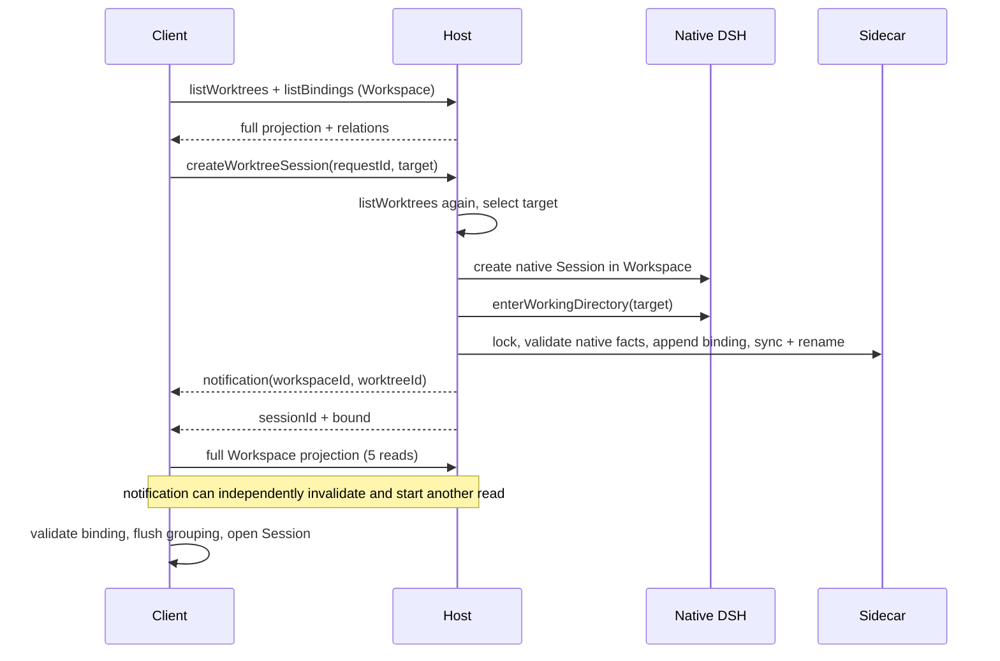

# Session creation: Local reuse bug and latency audit

## Scope and outcome

Investigated in `wt-worktree/feat-session-flow`, using the built-in browser and
`~/.dsh-test` on port 3088. Local reuse isolation is implemented and browser-verified.
The target-read and revision-guarded projection refactor is implemented; measurements below
separate the original baseline from the follow-up browser validation.

## Local reuse identity mismatch

Native `uiWorkspace.startSession()` chooses a blank by Workspace membership and
the Session header cwd. A Worktree Session intentionally keeps that original cwd
at the Workspace root; its effective directory is published separately. The native
selector therefore names a Worktree blank when Local is requested. The native Host
reuses it, and navigation returns to the same Worktree. No error is required for
this failure; it is the wrong reuse identity, not a failed write.

Local's connector now reads Workspace bindings, excludes every recorded Session
(active and detached), and selects only an unarchived native blank member whose
header matches the Workspace root. It calls the native Session creation API with
the optional safe candidate, allowing the Host to refuse stale reuse. It does not
rewrite headers, effective cwd, messages, Workspace membership, or Sidecar facts.
The Surface owns pending/error feedback, and repeated clicks share one operation.
This fixes the plugin's Local `+` and Local Dashboard creation entry; it does not
replace the native shell's global New Session action or keyboard shortcut.

## Original Worktree create path

`worktree-session.ts` preflight, `host/session-creation.ts` admission, and
`worktree-view-read.ts` opening projection each call `listWorktrees`: at least
three full Worktree scans for a genuine creation. The full view also reads
Workspace Git state, all bindings, Main instructions, and the root checkout.
Each scan projects paths, activity, health and HEAD for unrelated records.
The existing generation guard prevents stale publication but does not merge
invalidations from the same creation: its Host notification omits the requestId,
and the opening refresh invalidates without a changeId too.

## Measurements

One warm genuine-create browser sample with tagged probes, no full test suite running:

| Stage | Duration |
| --- | ---: |
| Client preflight | 88 ms |
| Host create RPC after preflight | 174 ms |
| Native Session create within that RPC | 41 ms |
| Native directory entry | 4 ms |
| Binding validation, lock and commit | 22 ms |
| Sidecar durable write, included in binding time | 13 ms |
| Opening projection after Host response | 182 ms |
| Connector total before native navigation | 444 ms |
| Browser click through visible blank input | 543 ms |

Nested durations must not be added twice. The remaining Host RPC time includes
target preflight and transport/scheduling; it was not separately attributed.
Browser timing also includes automation and native UI scheduling. One sample is
diagnostic evidence, not a percentile or a promised latency target.

Eight test Sidecar shards were 686–34,889 bytes, with at most 39 Worktrees and
88 bindings. Eighty actual repository reads (including boundary/schema validation)
had median 0.288 ms and maximum 4.268 ms. These are warm local reads, not cold disk
or large-dataset benchmarks. Temporary tagged probes were removed after collection.

## Assessment

- The durable ownership split is appropriate: DSH owns the Session and directory
  facts, Sidecar owns the relationship. These are separate commits, so partial
  creation must preserve the native Session identity for binding recovery. Making
  a second Session database would not remove that boundary or improve correctness.
- `bindSession` normally writes one Workspace shard. Idempotent reuse returns
  `changed:false`, avoiding a rewrite outside legacy migration/recovery. Atomic
  rename and file sync protect durable relations and must remain.
- The command/read-model boundary is too broad. A narrow binding mutation forces
  full Git presentation reads because its result contains no usable committed
  relationship projection. This is the primary structural issue evidenced here.
- The Workspace lock spans native Session reads and physical validation. Slow
  native facts can hold up other bindings. This is a contention risk, not proof
  of current lock contention. Moving checks outside the lock requires rechecking
  revision, lifecycle and identity before committing; deleting the lock is unsafe.
- Lists are small in this dataset. Per-Worktree binding filters are O(W×B), and
  physical Git matching can be O(W×G) with filesystem I/O. Read-local maps can help
  at scale, but a database migration is not justified by these measurements.

## Redesign and implementation

1. Correlate creation response and notification with the same requestId/changeId.
   Share the post-commit read; never reuse a pre-commit read merely because it is in flight.
2. Return a committed binding result with Workspace revision and validated target
   identity. Merge only that relationship into an existing ready grouping before
   navigation. Reject stale revisions and follow concurrent removal/rebinding;
   fall back to a scoped authoritative read when no safe ready base exists.
   Unrelated Git display reads no longer gate warm opening; target health and HEAD remain validated.
3. Add a narrow target admission read for Host creation. It must preserve path,
   lifecycle, recovery and effective-cwd checks, but need not collect every other
   Worktree's activity or HEAD. Client reuse selection must use the same explicit
   `(workspaceId, Local | worktreeId)` identity instead of header cwd alone.
4. Measure lock wait/hold times and larger fixtures before changing persistence.
   If necessary, build per-read indexes; preserve ordered bindings for rendering.

Validation must cover both response/notification arrival orders, newer revision
supersession, concurrent deletion/rebinding, partial native creation, duplicate
clicks, independent Local/Worktree blanks, and no transient Local row on opening.
Steps 1–3 are implemented. A warm create uses three target reads (Client selection,
Host admission, post-bind snapshot); reuse uses two. Each snapshot contains target projection,
all Workspace bindings and revision from one Sidecar snapshot. Target filtering precedes
per-record path/activity/HEAD reads. The Git checkout list is still read for identity checks.
The ready reader merges only after checking generation, preflight minimum revision and the
last merged revision. Missing ready state, other notifications and reconnects use the original
scoped full refresh. Post-create snapshot failure preserves successful creation and uses that
fallback. Persistence format, locking, fsync and native ownership remain unchanged.

### Follow-up measurements

Built-in browser against the rebuilt `~/.dsh-test` service on port 3088, with no test suite
competing for CPU. Temporary Client probes confirmed `projectionReady=true` for all samples.

| Operation/stage | Original sample | Refactored warm samples |
| --- | ---: | ---: |
| Genuine create: click → visible blank | 543 ms | 569 / 534 ms |
| Genuine create: connector → before navigation | 444 ms | 400 / 420 ms |
| Opening grouping after state is available | 182 ms | 18 / 17 ms |
| Client target preflight | 88 ms (full scan) | 104 / 124 ms |
| Blank reuse: click → visible target context | 582 ms (earlier run) | 444 / 287 ms |
| Blank reuse: connector → before navigation | not isolated | 192 / 157 ms |
| Worktree blank → Local blank | not isolated | 315 / 305 ms |

The first post-restart reuse took 3,450 ms through automation but 427 ms inside the connector;
it is recorded separately as a cold/outlier sample. A pre-existing missing-Worktree notification
from the test fixture appeared around reload; the selected target remained ready and later warm
operations succeeded without it. The two genuine creates were distinguished from reuse by
first submitting a harmless “reply OK, no tools” message and waiting for generation to stop.

The repeated full scans and opening refresh are eliminated on the tested warm path, but these
small samples do **not** demonstrate a material total-create latency improvement: 534–569 ms
overlaps the original 543 ms. Target admission/post-commit reads and native operations still
dominate. Reuse improved in these samples, but this is not a controlled percentile benchmark.
Step 4 (persistence/index changes) remains deferred pending larger-dataset and contention data.

## Verification

The built-in browser reproduced Local `+` remaining on an untouched Worktree blank
before the change. After the change, Worktree blank → Local blank → Worktree blank
worked; the final build without probes again opened Local directly with a `main`
context and its blank under Local. The native global action was not substituted.

Executed from the feature root: `pnpm run check:workspace`, `pnpm run check:patches`,
and `pnpm --filter @cerbur/clutch-dsh-worktree lint`, `typecheck`, `build`, `test`.
Also ran `node --test packages/clutch-dsh-worktree/test/readme-parity.test.mjs`.
All gates passed after updating the old integration test that required the
incorrect native Workspace reuse path; its replacement exercises a Worktree-bound
blank with the same header cwd through the real Client entry and asserts distinct
native creation, navigation, and preserved original Session state.
Before the target-read refactor: 1,275 passed, 12 skipped, no failures. New Local connector tests
also cover detached bindings, archived candidates, coalescing, disposal, read/native
failures, stale candidate rejection, and an unavailable native catalog.

After the refactor, all seven gates passed again: 1,290 tests passed, 12 skipped,
zero failures. Target-state coverage includes both notification orders, no full scans on warm
create/reuse, stale revisions, unrelated invalidation, reconnect/disposal, cold fallback,
concurrent removal/rebinding/missing targets, and obsolete in-flight full reads. The target-only
projection test asserts that only the selected Worktree receives HEAD and activity reads.
Temporary probes were removed, the final test service restarted, and the built-in browser
again verified Worktree blank → Local blank → reuse, then genuine creation after a message.
The final screenshot is `/tmp/session-refactor-verified.png`. No DSH core changes or data migrations
were needed.
